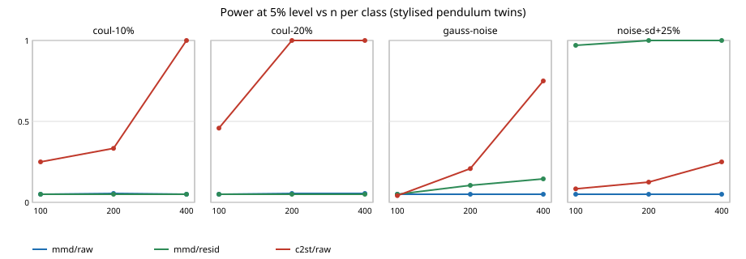

# Does a kernel MMD test catch the same wrong digital twins as a classifier two-sample test?

A follow-up to `research/mimic-twinc2st` and `research/free-c2stpower` (track 11, adversarial human imitation, via the idea that a detector's score is a fidelity score for a simulator). Their "next steps" asked for a different kind of detector. A kernel two-sample test has no classifier to tune, so it is a natural comparison. **Stylised and simulated only; no real data, no LLM.**

Every number below is copied from `experiments/results.txt` or `experiments/bandwidth.txt`.



## Results

Setup: the "real" system is the pendulum of `mimic-twinc2st` (RK4, 100 steps, start angle uniform on [-2, 2] rad, viscous 0.1, Coulomb 0.3, Student-t(3) noise, sd 0.02 rad). A test rejects when its statistic exceeds the 95th percentile of the same statistic for the exact twin at the same n. Statistics: unbiased squared MMD with an RBF kernel and median-heuristic bandwidth, on raw angles (`mmd/raw`) or on second differences (`mmd/resid`); and the 5-fold CV AUROC of gradient-boosted trees on raw angles (`c2st/raw`). Power at n per class = 100 / 200 / 400:

| twin error | mmd/raw | mmd/resid | c2st/raw |
|---|---|---|---|
| Coulomb -10% | 0.05 / 0.06 / 0.05 | 0.05 / 0.05 / 0.05 | 0.25 / 0.33 / 1.00 |
| Coulomb -20% | 0.05 / 0.06 / 0.06 | 0.05 / 0.05 / 0.05 | 0.46 / 1.00 / 1.00 |
| Gaussian noise, same sd | 0.05 / 0.05 / 0.05 | 0.05 / 0.10 / 0.14 | 0.04 / 0.21 / 0.75 |
| noise sd +25% | 0.05 / 0.05 / 0.05 | 0.97 / 1.00 / 1.00 | 0.08 / 0.12 / 0.25 |

- **Raw-trajectory MMD is blind to friction errors at the median bandwidth.** Power sits at the 5% level at every n tried. The classifier detects the same errors from n = 200 to 400. A kernel test on whole trajectories is dominated by the spread of start angles, and the friction effect is small beside it.
- **That blindness is partly, not wholly, a bandwidth choice.** At n = 200, shrinking the bandwidth to 0.03 times the median lifts raw-MMD power to 0.13 (-10%) and 0.37 (-20%); at 0.1 times it is 0.07 and 0.10 (`bandwidth.txt`). It still does not match the classifier.
- **Choosing features matters more than the test.** MMD on second differences, which cancel smooth motion and keep noise, detects a +25% noise-level error at 0.97 from n = 100, where raw-feature boosted trees reach only 0.08 to 0.25. This is the same lesson as `mimic-twinc2st`'s engineered features, now for MMD. These features are blind to friction (0.05), because second differences discard it.
- **The Gaussian-vs-Student-t noise-shape error is weakly detected by MMD** (0.10 and 0.14 at n = 200 and 400, with second differences). The classifier on raw angles reaches 0.75 at n = 400; `mimic-twinc2st` found that adding second-difference features to the classifier makes this error far easier, so the c2st column here is not the strongest classifier.
- **Null rows** are 0.05 for MMD and 0.08 for the classifier (24 replicates, so a quantile of 24 values); see `results.txt`.

```bash
cd research/mimic-mmd
pip install numpy scikit-learn
python3 -m unittest discover -s tests -v     # 8 tests
python3 experiments/run.py                   # about 10 minutes on 4 CPUs, writes results.json/results.txt
python3 experiments/bandwidth.py             # about a minute, writes bandwidth.txt
python3 experiments/figure.py                # experiments/power_vs_n.svg
```

## Builds on

Gretton, Borgwardt, Rasch, Schölkopf and Smola (2012), "A Kernel Two-Sample Test", *JMLR* 13: the unbiased MMD statistic and median heuristic. Lopez-Paz and Oquab (2017), "Revisiting Classifier Two-Sample Tests", ICLR: the C2ST. Sibling projects `research/mimic-twinc2st` and `research/free-c2stpower`, whose simulator is copied here so the directory stands alone. No lab's work is built on, and no lab is affiliated with or endorses this project.

## Limitations

One toy system, one real parameter set, three n values, one kernel family. The classifier comparison has 24 replicates per cell (MMD has 200), so its intervals are wide and the 1.00 entries mean at least about 0.86. The bandwidth was swept only for raw MMD, at n = 200, with 100 replicates, and only for friction errors. The second-difference MMD and the noise scenarios were chosen after seeing `mimic-twinc2st`, so they are not a blind test. The classifier uses raw angles only, so it is not its strongest form against noise-shape errors. Replicates share the seed scheme `7919*r + n` across twins, so the real samples are common random numbers across twins within a replicate. Nothing here is a claim about a physical pendulum.

## Next steps

Pair MMD with a learned kernel or feature map (or the classifier's own score); sweep bandwidth for second-difference MMD; run the MMD on the MuJoCo twin of `mimic-mujocotwin`.

## Outside dependencies

numpy and scikit-learn (matplotlib is not used). Produced with AI assistance (Claude). No LLM was used.

MIT.
