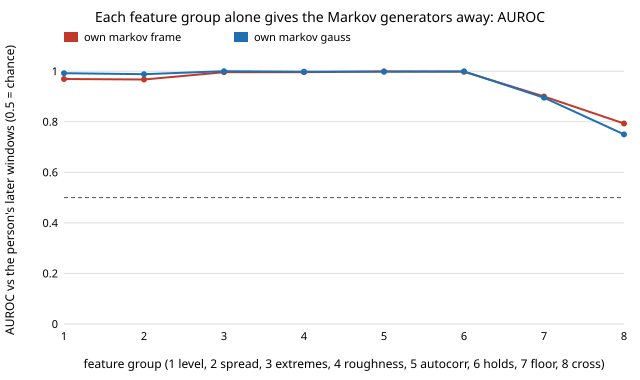

# Can a learned Markov chain over a person's webcam frames fool a detector? No: every chain is caught at AUROC 1.000, even one that emits real frames

Follow-up to `mimic-webcam-persongen` (track 11, adversarial human imitation), whose next step asked whether a learned, non-parametric per-person model reaches the own-stitch rows (AUROC 0.57 to 0.65) where a fitted parametric generator was caught at 1.000. **Preliminary, stylised: 46 people filling in one web form, one context, 3 seeds; a negative result.** Produced with AI assistance (Claude).

**Live page:** https://duncan-haywood.github.io/monorepo-projects/research/mimic-webcam-markov/

**Result.** A first-order Markov chain over k-means states of a person's frames (k = 8, 32, 128), fitted on their earlier windows or on everyone else's, emitting state centres or real frames of the state, is caught at AUROC 1.000 by the boosted-tree detector on that person's later windows in 22 of 24 cells (12 generators, population or profile-aware detector); the exception is pooled 128-state member emission at 0.999 under both. Stitching 50-frame blocks of the same real frames scored 0.565 to 0.654 in `mimic-webcam-persongen`, so what the chain loses is longer-range structure, not frame content.



## Method

Data, features, detector and per-person chronological split are those of `mimic-webcam-persongen` (imported, nothing copied): 100-frame windows at 10 Hz, 12 channels, 46 people, first half of each person's windows to fit, second half held out. `markov.py` fits a `Chain` on a pool of real windows: frames are quantised to k states (k-means), transitions are counted with add-0.1 smoothing, the start state follows each window's first frame, and a window is a 100-step walk. Emission is the state centre (`centroid`) or a random real frame of that state (`member`). `own` pools are the person's fit windows; `pooled` pools are the other 45 people's. The detector and both variants (population, and profile-aware with the person's mean level and spread) are `mimic-webcam-persongen/run.py`'s `score`.

## Results (mean AUROC of 3 seeds, `results/markov.txt`)

| generator | k=8 centroid | k=8 member | k=32 centroid | k=32 member | k=128 centroid | k=128 member |
|---|---|---|---|---|---|---|
| own, population detector | 1.000 | 1.000 | 1.000 | 1.000 | 1.000 | 1.000 |
| pooled, population detector | 1.000 | 1.000 | 1.000 | 1.000 | 1.000 | 0.999 |

The profile-aware detector gives the same values (1.000 everywhere except pooled k=128 member at 0.999).

Which features catch them (`results/groups.txt`, seed 0, one detector per feature group, held-out AUROC):

| generator | level | spread | extremes | roughness | autocorr | holds | floor | cross | all |
|---|---|---|---|---|---|---|---|---|---|
| own k=8 centroid | 0.978 | 0.962 | 1.000 | 0.963 | 0.932 | 1.000 | 0.918 | 0.757 | 1.000 |
| own k=128 member | 0.980 | 0.983 | 0.995 | 0.998 | 1.000 | 0.998 | 0.965 | 0.834 | 1.000 |
| pooled k=128 member | 0.995 | 0.997 | 1.000 | 0.999 | 1.000 | 1.000 | 0.997 | 0.862 | 1.000 |

- No single feature group is needed: nearly every group alone separates chain windows from real ones at 0.92 or more. A first-order chain on frames gets none of the window-scale statistics right, even with real frames as emissions.
- My first guess was that chains lose the differences between windows (every chain window samples the same mix of states, while real windows differ in level). The between-window spread of the window mean supports it only in part: real held windows 2.83, own k=128 member 1.25 (too uniform), own k=8 centroid 2.39, but pooled k=128 member 4.56 (too varied). The guess does not explain the pooled row, and I did not test further.
- Given persongen's result that 50-frame blocks of real frames reach 0.65, the gap is in how frames are joined: a chain jumps state at every 0.1 s step with a fixed transition law, while real signals dwell in states and drift. A semi-Markov (dwell-time) chain or a higher-order one is the obvious next test; this project did not run either.

## Limitations

- One context, 46 people, 3 seeds, a chronological half split (6 to 27 held windows per person). k-means with `n_init=1`; no tuning of smoothing, k beyond three values, or the distance. Frames are not scaled per channel before clustering.
- A negative result for first-order chains only. It says nothing about sequence models or an LLM or code-writing proposer (`mimic-codeloop`).
- The detector is the loop's own (trained here); no human judges, no pixels, no faces. Signals stay in this repository, are labelled generated by their file names, and are not sent anywhere. No fairness breakdown: DUX records no group labels.

## Next steps

Semi-Markov (explicit dwell times) and second-order chains; a small sequence model; then `mimic-codeloop`, letting a code model rewrite the generator against the detector's per-group feedback above.

## Reproduce

```bash
cd research/mimic-webcam-markov
pip install numpy scipy scikit-learn
python3 -m unittest discover -s tests -v   # 5 tests
python3 run.py 3                           # a few minutes, writes results/markov.{json,txt}
python3 diagnose.py                        # writes results/groups.txt
python3 experiments/figure.py              # writes experiments/markov.svg
```

## Builds on

`mimic-webcam` (data, features, detector) and `mimic-webcam-persongen` (split, scoring, copying baselines). DUX (Bieber et al. 2023, [Zenodo 7778612](https://zenodo.org/records/7778612), CC-BY-4.0). No lab's work is built on and none is affiliated with or endorses this project.

## Owner steps

None.

## Outside dependencies

numpy, scipy, scikit-learn. Produced with AI assistance (Claude).

MIT.
