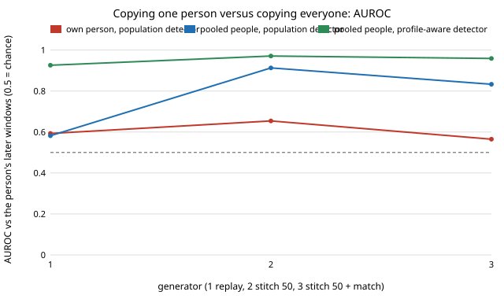

# Does fitting a webcam-signal generator to one person fool a detector that has seen that person? Copies of their own windows nearly do; a fitted generator does not

Follow-up to `mimic-webcam-stitch` (track 11, adversarial human imitation), which found that copying real frames is caught mostly because it mixes people, and to `mimic-webcam`, where fitted parametric generators were caught at AUROC 1.000. It left open what happens when a generator is built from one person's own windows only and judged on that person's later windows. **Preliminary, stylised: 46 people filling in one web form, one context, 6 seeds; the copying generators are ceilings that reuse real frames.** Produced with AI assistance (Claude).

**Live page:** https://duncan-haywood.github.io/monorepo-projects/research/mimic-webcam-persongen/

**Result.** Personalising removes most of the giveaway for copies, and does nothing for a fitted generator. Against each person's later windows, 50-frame blocks drawn from that person's own earlier windows are caught at AUROC 0.654 (join-matched 0.565, whole-window replay 0.593). The same copies drawn from other people are caught at 0.913 (0.833, 0.582), and at 0.971 (0.959, 0.926) once the detector is also told the person's mean level and spread. A parametric generator (window levels, AR(1) memory, channel correlation, holds) fitted on one person or on everyone is caught at 1.000 in both detectors.



## Method

Data, 8 feature groups and boosted-tree detector are those of `mimic-webcam` (imported; nothing copied), 100-frame windows at 10 Hz, 46 people, those with at least 12 windows (all 46). Each person's windows, in file (time) order, are split in half: *fit* (first half) and *held* (second half). Every generator sees only fit windows. For each person the generator makes as many windows as the person has in each half.

- `own replay`, `own stitch50`, `own stitch50+match`: whole fit windows, random 50-frame blocks, or join-matched blocks (16 candidates, `mimic-webcam-stitch`'s rule) from that person's fit windows.
- `pooled ...`: the same, drawing from the fit windows of the other 45 people.
- `own param`, `pooled param`: the `mimic-webcam` generator with one fixed genome (window level and spread, AR(1), channel correlation, holds 0.5; not searched), fitted on the person's fit windows or on the other people's.
- Detector: trained on all people's real fit windows (label human) against all generated fit-half windows, scored by AUROC on real held windows against freshly generated held-half windows. The *profile-aware* detector also gets the person's mean level and spread over the fit windows, so it can notice that a window does not look like that person.

## Results (mean AUROC of 6 seeds, `results/persongen.txt`)

| generator | population detector | profile-aware detector |
|---|---|---|
| own replay | 0.593 | 0.594 |
| own stitch, 50-frame blocks | 0.654 | 0.663 |
| own stitch + match | 0.565 | 0.563 |
| own param | 1.000 | 1.000 |
| pooled replay | 0.582 | 0.926 |
| pooled stitch | 0.913 | 0.971 |
| pooled stitch + match | 0.833 | 0.959 |
| pooled param | 1.000 | 1.000 |

- A detector that knows nothing about the person misses mixing people for whole-window replay (0.582), but not for blocks (0.913): person-to-person differences show up only when different windows are joined, or when the detector has the profile (0.926).
- Own-person copies barely move when the detector gets the profile (0.593 to 0.594): they already match it.
- The own-person rows are not a clean 0.5 floor. Real held windows come later than the fit windows, so some drift and the usual overfit of a boosted tree to a small training set remain; 0.56 to 0.65 is the range of what is left.
- The fitted generator is caught at 1.000 whoever it is fitted on, as in `mimic-webcam`: matching a person's level and spread is not close to enough, so the gap to copies is in structure the parametric program lacks.

## Limitations

- Copies are not generators and say nothing about a model that invents signal. The own-person rows copy that person's real frames, which a real imitator would not have for a new person.
- One context, 46 people, 6 seeds, a chronological half split (12 to 54 windows per person, so 6 to 27 held windows); the profile-aware detector uses only two feature groups, and no per-person detector was trained.
- No human judges, no pixels, no faces. Signals stay in this repository and are not sent anywhere. No fairness breakdown: DUX records no group labels.

## Next steps

Replace the copy with a learned per-person model that is not parametric (a Markov chain over a person's quantised frames, or a small sequence model) and see whether it reaches the own-stitch rows, or let a loop (or `mimic-codeloop`) search over person-conditioned components.

## Reproduce

```bash
cd research/mimic-webcam-persongen
pip install numpy scipy scikit-learn
python3 -m unittest discover -s tests -v   # 5 tests
python3 run.py 6                           # about 3 minutes, writes results/persongen.{json,txt}
python3 experiments/figure.py              # writes experiments/persongen.svg
```

## Builds on

`mimic-webcam` (data, features, detector, generator) and `mimic-webcam-stitch` (stitching). DUX (Bieber et al. 2023, [Zenodo 7778612](https://zenodo.org/records/7778612), CC-BY-4.0). No lab's work is built on and none is affiliated with or endorses this project.

## Owner steps

None.

## Outside dependencies

numpy, scipy, scikit-learn. Produced with AI assistance (Claude).

MIT.
