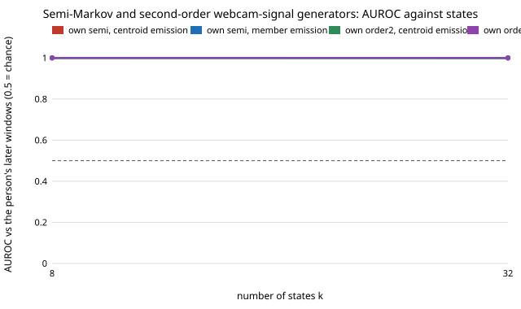

# Does giving a Markov chain dwell times or second-order memory let it fool a webcam-signal detector? No: all 16 variants are caught at AUROC 0.999 to 1.000

Follow-up to `mimic-webcam-markov` (track 11, adversarial human imitation), whose next step named semi-Markov (explicit dwell times) and second-order chains as the obvious fixes for a first-order chain that jumps state every 0.1 s. **Preliminary, stylised: 46 people filling in one web form, one context, 3 seeds; a negative result.** Produced with AI assistance (Claude).

**Live page:** https://duncan-haywood.github.io/oss-monorepo/research/mimic-webcam-semimarkov/

**Result.** Chains with 8 or 32 k-means states over a person's webcam-signal frames, either semi-Markov (state held for a dwell time drawn from the empirical run lengths of that state) or second-order (next state depends on the last two), fitted on that person's earlier windows or on the other 45 people's, emitting state centres or real frames of the state, are scored at AUROC 0.999 to 1.000 by the boosted-tree detector on that person's later windows. All 16 generator cells sit in that range, for the population and the profile-aware detector alike. Stitching 50-frame real blocks scored 0.565 to 0.654 in `mimic-webcam-persongen`, so neither fix closes the gap.



## Method

Data, features, detector and per-person chronological split are those of `mimic-webcam-persongen` and `mimic-webcam-markov` (imported, nothing copied): 100-frame windows at 10 Hz, 12 channels, 46 people, first half of each person's windows to fit, second half held out. `semimarkov.py` subclasses `markov.Chain`:

- `semi`: runs of equal state in the fit windows give per-state dwell lists and a jump chain (add-0.1 smoothing, no self-transitions). A window draws a start state, holds it for a sampled dwell, jumps, and repeats to 100 frames.
- `order2`: counts of (previous two states) -> next state; a pair never seen in the fit windows falls back to the first-order row.

Names read `<own|pooled> <semi|order2><k> <centroid|member>`; `order28` is order 2 with k = 8 and `order232` is order 2 with k = 32.

## Results (mean AUROC of 3 seeds, `results/semimarkov.txt`)

| generator | semi8 c | semi8 m | semi32 c | semi32 m | order2 k=8 c | order2 k=8 m | order2 k=32 c | order2 k=32 m |
|---|---|---|---|---|---|---|---|---|
| own, population detector | 1.000 | 1.000 | 1.000 | 0.999 | 1.000 | 1.000 | 1.000 | 1.000 |
| pooled, population detector | 1.000 | 1.000 | 1.000 | 1.000 | 1.000 | 1.000 | 1.000 | 1.000 |

(c = centroid emission, m = member emission; values rounded to 3 places, per-seed ranges in the file; the lowest single seed is 0.999. The profile-aware detector gives the same rounded values.)

- Giving the chain dwell times did not help: with k = 8 or 32 and k-means states of 0.1 s frames, the detector still separates synthetic from real windows almost perfectly.
- A fitted second-order memory did not help either. With only 6 to 27 fit windows per person, many state pairs are unseen at k = 32, so the second-order chain often backs off to first order; I did not measure how often.
- Not tested: why. The predecessor's per-group diagnosis (nearly every feature group alone separates chains from real windows) was not rerun here, so I cannot say which window statistics these variants still get wrong.

## Limitations

- One context, 46 people, 3 seeds, a chronological half split. k of 8 and 32 only (the predecessor also used 128); k-means with `n_init=1`; no tuning of smoothing. Dwell times are the empirical run lengths, with no drift within a dwell, so emission within a dwell is constant (centroid) or resampled (member). A model with continuous drift is not covered.
- A negative result for these two chain families. It says nothing about sequence models, or about an LLM or code-writing proposer (`mimic-codeloop`).
- The detector is the loop's own (trained here); no human judges, no pixels, no faces. Signals stay in this repository, are labelled generated by their file names, and are not sent anywhere. No fairness breakdown: DUX records no group labels.

## Next steps

Stop adding chain variants: three families (first-order, semi-Markov, second-order) are all at the ceiling. Run the per-group diagnosis on the best of these, then move to `mimic-codeloop`, letting a code model rewrite the generator against the detector's per-group feedback, or fit a small continuous sequence model.

## Reproduce

```bash
cd research/mimic-webcam-semimarkov
pip install numpy scipy scikit-learn
python3 -m unittest discover -s tests -v   # 5 tests
python3 run.py 3                           # about 25 minutes on a shared CPU, writes results/semimarkov.{json,txt}
python3 experiments/figure.py              # writes experiments/semimarkov.svg
```

## Builds on

`mimic-webcam-markov`, `mimic-webcam` (data, features, detector) and `mimic-webcam-persongen` (split, scoring, copying baselines). DUX (Bieber et al. 2023, [Zenodo 7778612](https://zenodo.org/records/7778612), CC-BY-4.0). No lab's work is built on and none is affiliated with or endorses this project.

## Owner steps

None.

## Outside dependencies

numpy, scipy, scikit-learn. Produced with AI assistance (Claude).

MIT.
