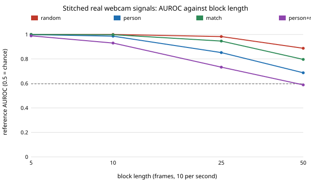

# Why is block-stitched real webcam signal still caught: the joins, or mixing people? Both, and each fix alone is not enough

Follow-up to `mimic-webcam` (track 11, adversarial human imitation): that project found that stitching 2.5 s segments from random training windows is caught at AUROC 0.98 while replaying whole windows gives 0.61, and left the cause open. **Preliminary, stylised: 46 people filling in one web form, one context, 8 seeds, a ceiling study that copies real frames.** Produced with AI assistance (Claude).

**Live page:** https://duncan-haywood.github.io/monorepo-projects/research/mimic-webcam-stitch/

**Result.** Block length matters most, and the two suspects add up. With 50-frame (5 s) blocks, random stitching is caught at AUROC 0.887, restricting each window to one person's windows gives 0.687, choosing each next block to start near where the last one ended gives 0.796, and doing both gives 0.588, the same as replaying whole windows (0.597). At 25 frames the same four rows are 0.983, 0.852, 0.946 and 0.733; at 5 frames only `person+match` is below 0.999 (0.989). So mixing people is the larger giveaway at long blocks, join mismatch is a smaller one, and removing both only reaches the replay ceiling, which already copies whole people. Nothing here is a generator: every frame is a real person's frame.



## Method

Data, person split (24 imitator/train people, 14 held-out), eight feature groups and boosted-tree reference detector are those of `mimic-webcam` (imported; nothing copied). `stitch.py` builds a 100-frame window from blocks of `seg` frames in four modes: `random` (each block from a random training window and offset), `person` (all blocks from windows of one randomly chosen training person), `match` (the next block is the best of 16 random candidates by squared distance, in per-channel standard deviations, between its first frame and the previous block's last frame), and `person+match`. `run.py` scores each at block lengths 5, 10, 25 and 50 against held-out people, with the all-groups detector and one group at a time.

## Results (mean reference AUROC of 8 seeds, `results/stitch.txt`)

| blocks of | random | person | match | person+match |
|---|---|---|---|---|
| 5 frames | 1.000 | 0.999 | 1.000 | 0.989 |
| 10 | 1.000 | 0.986 | 0.998 | 0.930 |
| 25 | 0.983 | 0.852 | 0.946 | 0.733 |
| 50 | 0.887 | 0.687 | 0.796 | 0.588 |

Replay of whole windows: 0.597. Per-group AUROCs are in `results/stitch.txt`.

- Short blocks are caught however they are chosen: the detector sees the unnaturally frequent switching of level, spread and autocorrelation.
- At 50 frames `person+match` leaves every group near 0.5 to 0.6 (autocorrelation 0.500, cross-channel 0.498), so what remains is the same small person-to-person difference as in the replay ceiling.
- A window with several blocks from one person is not independent of a single person's window, so `person` at 50 frames is partly a replay of two windows of that person.

## Limitations

- Ceilings that copy real frames, not a generative model; they show where detection comes from. A generator that matches this at 5 s blocks would need to reproduce person-level style and smooth joins at once.
- One context, one coding tool, 46 people, windows biased toward input activity (see `mimic-webcam`); the `match` rule is one simple choice of 16 candidates.
- No human judges, no pixels, no faces. Signals stay in this repository, are not sent anywhere as signals from a person, and the detector (`run.py`) ships with them. No fairness breakdown: DUX records no group labels.

## Next steps

Learn the per-person style instead of copying it: fit a generator on a person's windows only and test it against held-out windows of the same people, or let a loop (or `mimic-codeloop`) search over join and style components.

## Reproduce

```bash
cd research/mimic-webcam-stitch
pip install numpy scipy scikit-learn
python3 -m unittest discover -s tests -v   # 4 tests
python3 run.py 8                           # about 9 minutes, writes results/stitch.{json,txt}
python3 experiments/figure.py              # writes experiments/stitch.svg
```

## Builds on

`mimic-webcam` (data, features, detector, replay and stitch ceilings). DUX (Bieber et al. 2023, [Zenodo 7778612](https://zenodo.org/records/7778612), CC-BY-4.0). No lab's work is built on and none is affiliated with or endorses this project.

## Owner steps

None.

## Outside dependencies

numpy, scipy, scikit-learn. Produced with AI assistance (Claude).

MIT.
