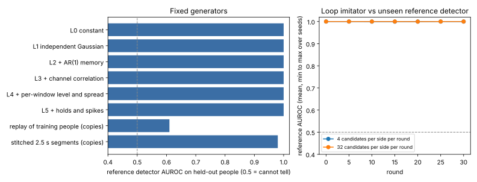

# Can a generator imitate a person's webcam emotion signals well enough to fool a detector?

Milestone 10 (`mimic-webcam`) of track 11, adversarial human imitation: the third subject, webcam, **signals first**. **Preliminary, stylised: 46 people filling in one web form, one context, a fixed library of generator components (no model writes code), 8 seeds.** Produced with AI assistance (Claude).

**Live page:** https://duncan-haywood.github.io/oss-monorepo/research/mimic-webcam/

**Result.** No generator here fools a detector on held-out people. A boosted-tree reference detector the loop never saw separates every fixed generator from people at AUROC 0.999 to 1.000, and separates the final imitator of every loop run at 0.999 to 1.000 (8 seeds at 4 candidates per side per round; 4 seeds at 32 per round also 1.000). The only thing that comes close to chance is replaying whole windows of other people (0.61, mean of 8 seeds, range 0.56 to 0.64), and that copies people. The 0.61 is also the floor of the benchmark: it is how far apart two sets of people are when the signals are identical in kind.



## Data and what a sample is

DUX (Bieber, Leppich, Harms and Schubert 2023, [Zenodo 7778612](https://zenodo.org/records/7778612), CC-BY-4.0) logged keyboard and mouse events of 46 people in a travel-expense web form and attached to each event the latest Affectiva facial-coding scores (12 channels: Anger, Confusion, Contempt, Disgust, Engagement, Fear, Joy, Neutral, Sadness, Sentimentality, Surprise, Valence). Only derived scores are used; there is no video, no image and no landmark in the data or in this repository. `data.py` keeps the rows where the scores changed (about 80 ms apart), holds the latest frame on a 10 Hz grid and cuts non-overlapping 10 s windows (100 × 12). A window is kept when at least 80% of its steps lie within 1 s of a real frame. That gives 1,515 windows from 46 people (12 to 54 each).

**Bias to know about.** Scores are logged only when the person produces an event, so idle stretches (40 to 70% of a session) have no frames and are dropped. The windows are moments of mouse and keyboard activity, not all of a session. People are the unit of every split.

## Method

- **Split by person** (`signals.split`): 24 people for the imitator's fit and the detectors' human training data, 8 for in-loop validation, 14 for the reference test, redrawn per seed.
- **Imitator (code is the free parameter).** A generator program (`signals.generate`) with 9 genes: window level (global mean or a training window's), spread (same), dynamics (independent or AR(1) with training memory times a multiplier), amplitude, channel correlation (training Cholesky), holds (probability of repeating the previous step, as the real 10 Hz grid does), spikes, clipping to each channel's range, rounding. Its statistics are fitted on the training people only. The code comes from a fixed component library, searched by mutation; no model writes code.
- **Detector (code too).** Eight feature groups (level, spread, extremes, roughness, lag-1 autocorrelation, holds, floor, cross-channel correlation; `signals.feature_groups`). The in-loop detector picks 3 groups and fits a logistic regression.
- **Loop** (`loop.py`): 30 rounds. The detector moves first (4 candidate group sets, scored by 2-fold AUROC on training people), then the imitator (4 mutations scored by the detector's mean log-odds that its samples are human). Blind: no explanations, no code sharing.
- **Reference detector** (`ladder.reference_auroc`): gradient-boosted trees on all groups, fitted on training people against the generator's samples, scored on the 14 held-out people against fresh samples. The loop never sees it.
- **Ladder** (`ladder.py`): six fixed generators from a constant to AR(1) with channel correlation, per-window levels, holds and spikes; two ceilings that copy people (replay of training windows, 2.5 s segments stitched from random training windows).

## Results

| generator | reference AUROC (mean of 8 seeds) |
|---|---|
| constant | 1.000 |
| independent Gaussian | 1.000 |
| + AR(1) memory | 1.000 |
| + channel correlation | 1.000 |
| + per-window level and spread | 1.000 |
| + holds and spikes | 1.000 |
| replay of training people (copies) | 0.610 |
| stitched 2.5 s segments (copies) | 0.980 |

- **Loop imitators**: final reference AUROC 1.000 (lowest of any logged round in any seed 0.997); in-loop detector 0.999 on its validation people. At 8 times the candidates per round (4 seeds): 1.000 and 0.996. See `results/summary.txt` and `results/loop*.json`. The loop moved the genomes (mostly to AR(1), per-window levels, channel correlation, holds of 0.25 to 0.65) but never close to the people.
- **Which signal gives it away** (`whichgroup.py`, best fixed generator, one group at a time): extremes 1.000, holds 0.995, autocorrelation 0.954, spread 0.937, roughness 0.936, floor 0.914, level 0.907, cross-channel correlation 0.772. Facial-coding scores are zero-inflated with rare large excursions (Joy, Engagement); smooth Gaussian-family components cannot make the tails.
- **Stitching real 2.5 s segments is still caught (0.98)**: the joins and the mix of people within one window are visible, so even real material is not safe when assembled.

## Limitations

- One context (a form being filled in), one coding tool, a short window, 46 people, and windows biased to input activity. Every claim is about these.
- A fixed component library; the answer for code a model writes is milestone 11 (`mimic-codeloop`).
- The blind game only. Shared feedback (detector explains, imitator shares code) and a second subject context are not run here.
- The replay ceiling (0.61) says people differ from each other by about as much as the benchmark can resolve with this reference detector; chance accuracy is therefore not reachable even by real data from other people.
- No human judges, no pixels, no faces. Generated signals stay in this repository and are not sent anywhere as signals from a person. No fairness breakdown: DUX records no group labels for these scores.

## Next steps

Add a heavy-tailed, zero-inflated component (a mixture with rare bursts fitted per channel) and see whether extremes stop giving it away; run the shared-feedback conditions from `mimic-cursor`; then `mimic-codeloop`. Pair signals with the cursor strokes of the same sessions.

## Reproduce

```bash
cd research/mimic-webcam
pip install numpy scikit-learn matplotlib
python3 -m unittest discover -s tests -v   # 8 tests
python3 data.py                  # optional: rebuilds windows.npz from Zenodo (319 MB download)
python3 ladder.py 8              # fixed generators, a few minutes
python3 loop.py 8 30 4           # the loop, about 25 minutes on 4 CPUs
python3 loop.py 4 30 32 results/loop_budget8x.json   # larger budget, about 40 minutes
python3 whichgroup.py && python3 experiments/figure.py
```

## Builds on

`mimic-cursor` (the game structure, data source and split by person). DUX for the data. Goodfellow et al. (2014) and Lopez-Paz and Oquab (2017) for the detector-as-fidelity-score idea. No lab's work is built on and none is affiliated with or endorses this project.

## Owner steps

None.

## Outside dependencies

numpy, scikit-learn, matplotlib (figure only); DUX data from Zenodo. Produced with AI assistance (Claude). No LLM proposer was used.

MIT.
