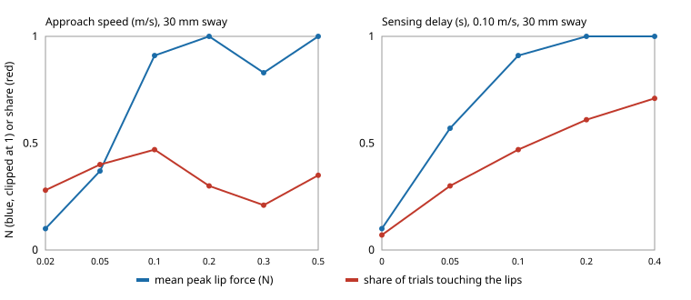

# When a spoon-feeding arm meets a moving mouth, what sets the force on the lips: the sensor, the approach speed or a force cap?

Sixth milestone (`osrobot-assist`) of track 9, open-source purpose-built robots, in the direction of the CAIRO Lab interest in human-robot collaboration and assistive robotics. Produced with AI assistance (Claude). Pure Python standard library. **Every constant (tip mass, loop gains, lip stiffness, mouth opening, sway shape, comfort limit) is an assumed round number marked ASSUMED in `model.py`, not a measurement of a person or a product, and no robot was built or tested with anyone.** All numbers below are from `experiments/results.txt`. Simulation only; **a stylised, preliminary study, and the Assistive Gym / MuJoCo human model the milestone mentions was not used** (neither is installed here; this is a planar point-mass stand-in).

**Live page:** https://duncan-haywood.github.io/monorepo-projects/research/osrobot-assist/



- **In this model the push on the lips is set by the controller, not the lips.** The tip's forward reference sits 0.05 s ahead of it, so a blocked tip pushes with `KP × 0.05 s × speed` = 20 N·s/m × speed. The peak force therefore tracks approach speed: 0.40 N at 0.02 m/s, 1.00 at 0.05, 2.00 at 0.10 and 4.00 at 0.20 (maximum over 200 trials at 30 mm sway). This is largely a property of the chosen controller, so treat it as an identity the tests check, not a discovery about people.
- **With the assumed 2 N comfort limit, the camera design at 0.10 m/s or slower is safe in every trial at 30 mm sway, and at 0.05 m/s at every sway tested up to 50 mm** (fed with peak force at most 2 N; 0.10 m/s was not run at 50 mm). At 0.20 m/s the share of trials fed safely falls to 0.71 at 30 mm sway and 0.42 at 50 mm; the blind open-loop arm at 0.20 m/s manages 0.21 and 0.14.
- **A camera mostly cuts how often the lips are touched, not how hard.** At 0.05 m/s and 30 mm sway the camera design touches the lips in 0.40 of trials against 0.72 for the open-loop arm; peak force is the same 1.0 N. At 50 mm: 0.56 against 0.83.
- **Latency is what costs the camera its advantage.** At 0.10 m/s and 30 mm sway the touch share rises from 0.07 with no delay to 0.30 (0.05 s), 0.47 (0.10 s), 0.61 (0.20 s) and 0.71 (0.40 s). Sensing noise from 0 to 12 mm changes the touch share little (0.49, 0.47, 0.38, 0.46) but lengthens the feeding time from 1.68 to 2.93 s, because the arm waits to line up.
- **A force cap (1 N or 0.5 N) at 0.20 m/s lowers the worst peak from 4.0 to 2.7 and 2.4 N and the mean peak at 50 mm sway from 2.26 to 1.52 and 1.46 N, but it did not raise the safe share** (0.42 → 0.44 and 0.41 at 50 mm; 0.71 → 0.63 and 0.60 at 30 mm), because the impact at the lip plane (a Hunt–Crossley contact, assumed) still exceeds 2 N in many fast approaches. It costs 0.1 to 0.3 s. A cap does not substitute for a slow approach.
- **Every design eventually feeds (fed = 1.00 everywhere)** because the model is patient: the tip waits against the lips or in front of them until the sway brings the mouth over it, within the 12 s limit. So the cost of a poor design shows up as time and force, never as a failed feed, which a real user would not tolerate silently.

## Reproduce
```bash
cd research/osrobot-assist
PYTHONPATH=src python3 -m unittest discover -s tests -v   # 6 tests, under a second
PYTHONPATH=src python3 experiments/run.py                 # about 5 s; writes experiments/results.txt
python3 experiments/figure.py                             # experiments/force_sweeps.svg, parsed from results.txt
```

## Motivation
Feeding is a classic assistive task where the target moves and contact is expected but must stay gentle. A purpose-built feeding arm can drop most of a general arm's degrees of freedom, so the open design question is where its sensing, speed and force limits earn their cost. This project asks what actually controls lip contact in a simple closed-loop model.

## Builds on
The human-robot collaboration and assistive-robotics interests of the CAIRO Lab (<https://cairo-lab.com/>); no specific paper from it is reproduced and nothing here is affiliated with or endorsed by it. The task framing follows Erickson et al. (2020), Assistive Gym, *ICRA*, which was not run. The lip contact law is Hunt and Crossley (1975), "Coefficient of restitution interpreted as damping in vibroimpact", *Journal of Applied Mechanics* 42(2), with assumed parameters. Companion to `osrobot-specialise` (purpose-built against general designs) and `osrobot-uav`.

## Method
`src/osrobot_assist/model.py`. A point-mass spoon tip (0.30 kg) moves in a plane under a PD position loop (`KP` 400 N/m, `KD` 28 N·s/m, actuator limit 20 N) toward a mouth opening of 12 mm half-width in a lip plane. The mouth centre sways sideways as two sinusoids (slow drift near 0.25–0.35 Hz, faster sway near 0.9–1.2 Hz at one third the amplitude) with random phases; amplitude is the swept "amp_mm". Outside the opening the lips are a spring-damper wall (800 N/m, Hunt–Crossley factor 1.5 s/m). *Open loop* aims at the mouth's rest position. *Camera* aims at a sensed mouth position with latency, Gaussian noise and 15 Hz sample-and-hold, and waits short of the lip plane until lined up within half the opening. Forward speed is capped at the approach speed; an optional forward force cap models a compliant or current-limited arm. A trial ends when the tip crosses the lip plane inside the opening ("fed") or after 12 s. 200 seeded trials per row; seeds are shared across designs so rows are paired.

## Limitations
- A planar point mass: no spoon geometry, tilt, food, head rotation, mouth opening timing, tongue, or the arm's own links and joint limits. Lateral edge contact after entry is not modelled, so "fed" is optimistic.
- The user is passive and sways on a fixed schedule; real people anticipate, lean toward the spoon and react to contact. Comfort is a single assumed 2 N threshold, not a measured or standard value, and nothing here is a safety case. ISO 13482 (personal-care robots) and a risk assessment apply before any test with a person.
- The peak-force result is nearly an identity of the chosen controller (stall push = `KP × LEAD × speed`), so the ranking of speeds would change with a different loop; the contact stiffness and damping were not swept.
- No comparison with a general-purpose arm's cost or reach, so the "purpose-built" question is only partly addressed.

## Next steps
Run the same sweeps in MuJoCo or Assistive Gym with a human model; sweep lip stiffness and the force-loop design; add anticipation by the user; compare a 2-DOF purpose-built arm with a 6-DOF arm on the same task, with bills of materials.

## Owner steps
Building a feeding arm and testing it with people are owner steps (risk assessment, consent, relevant standards); no purchases or hardware were made or priced here.

## Outside dependencies
Python 3 standard library only. The Assistive Gym and MuJoCo human models the milestone names were not used.
