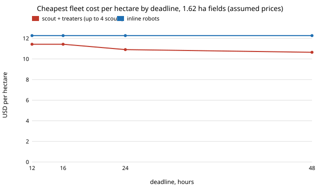

# osrobot-deadline: when a pest window sets a deadline, is a scout-and-treater fleet or a fleet of inline weeding robots cheaper?

Follow-up to `osrobot-pipeline` (track 9, open-source purpose-built robots), which listed "a pest window would favour more machines" as an unmodelled limit. This project adds the deadline: for 16 equal fields, find the cheapest fleet that finishes by D hours, with one scout or up to four, against inline robots. **Every price is an assumed round number, not a quote; no new simulation was run** (it reuses `osrobot-pairprice`'s fitted per-field minutes). In the direction of the ARPG, RECUV and Autonomous Systems IRT interest in field robots; nothing here is affiliated with or endorsed by them. Produced with AI assistance (Claude). Pure Python standard library. Simulation only; nothing was built or flown.

**Live page:** https://duncan-haywood.github.io/monorepo-projects/research/osrobot-deadline/



- **A deadline makes a single scout the bottleneck.** With one scout, the fastest 16 fields can finish is 5.3, 15.9 and 32.5 h (0.18, 0.72, 1.62 ha fields), however many treaters are added; 32 inline robots finish in 0.7, 2.8 and 6.2 h (Sweep 1). Four scouts cut the floor to 1.6, 4.8 and 10.0 h.
- **At 0.72 ha the extra cost of a pipeline is small but real.** Cheapest pipeline against cheapest inline fleet is 1.06 with no pressure, 1.08 at a 12 h deadline (2 scouts, 2 treaters), 1.12 at 6 to 8 h (4 scouts, 4 treaters), and no pipeline of up to four scouts meets 4 h while 16 inline robots do (13.19 USD/ha).
- **At 1.62 ha the pipeline wins only if the deadline is loose enough to pick a small one.** It is cheaper than inline at every deadline it can meet: 0.87 at 48 h (1 scout, 1 treater), 0.89 at 24 h, 0.93 at 12 to 16 h. Below about 10 h four scouts cannot finish, and at 8 h only inline (16 robots, 12.27 USD/ha) can; at 4 and 6 h no fleet of the sizes searched finishes.
- **At 0.18 ha it never wins:** 1.49 at every deadline from 6 h to 48 h, 1.51 at 4 h.
- **Meeting a deadline by adding scouts is cheap relative to treaters alone:** at 0.72 ha and 16 h, one scout with two treaters costs 15.85 USD/ha, while two scouts with two treaters cost 14.21 (Sweep 2).

## Reproduce
```bash
cd research/osrobot-deadline
PYTHONPATH=src python3 -m unittest discover -s tests -v   # 8 tests, a second
PYTHONPATH=src python3 experiments/run.py > experiments/results.txt   # a second
python3 experiments/figure.py                             # experiments/deadline.svg, parsed from results.txt
```

## Motivation
Weeds and pests have windows: a field treated late is worth less. A farmer sizing a fleet needs to know whether the scout-and-treater architecture still makes sense when the job must finish by a date, and how much each hour of deadline costs.

## Builds on
`osrobot-pipeline` (scheduling model, copied into `src/osrobot_deadline/fleet.py` so this project stands alone, generalised from one scout to s scouts) and, through it, `osrobot-pairprice` and `osrobot-scoutpair`. `test_loose_deadline_reduces_to_pipeline_project` checks that with no deadline the result equals `osrobot-pipeline`'s 13.92 USD/ha at 0.72 ha.

## Method
Sixteen equal fields. s scouts each fly fields in turn (earliest-free scout takes the next field); each mapped field goes to the next free treater. n inline robots work fields in turn. Held fleets, costed over the makespan exactly as in `osrobot-pipeline`: capital times 30% a year over 500 h, labour 20 USD/h for set-up and battery swaps, electricity 0.15 USD/kWh. For each deadline the search takes s in 1 to 4 (or 1 only), k in 1 to 16 treaters, and n in 1 to 32 inline robots, and keeps the cheapest that finishes in time; ties go to fewer machines.

## Limitations
- Prices, duty, labour and times are assumed round numbers; only the structure is the finding.
- The deadline is a hard cut-off for the whole farm; there is no value curve for late fields, no weather, failures, or travel between fields, and fields are equal.
- Fleet sizes are capped at four scouts, 16 treaters and 32 inline robots; "cannot finish" means within those caps.
- Held fleets are charged only for this job. Inherits the limits of `osrobot-scoutpair` (no registration error, assumed detector, one weed density) and of `osrobot-pipeline`.

## Next steps
Replace the hard deadline with a loss of yield for each late field; a second person preparing flights instead of extra scouts; sourced prices for an open drone and ground platform.

## Owner steps
None taken. Quoting parts, buying or flying anything is the owner's step.

## Outside dependencies
None: Python 3 standard library only. A real system would need a drone and camera, a ground platform, a detector, registration and a treatment tool that this project could not make or run.

MIT.
