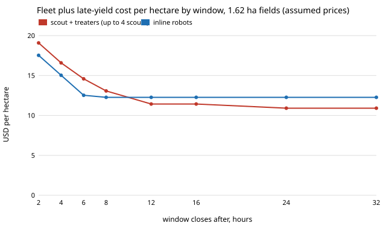

# osrobot-deadlineloss: if a late field loses yield instead of failing a hard deadline, does the scout-and-treater fleet still lose to inline weeding robots?

Follow-up to `osrobot-deadline` (track 9, open-source purpose-built robots), whose "Next steps" asked to "replace the hard deadline with a loss of yield for each late field". This project does that with one sourced number: **2% of yield lost for each leaf stage that weed control is delayed past the critical time** (Knezevic, Evans & Mainz 2003, *Crop Management* 2(1), doi:10.1094/CM-2003-0219-01-RS; pooled corn and soybean data, moderate to high weed density, valid up to canopy closure in corn and R3 in soybean). The fleet minimises fleet cost plus the yield it loses. **Fleet prices, duty and times are still assumed round numbers as in `osrobot-deadline`; days per leaf stage, working hours per day and crop revenue are not sourced and are swept.** No new simulation (it reuses `osrobot-pairprice`'s fitted per-field minutes). In the direction of the ARPG, RECUV and Autonomous Systems IRT interest in field robots; nothing here is affiliated with or endorsed by them. Produced with AI assistance (Claude). Pure Python standard library. Simulation only; nothing was built or flown.

**Live page:** https://duncan-haywood.github.io/monorepo-projects/research/osrobot-deadlineloss/



- **Hours of lateness cost little; the verdict of `osrobot-deadline` mostly survives.** At 0.72 ha the best pipeline costs 1.06 to 1.20 times the best inline fleet in every cell of the sweep (windows 4 to 32 h, leaf stage 2 to 8 days, revenue 1,000 and 2,000 USD/ha), and at 0.18 ha 1.49 to 1.51. At 1.62 ha it ranges from 0.89 to 1.18.
- **At 1.62 ha the verdict flips with the window.** With revenue 2,000 USD/ha and a 4-day leaf stage (Sweep 3): inline robots are cheaper when the window closes at 8 h or earlier (12.27 against 13.07 USD/ha at 8 h), and the pipeline is cheaper from 12 h (11.43 against 12.27) and 24 h (10.91 against 12.27).
- **The loss can still be as large as the fleet.** The worst cell is 8.56 USD/ha of late loss for the pipeline (1.62 ha, 4 h window, 2-day stage, revenue 2,000 USD/ha) against about 12 USD/ha of fleet cost; inline loses 5.53 in the same cell.
- **More revenue does not keep buying more machines here.** At 0.72 ha with an 8 h window and a 2-day stage, the chosen pipeline stops growing at four scouts and four treaters (the search cap) from 2,000 USD/ha upwards, and the ratio holds at 1.12 up to 100,000 USD/ha (Sweep 2). That is the cap, not an optimum.

## Reproduce
```bash
cd research/osrobot-deadlineloss
PYTHONPATH=src python3 -m unittest discover -s tests -v   # 7 tests, under a second
PYTHONPATH=src python3 experiments/run.py > experiments/results.txt   # a few seconds
python3 experiments/figure.py                             # experiments/loss.svg, parsed from results.txt
```

## Motivation
A hard deadline is easy to code and not how weeds behave: a field treated a little late loses a little. A farmer sizing a fleet needs the price of lateness, not only a cut-off. This replaces the cut-off with a measured-in-the-literature loss rate and asks whether the fleet choice changes.

## Builds on
`osrobot-deadline` (scheduling model, copied into `src/osrobot_deadlineloss/fleet.py` so this project stands alone, with per-field finish times added), `osrobot-pipeline`, `osrobot-pairprice` and `osrobot-scoutpair`. `test_loose_window_equals_hard_deadline_project_cost` checks that with no lateness the pipeline costs 13.92 USD/ha at 0.72 ha, the figure in `osrobot-deadline`.

## Parameters
| Parameter | Value | Source |
|---|---|---|
| Yield loss per leaf stage of delay | 2% of yield | Knezevic, Evans & Mainz 2003 (above), pooled corn and soybean |
| Days per leaf stage | 2, 4, 8 (swept) | not sourced; varies with crop, temperature and stage |
| Working day | 8 h of machine work (fixed) | assumed; lateness is counted in working days |
| Crop revenue | 1,000 and 2,000 USD/ha (Sweep 2: to 100,000) | not sourced; swept |
| Prices, duty, labour, electricity, times | as `osrobot-deadline` | assumed round numbers / `osrobot-pairprice` fits |

## Method
Sixteen equal fields, one window that closes at D hours for all of them. Each field's finish time comes from the same list schedule as `osrobot-deadline` (s scouts, k treaters; or n inline robots). A field finished L working hours after the window loses 2% × (L / 8 h / days per stage) of its revenue, capped at all of it. For each case the search takes s in 1 to 4, k in 1 to 16 and n in 1 to 32 and keeps the fleet with the lowest fleet cost plus total loss; ties go to fewer machines.

## Limitations
- The 2% rate is from field trials of corn and soybean at moderate to high weed density and applies only up to canopy closure (R3 in soybean); the paper itself warns losses are much higher beyond. It is applied linearly here, with a cap at total loss. It says nothing about the crops or weeds a small open robot would work.
- Leaf-stage length, working-day length and revenue are not sourced. The result is shown for several values; the conclusion at 1.62 ha depends on them (Sweep 1).
- One window for all fields, equal fields, no weather, failures or travel between fields; fleets capped at four scouts, 16 treaters and 32 inline robots.
- All fleet prices, duty and labour are assumed round numbers. Sourced prices for an open drone and ground platform remain open.

## Next steps
Source prices for an open drone and ground platform; give fields staggered windows; ask a farmer-facing question such as the cheapest fleet for a fixed budget.

## Owner steps
None taken. Quoting parts, buying or flying anything is the owner's step.

## Outside dependencies
None: Python 3 standard library only.

MIT.
