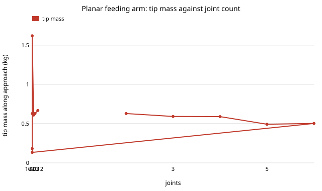

# Does a spoon-feeding arm need more than two joints? Tip mass, lip force and servo cost of 2 to 6 joint arms

Follow-up to `osrobot-assist` (track 9, open-source purpose-built robots), taking the one "Next steps" item in that chain that is a new question, not a variant of the lip-force result: **compare a 2-DOF purpose-built arm with a 6-DOF arm on the same task, with a priced bill of materials.** In the direction of the CAIRO Lab interest in assistive robotics; nothing here is affiliated with or endorsed by it. Produced with AI assistance (Claude). Pure Python standard library. **Every mass, length and inertia is an assumed round number (ASSUMED in `src/osrobot_dof/model.py`), not a measurement of any product, and no robot was built or tested with anyone.** All numbers are from `experiments/results.txt`. Simulation only; a stylised, preliminary study.

**Live page:** https://duncan-haywood.github.io/monorepo-projects/research/osrobot-dof/



- **In this model extra joints do not make the arm hit the lips harder or softer in any way that matters; they triple the servo bill.** The effective mass at the spoon tip along the approach direction is 0.63 kg for 2 joints, 0.59 (3), 0.59 (4), 0.49 (5) and 0.50 kg (6). Servo cost alone goes from $52 to $156 (low price) or $98 to $295 (high price).
- **Lip force barely moves.** Camera design, 30 mm sway, 200 paired trials. At 0.10 m/s the worst peak is 2.0 N for every arm and the share fed at most 2 N is 1.00. At 0.20 m/s the worst peak is 4.0 N for every arm (the controller's stall push, as in `osrobot-assist`), and the safe share is 0.60 (2 joints), 0.61, 0.61, 0.65 and 0.65 (6 joints). Mean peak force is 1.60 N for 2 joints and 1.38 N for 6. These differences are small beside the sampling error of 200 trials (about 0.03 on a share), so read them as "no clear difference", not "6 joints is safer".
- **The mass is mostly the servo gearbox, not the links.** With the servo rotor inertia at zero, the tip mass is 0.13 kg (2 joints) and 0.06 kg (6); at the assumed 1e-7 kg m² reflected through a 345:1 gearbox it is 0.63 and 0.50; at 3e-7 it is 1.62 and 1.19 kg. Changing the servo's own mass from 0.03 to 0.12 kg moves the 2-joint mass only from 0.61 to 0.67 kg. A 2-joint arm has the longest lever arms, so it feels each joint's reflected inertia most.
- **What this does not say.** A planar position-only task needs two joints; the reasons to use six (spoon tilt and orientation, 3-D head motion, avoiding the user's body and joint limits) are not in the model. It shows only that the lip-contact result of `osrobot-assist` does not depend on how many joints carry the spoon, so those other benefits are what would have to justify the extra cost.

## Reproduce
```bash
cd research/osrobot-dof
PYTHONPATH=src python3 -m unittest discover -s tests -v   # 7 tests, under a second
PYTHONPATH=src python3 experiments/run.py                 # about 20 s; writes experiments/results.txt
python3 experiments/figure.py                             # experiments/tip_mass.svg, parsed from results.txt
```

## Motivation
A purpose-built feeding arm can drop most of a general arm's joints. `osrobot-assist` asked what controls lip force; the open design question it left is whether the joint count itself changes contact, or only cost.

## Builds on
The assistive-robotics and human-robot collaboration interests of the CAIRO Lab (<https://cairo-lab.com/>); no specific paper from it is reproduced. The feeding model and controller are an unchanged-in-behaviour copy of `osrobot-assist` (planar point mass, PD loop, Hunt and Crossley (1975) lip contact, swaying mouth), with the tip mass and damping made arguments (damping ratio held at 1.28, `osrobot-assist`'s value, so only the mass changes). The tip mass is the operational-space mass of Khatib (1987), "A unified approach for motion and force control of robot manipulators: the operational space formulation", *IEEE Journal of Robotics and Automation* 3(1), Λ = (J M⁻¹ Jᵀ)⁻¹, for a planar chain. The reflected rotor inertia (gear² × rotor inertia) is standard servo modelling. The 12 V 30 kg·cm servo is the class used by the open SO-ARM100/101 arms; the hardware was not run.

## Method
`src/osrobot_dof/model.py`. A planar chain of n equal links with total reach 0.50 m puts the tip at 0.35 m, 0.05 m from the shoulder (damped least-squares inverse kinematics; spare freedom of n > 2 pulled toward a gentle zig-zag so the pose is not coiled). Masses: a 0.060 kg servo at each joint, printed links at 0.20 kg/m (a point mass at each link's middle), a 0.050 kg spoon, and each servo's rotor inertia (1e-7 kg m², 345:1) reflected on its own joint. The joint-space mass matrix gives Λ, and Λ's x entry is the tip mass for the feeding trials. The pose is one fixed configuration at the lip plane: mass at other poses and the approach path are not modelled. Servo prices: $49.22 at [RobotShop US](https://robotshop.com/products/feetech-12v-30kgcm-magnetic-encoding-servo-sts3215) (sale price including tariffs, "restocking soon") and $26.00 at [AIFit Lab](https://aifitlab.com/products/feetech-sts3215-servo-motor) (backordered), both read on 2026-10-19; other retailers listed £19.20 and ¥4,787, and prices change often. No other part (controller board, power supply, printed parts, camera) is priced.

## Limitations
- One pose, one planar arm, point masses for links; no joint limits, torque limits, friction, backlash or gearbox compliance. Reflected rotor inertia is the dominant term and is assumed, not measured; the real value for a given servo should replace it.
- The extra benefits of more joints are absent by construction (see above), so this cannot argue for a 2-joint arm in practice, only that lip contact does not.
- The user is passive, the lip wall and 2 N comfort limit are the assumed ones from `osrobot-assist`, and nothing here is a safety case. ISO 13482 (personal-care robots) and a risk assessment apply before any test with a person.
- The servo cost is the only priced part, so it is a lower bound on a bill of materials, and a single retailer's price on one day.

## Next steps
A bill of materials for the whole arm with a source and date for every part; the same comparison in MuJoCo with a spoon orientation task, where extra joints can pay; mass over the whole approach path rather than one pose.

## Owner steps
None taken. Building a feeding arm, buying parts and testing it with people need the owner's risk assessment, consent and the relevant standards.

## Outside dependencies
Python 3 standard library only. Servo mass, link density, rotor inertia and spoon mass are assumed, not measured; the two servo prices are a retailer's listings, not a quote.
