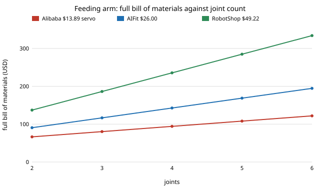

# What does a 2-joint feeding arm cost against a 6-joint one once the whole bill of materials is priced? About 1.8 times, not 3

Follow-up to `osrobot-dof` (track 9, open-source purpose-built robots), taking the first item of its "Next steps": **a bill of materials for the whole arm with a source and date for every part.** `osrobot-dof` priced the servos alone and reported that extra joints "triple the servo bill". This project prices everything else from the published SO-ARM101 parts list and finds that claim overstates the cost ratio. In the direction of the CAIRO Lab interest in assistive robotics; nothing here is affiliated with or endorsed by it. Produced with AI assistance (Claude). Pure Python standard library. Prices only: nothing was built or bought.

**Live page:** https://duncan-haywood.github.io/monorepo-projects/research/osrobot-dofbom/



- **At the SO-ARM101 table's own servo price ($13.89) a 2-joint arm costs $66.38 and a 6-joint arm $121.94: a ratio of 1.84, with $55.56 extra.** The servo-only ratio is 3.00 by construction. Control board, cable, power supply, clamps and screwdrivers add a fixed $38.60 that does not grow with joints (the board drives every servo).
- **The dearer the servo, the closer the ratio gets to 3.** At AIFit Lab's $26.00 retail listing the ratio is 2.15 (extra $104.00); at RobotShop's $49.22 it is 2.44 (extra $196.88). Fixed parts are 58% of a 2-joint arm at the cheap servo and 28% at the dear one.
- **The ratio reaches 2.5 only at a $57.90 servo and 2.9 at $366.70.** Under any servo price listed here, adding four joints costs between 1.8 and 2.4 times, never 3.
- **Printed links barely matter.** At 0.100 kg of links (`osrobot-dof`'s line density and reach) and a swept $15 to $40 per kg of filament, they add $1.50 to $4.00 to either arm and move the ratio from 1.84 to 1.79.
- **Check against the source.** The model reproduces the table's totals: one follower arm (six servos, board, cable, power supply, 2 clamps, screwdrivers) $121.94, and the two-arm set $229.88, both exact (`tests/test_bom.py`).
- **What this does not say.** It prices parts, not whether the extra joints are worth it: spoon tilt, 3-D head motion and obstacle avoidance are the reasons to use six and none is modelled here or in `osrobot-dof`. Which servo and retailer a builder can actually get depends on stock, country, tariffs and quantity.

## Reproduce
```bash
cd research/osrobot-dofbom
PYTHONPATH=src python3 -m unittest discover -s tests -v   # 8 tests, instant
PYTHONPATH=src python3 experiments/run.py                 # instant; writes experiments/results.txt
python3 experiments/figure.py                             # experiments/bom.svg, parsed from results.txt
```

## Motivation
A purpose-built arm drops joints to save money. Whether it saves two thirds or less than half depends on what else is on the bill, and `osrobot-dof` priced only the servos, which makes the saving look biggest.

## Method
`src/osrobot_dofbom/bom.py`. An n-joint arm is n servos plus the table's fixed parts: control board $10.60, USB-C cable pack $7.00, power supply $10.00, clamp pack $5.00, screwdriver set $6.00 (a one-off tool). Servo price is the variable. The fixed parts are one set each however many servos there are (the Waveshare board is the table's single controller for the whole arm). Printed links use `osrobot-dof`'s model values with filament price swept. Everything is a sum, so each number can be checked by hand against `experiments/results.txt`.

| Input | Value | Source |
|---|---|---|
| STS3215 servo, 7.4 V, 1/345 | $13.89 | SO-ARM101 sourcing table, "Unit Cost (US)", Alibaba; README read 2026-10-21 |
| Motor control board | $10.60 | same table (Waveshare, Amazon) |
| USB-C cable, 2 pcs | $7.00 | same table |
| Power supply | $10.00 | same table |
| Table clamp, 2 pcs | $5.00 | same table, one-arm list |
| Screwdriver set | $6.00 | same table |
| Servo, retail, 12 V 30 kg·cm | $26.00 / $49.22 | AIFit Lab / RobotShop US listings read 2026-10-19 (`osrobot-dof`) |
| Printed link mass | 0.100 kg | `osrobot-dof`: 0.20 kg/m over 0.50 m reach |
| Filament | $15 to $40 per kg | swept, not sourced |

## Limitations
- The $13.89 servo is the 7.4 V part (16.5 kg·cm stall at 6 V per the table's note), the retail listings are the 12 V 30 kg·cm part; `osrobot-dof` modelled the 12 V class. Mixing them is a price sweep, not a like-for-like part swap.
- The table's prices are a snapshot from a fork of the SO-ARM100 project, with no shipping, tax, tariffs or 3D printing; they will drift.
- Parts that a real feeding arm needs and the table lacks (spoon holder, mount to a wheelchair or table, a camera for the camera-tracked design, safety stop) are not priced, so every total is a lower bound.
- Nothing here weighs benefit against cost.

## Prior work and licence
Parts list: SO-ARM100/SO-ARM101, Apache-2.0 (<https://github.com/TheRobotStudio/SO-ARM100>; the figures here are read from the fork <https://github.com/uofrobotics/SO-ARM101>, also Apache-2.0). Tip masses and the arm model: `osrobot-dof` and Khatib (1987). The assistive-robotics interests of the CAIRO Lab (<https://cairo-lab.com/>); no specific paper from it is reproduced.

## Next steps
Price a camera, mount and stop for a complete feeding arm; a same-part comparison (all 12 V or all 7.4 V); add a value side: price the extra joints against a spoon-orientation success rate in MuJoCo.

## Owner steps
None taken. Building a feeding arm, buying parts and testing it with people need the owner's risk assessment, consent and the relevant standards (ISO 13482).

## Outside dependencies
Python 3 standard library only. No input is assumed except the filament price, which is swept.
