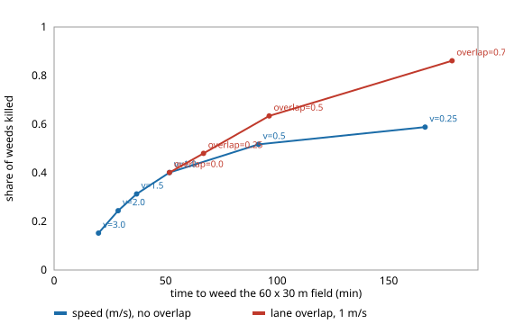

# For a weeding robot with a cheap camera, is it better to treat weeds as it drives or to scout first and come back, and what does a weak sensor cost?

Fifth milestone (`osrobot-field`) of track 9, open-source purpose-built robots, in the direction of the ARPG, RECUV and Autonomous Systems IRT interest in field-robot simulation. Produced with AI assistance (Claude). Pure Python standard library. **Every constant (blur law, treatment time, energy per metre, mud penalty, sensor hit rate) is an assumed round number in `src/osrobot_field/model.py` (marked ASSUMED), not a measurement of any robot, camera or crop, and no robot was built or driven.** All numbers below are from `experiments/results.txt` (30 simulated fields per row; fields and random draws are shared across rows). Simulation only; **a stylised, preliminary study. Perception is a probability, not an image pipeline, and terrain enters only as slower, costlier muddy squares; `terrain-twin`'s friction model is not used.**



- **In this model a second, planned stage never pays.** Scouting every lane at speed `v`, then visiting the detected targets by nearest neighbour, kills the same share of weeds as treating them where they are seen (0.399 against 0.401 at 1 m/s) and takes longer in every one of the 23 paired rows of the sweeps: 57.0 against 51.7 min and 220 against 189 Wh at the reference, a gap of 2.8 to 7.8 min that does not close with weed density (0.05 to 1.2 per m²) or with mud (0 to 60% of squares). The robot treats every target once either way, so a tour adds travel to targets that the lane already passed.
- **Speed buys time and costs weeds, at a rate set by the blur assumption.** With hit rate `p_max·exp(−v/2)` and `p_max = 0.7`, the share killed falls from 0.588 at 0.25 m/s (166 min) to 0.401 at 1 m/s (52 min) and 0.152 at 3 m/s (20 min). Changing the blur constant changes the answer a lot: the same 0.401 is reached at 2 m/s when the constant is 4, and at 0.5 m/s when it is 1 (sweep 7). The ordering of the two planners does not depend on it, the speed does.
- **A weak sensor is repaid with extra passes, at a steep price.** With lane overlap, a weed is looked at again by the neighbouring lane. Overlap 0 to 0.75 at 1 m/s raises the kill share 0.401, 0.480, 0.634, 0.861 and the time 52, 67, 96, 178 min (energy 189 to 609 Wh). No configuration in the grid reaches a 0.9 kill share with `p_max = 0.5`. With `p_max = 0.7` the quickest that does is 321 min (inline, 0.5 m/s, overlap 0.75, kill 0.940); with `p_max = 0.9`, 181 min; with a perfect hit rate (`p_max = 1.0`), 133 min, which is still 0.902 because one treatment kills 95% of the time. Moving from a 0.5 to a 0.9 hit rate cuts the time to reach a 0.8 kill share from 317 to 132 min.
- **Time and energy pick different designs.** The least-energy configuration that reaches a 0.8 kill share is slower and has less overlap than the least-time one (`p_max = 0.9`: 372 Wh at 0.25 m/s and overlap 0.25, against 585 Wh for the 132-min design). Which to prefer is a battery-and-labour question this model does not price.
- **False alarms are cheap until they are not.** A rate of 0.01 per m² wastes 29 of 231 treatments; 0.2 per m² wastes 374 of 577 and adds 20 min (52 to 72), without changing the kill share.
- **Mud is a tax on both planners and not a reason to choose between them.** Going from no mud to 60% of the squares adds 18 min (46 to 64 inline) and 76 Wh.

## Reproduce
```bash
cd research/osrobot-field
PYTHONPATH=src python3 -m unittest discover -s tests -v   # 7 tests, under a second
PYTHONPATH=src python3 experiments/run.py > experiments/results.txt   # about 4 min
python3 experiments/figure.py                             # experiments/kill_vs_time.svg, parsed from results.txt
```

## Motivation
A weeding robot is a field robot with one job, so its body, sensor and plan can all be chosen for that job. The cheapest sensor shapes everything else: if the camera misses weeds that it sees at speed, the plan has to look again, and looking again is the expensive part. This project asks what a plan should do about that, in the spirit of the track's question of how a purpose-built design should be chosen.

## Builds on
The field-robot, perception and mapping directions of ARPG (<https://arpg.colorado.edu/>), RECUV (<https://www.colorado.edu/recuv/>) and the Autonomous Systems IRT (<https://www.colorado.edu/irt/autonomous-systems/>); no specific paper from them is reproduced, and nothing here is affiliated with or endorsed by them. Lane (boustrophedon) coverage follows the standard coverage-path-planning survey of Galceran and Carreras (2013), "A survey on coverage path planning for robotics", *Robotics and Autonomous Systems* 61(12). Weed clustering is a Neyman–Scott cluster process (Neyman and Scott 1958, *J. R. Statist. Soc. B* 20), a common stand-in for patchy weed seedbanks. Open projects in this space that the track names, such as FarmBot, were not used or run. Companions here: `terrain-twin` (friction on correlated terrain), `osrobot-uav`, `osrobot-specialise`.

## Method
`src/osrobot_field/model.py`. A 60 × 30 m field holds clustered weeds (default 0.3 per m², parents with six children, spread 1.5 m) on 5 m squares, a share of which is mud (speed ×0.5, energy per metre ×2.5). A robot with a 1 m camera swath drives lane by lane (alternating direction, 4 s per turn). A weed in the swath is detected with probability `p_max·exp(−v/V_BLUR)` per look, and false positives appear uniformly at a rate per m² imaged. A target costs a 3 s stop plus lateral gantry time at 0.5 m/s, 0.3 Wh, and a 95% chance of killing a real weed; false and failed targets are wasted effort. Energy is distance times a per-metre cost plus 30 W while running. *Inline:* stop and treat each detection as it appears. *Scout:* drive all lanes at a speed without stopping, merge repeat detections of one weed, then visit all targets by nearest neighbour at 1.5 m/s and treat them. Lane overlap sets the spacing to `SWATH·(1−overlap)`, so a weed in the overlap gets another look until it is killed. In the scout planner a weed with several detections is visited once.

## Limitations
- Stylised and uncalibrated: no sensor, speed, energy or time was checked against a data sheet or field trial, and absolute minutes are artefacts of the constants (a 0.18 ha field taking 52 min is not a throughput claim). Sweep 7 shows the speed conclusions move with the blur assumption.
- The finding that scouting never wins is a statement about this cost model. It would likely change if treatment needed a different tool, a different vehicle, or a better path through the targets than nearest neighbour, if scouting could be done faster by a second platform or an aerial camera, or if treatment time depended on position. Nothing here tests those.
- Detection is independent per look and per weed, with no dependence on weed size, crop occlusion, lighting or a real classifier; crops are not modelled, so crop damage from false positives is only counted as wasted effort. Positioning error is zero, and treated weeds are removed outright.
- Terrain is independent muddy squares, with no slope, slip model, turning radius, obstacles or weather; the robot is treated as able to move in straight lines between targets.
- Search is a grid over planner, speed and overlap, with one seed set. The kill-share differences between the planners are within noise (the standard deviation across fields is not tabulated), so only the time and energy gaps are claimed.
- Safety around people, animals and crops, herbicide or laser rules and agricultural regulations are out of scope; no hardware test is implied. No weapons or harmful payloads are modelled.

## Owner steps
None taken. Building a rover and a camera, and any outdoor test, are the owner's steps and need a bill of materials with sourced prices, which this project does not provide.

## Next steps
Calibrate the hit-rate law from published detector benchmarks on a licensed dataset; replace nearest neighbour with a proper tour and let the scout stage use a second, faster platform; vary treatment time; add `terrain-twin`'s correlated friction and slip; price the hit rate against sensor cost to choose the sensor and the overlap together.

## Outside dependencies
None used: standard library only. A real system would need a camera, a detector, a drive base and a treatment tool that this project could not make or run.
