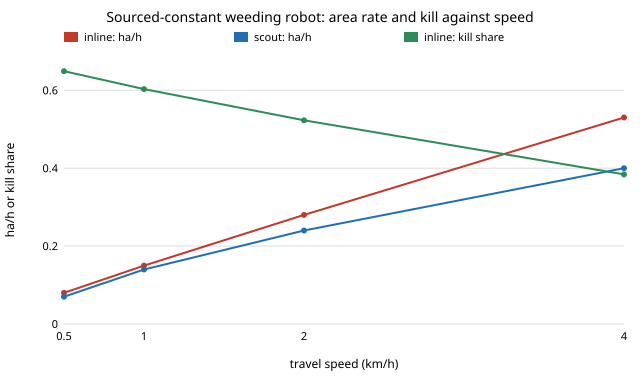

# Does "treat weeds as you drive" still beat "scout first, then treat" when the weeding robot uses published laser-weeder numbers? `osrobot-fieldreal`

Follow-up to `osrobot-field` and `osrobot-fieldtour` (track 9, open-source purpose-built robots), in the direction of the ARPG, RECUV and Autonomous Systems IRT interest in field robots. Produced with AI assistance (Claude). Pure Python standard library. **Why this project:** `osrobot-field` ran on round numbers the author chose. This one replaces the three that a laser weeder's literature actually gives (swath, time per weed, kill rate) and sweeps the ones nothing gives, to see whether the earlier conclusion survives. **Inputs that are still assumed and not from a source:** detector hit rate (0.7) and motion-blur law, false-positive rate, mud share, energy per metre, beam-steering speed, 4 s turns. No robot was built or driven; simulation only.

**Live page:** https://duncan-haywood.github.io/monorepo-projects/research/osrobot-fieldreal/



All numbers are from `experiments/results.txt` (60 × 30 m field, 20 seeds per row, fields and random draws shared across rows).

## Results
- **Treating inline still beats scout-then-treat, with the same kill share.** At 0.3 weeds/m² and 1 km/h inline takes 71.7 min against 79.3 for scout, 180 Wh against 216, kill 0.603 for both. The gap widens with density: at 3 weeds/m² scout takes 133.4 min against 110.8 (+20%) and 1,152 Wh against 1,031. Scout never wins in any row. The earlier finding survives the change of constants.
- **The sourced constants halve the time, not the ranking.** With the old constants (1 m swath, 3 s per target, 0.5 m/s tool, 95% kill) the same field at 1 km/h took 151.1 min (inline) and 156.6 (scout); with the sourced ones 71.7 and 79.3. Area rate goes from 0.07 to 0.15 ha/h for inline.
- **Speed trades kill for area rate, and the kill share is low.** Inline at 0.5, 1, 2 and 4 km/h: kill 0.649, 0.603, 0.523, 0.384; area rate 0.08, 0.15, 0.28, 0.53 ha/h. A single pass finds only about 60% of weeds at 1 km/h because the assumed detector (hit rate 0.7, falling with speed) misses the rest; the model has no second pass. Kill follows the assumed detector, not the laser.
- **Sensor hit rate sets kill almost one for one; the planner choice barely moves it.** At 1 weed/m², inline kill 0.429, 0.607, 0.781, 0.865 for hit rates 0.5, 0.7, 0.9, 1.0 (time 78.7 to 88.9 min). Scout's disadvantage stays 12 to 19% in time across all four.
- **Density costs time almost linearly in treatments.** Inline at 0.3, 1, 3 and 10 weeds/m²: 71.7, 82.8, 110.8 and 210.6 min (kill about 0.60 throughout). Scout was not run at 10 per m² (its nearest-neighbour tour over about 17,000 targets is quadratic and too slow here).
- **Beam-steering speed matters only if it is slow.** At 3 weeds/m² a 0.5 m/s tool takes 157.2 min; 1, 5 and 50 m/s take 131.4, 110.8 and 106.2. Fast galvo steering is worth about 30% over a slow gantry, and nothing beyond a few m/s.

## Params (source column)
| Input | Value | Source |
|---|---|---|
| Time per weed | 0.73 s | [1] 90 W, 810 nm laser, dynamic conditions |
| Kill probability | 0.992 | [1] 99.2% success |
| Swath | 2 m | [3] autonomous laser weeding robot, 2 m working width |
| Travel speed | 0.5 to 4 km/h swept (1 km/h default) | [2] commercial 0.5 to 2 km/h; [3] about 2 km/h |
| Weed density | 0.3 to 10 per m² swept | no general figure found; [4] reports a severe carrot case of 40 to 50 per ft² (about 430 to 540 per m²) which is far above this range |
| Hit rate, blur, false positives, mud, energy, steering | assumed | none found; swept where it matters (sweeps 4 and 5) |

Sources, from search-result summaries that were not opened in full, so check them before citing:
1. Frontiers in Plant Science (2024), review of laser weeding, doi 10.3389/fpls.2024.1469098, <https://www.frontiersin.org/journals/plant-science/articles/10.3389/fpls.2024.1469098/full>
2. Future Farming, commercial LaserWeeder, <https://futurefarming.com/crop-solutions/weed-pest-control/dutch-grower-this-is-the-machine-that-gives-us-excellent-results/>
3. Environmental performance of an autonomous laser weeding robot (life-cycle assessment), <https://www.springerprofessional.de/environmental-performance-of-an-autonomous-laser-weeding-robot-a/26957880>
4. Farmtario, "Slow burn weed control at 0.2 kilometres per hour", <https://farmtario.com/crops/slow-burn-weed-control-at-0-2-kilometres-per-hour/> (a single grower's account)

## Reproduce
```bash
cd research/osrobot-fieldreal
PYTHONPATH=src python3 -m unittest discover -s tests -v   # 6 tests
PYTHONPATH=src python3 experiments/run.py > experiments/results.txt   # a few minutes
python3 experiments/figure.py                             # experiments/speed_vs_rate.svg
```

## Method
`src/osrobot_fieldreal/model.py` is `osrobot-field`'s model, copied so the project stays self-contained, with SWATH, TREAT_S and TREAT_OK changed to the sourced values and GANTRY_V set to a fast beam (5 m/s). Clustered weeds, lane-by-lane coverage, a noisy detector whose hit rate falls as `exp(-v/2 m/s)`, mud blocks, and two planners (inline stop-and-treat, and scout then nearest-neighbour tour at 1.5 m/s). Area rate is field area over total time. Tests check the constants, lane coverage, reproducibility, that a run at 2 km/h stays under the sourced 0.40 ha/h ceiling (2 km/h × 2 m), and that more weeds take more time.

## Limitations
- Kill is capped by the assumed detector in a single pass; a real robot would see weeds again or use a better camera. The headline ranking (inline over scout) is the part that is robust across the swept inputs; the absolute minutes are not predictions for any product.
- The laser is modelled as a stop of 0.73 s, not as treating on the move, which commercial machines do; that biases both planners against moving fast and the ranking could change for a robot that never stops.
- The cited figures were read from search summaries, and a laser's per-weed time depends on weed size and power. No density source was found.

## Next steps
Let the inline robot make a second pass over missed weeds; treat on the move (no stop) and see whether scouting can win then; find a sourced weed-count distribution (agronomy surveys) for the density axis.

## Owner steps
None taken. Building or flying a laser weeder involves laser safety (IEC 60825-1 classes and eyewear) and a risk assessment before any hardware test.

## Outside dependencies
Python 3 standard library only.
