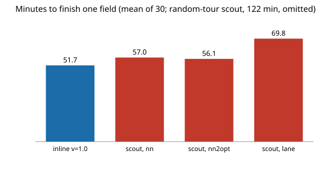

# Does a better tour rescue scout-then-treat weeding? Not in this model: 2-opt shortens the tour 13% and scouting still loses to treating inline

Follow-up to `osrobot-field` (track 9, open-source purpose-built robots), taking the first doubt its Limitations section left open: that "scouting never wins" might be an artefact of using nearest neighbour for the second stage. In the direction of the ARPG, RECUV and Autonomous Systems IRT interest in field-robot simulation; nothing here is affiliated with or endorsed by them. Produced with AI assistance (Claude). Pure Python standard library. **Every constant is an assumed round number (marked ASSUMED in `src/osrobot_fieldtour/model.py`, copied unchanged from `osrobot-field`), not a measurement of any robot, camera or crop, and no robot was built or driven.** All numbers are from `experiments/results.txt` (30 simulated fields per row; fields and random draws are shared across rows). Simulation only; a stylised, preliminary study.

**Live page:** https://duncan-haywood.github.io/monorepo-projects/research/osrobot-fieldtour/



- **2-opt shortens the tour but not by enough.** Over the same detections (about 232 targets per field), the mean straight-line tour is 5,403 m in random order, 539 m by nearest neighbour and 468 m after 2-opt (13% shorter). Finishing a field takes 57.0 min with nearest neighbour and 56.1 min with 2-opt, against 51.7 min for treating inline (reference setting, scout speed 1 m/s, tour speed 1.5 m/s). Energy: 220, 216 and 189 Wh.
- **The gap to inline survives at every weed density tried (0.05 to 1.2 per m²).** At 2-opt, scout is slower by 2.5, 3.5, 4.4, 5.0 and 5.0 min at densities 0.05, 0.15, 0.3, 0.6 and 1.2 (rows of sweep 2). The kill share is the same within 0.013 at every density (0.399 to 0.412); this study does not claim a kill difference.
- **A faster tour closes most of the gap, not all.** With 2-opt and the tour at 3 m/s the time is 53.0 min against 51.7 inline (sweep 3); slower tours widen it (59.2 min at 1 m/s). A tour speed above the scouting speed is a design choice this model does not price (it ignores braking, mud-bound wheels and the fact that 3 m/s is faster than the 2 m/s assumed in the detection blur law for looking, not driving).
- **A bad plan is expensive.** Visiting detections in random order takes 121.7 min; a simple lane-order sweep over the detected points takes 69.8 min. The lane sweep is the weakest sensible rule here because it ignores clustering. Weeds are clustered, so a tour that follows the clusters beats one that follows the lanes.
- **Why scouting still loses.** The robot covers every lane once in both plans, and then scouting drives again to the targets. The tour is the extra cost, and even a near-optimal tour of clustered targets costs on the order of 470 m, about 5 min at 1.5 m/s, plus the same 232 treatments. Only a different cost structure (a second platform, a faster scouting pass, a treatment tool that cannot work on the move) would change that, and none is modelled.

## Reproduce
```bash
cd research/osrobot-fieldtour
PYTHONPATH=src python3 -m unittest discover -s tests -v   # 6 tests, under a second
PYTHONPATH=src python3 experiments/run.py > experiments/results.txt   # about 2 min
python3 experiments/figure.py                             # experiments/minutes.svg, parsed from results.txt
```

## Motivation
`osrobot-field` found that scouting every lane and then visiting detections by nearest neighbour never beat treating detections where they are seen, and listed "a proper tour" as untested. Nearest neighbour is known to be a weak travelling-salesman heuristic (Johnson and McGeoch (1997) report it well above the best tours on random instances), so the result might have been the tour's fault. This project replaces the tour and asks whether the conclusion survives.

## Builds on
`osrobot-field` (this repository): the field, detector, mud, lane and energy model is copied from it unchanged, and only the visiting order is new. 2-opt is the segment-reversal local search of Croes (1958), "A method for solving traveling-salesman problems", *Operations Research* 6(6), here on an open path from the robot's position. Johnson and McGeoch (1997), "The traveling salesman problem: a case study in local optimization", in *Local Search in Combinatorial Optimization* (Aarts and Lenstra, eds.), is the survey for how heuristics compare. The field-robot interest of ARPG (<https://arpg.colorado.edu/>), RECUV (<https://www.colorado.edu/recuv/>) and the Autonomous Systems IRT (<https://www.colorado.edu/irt/autonomous-systems/>) is the direction; no paper from them is reproduced.

## Method
`src/osrobot_fieldtour/model.py`. `run_scout(tour=...)` takes the merged detections (real weeds seen once plus false positives) and orders them with one of: `random` (a floor), `nn` (nearest neighbour, as in `osrobot-field`), `nn2opt` (nearest neighbour then 2-opt until no segment reversal shortens the straight-line path, at most 50 passes), or `lane` (sort by one-metre row, alternating direction, the path inline would take through the same points). Tours are planned on straight-line distance and ignore mud; the robot then drives them through the mud model, so the planner is mud-blind. The start is wherever the scouting pass ended.

## Limitations
- Stylised and uncalibrated, as in `osrobot-field`; absolute minutes are artefacts of the constants. A 2-opt of 232 points is not an optimal tour: Or-opt, Lin-Kernighan or an exact solver would shorten it further (by a few percent, in the usual random-instance literature, not measured here), so "scouting loses" is shown for nearest neighbour and 2-opt only.
- The tour ignores mud, which doubles travel time on 20% of squares. A mud-aware planner might gain a little; not tested.
- The `lane` rule bins by one-metre row, not by the robot's own lane centres, and is a crude proxy for inline's path.
- Single reference scouting speed (1 m/s) for sweeps 1 and 2. The kill-share differences are within noise; only the time and energy gaps are claimed.
- Safety, regulations and hardware are out of scope.

## Next steps
Let the scout stage be a second, faster platform; price a mud-aware tour; use `terrain-twin`'s correlated friction.

## Owner steps
None taken. Building a rover or running any outdoor test is the owner's step.

## Outside dependencies
None: Python 3 standard library only. A real system would need a camera, detector, drive base and treatment tool that this project could not make or run.

MIT.
