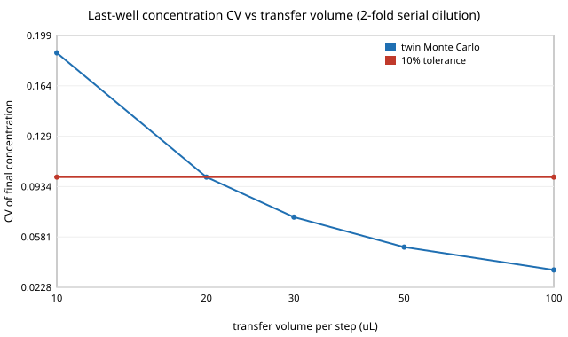

# Can a small twin of a liquid-handling bench catch protocol errors before they run, and how much pipetting error does a serial dilution tolerate?

Third milestone (`osrobot-lab`) of track 9, open-source purpose-built robots, in the direction of the HIRO Group's robots in chemistry labs. Produced with AI assistance (Claude). Pure Python standard library. **Every deck dimension, labware height, speed, timing and pipetting-error value is an assumption in `model.py` (marked ASSUMED), not a measurement of any product, and nothing here uses or reimplements the Opentrons Python API or claims any hardware is open.** All numbers below are from `experiments/results.txt`. Simulation only; **a small, preliminary result, and the fault-injection part is a test of the checker against faults it was written for, not evidence about real protocol failures.**



- **The state model catches what a syntax check cannot.** On 522 mutants of three reference protocols (11 fault kinds, every eligible site mutated once), the structural baseline (labware and wells exist, volumes positive) flags 100, all of them the two fault kinds it can see (typos, off-plate wells). The twin flags 366, and 355 with the code the fault was written to trigger. The three clean protocols raise no finding from either.
- **The misses are mostly equivalent mutants, not bugs found.** 11 of 50 "overdraw" mutants aspirate 5000 µL from a 15 mL reservoir that holds it (the twin correctly raises only VOL_RANGE). 25 of 32 "skip a tip change" mutants swap tips between wells that the model labels as the same liquid (the dilution series and the master mix), so no contamination is modelled; all 7 between distinct samples are flagged. 131 of 135 low-travel mutants cross no taller labware.
- **Collisions are geometry, not a flag.** In the master-mix protocol the tip pick-ups that return from the plate (slot 3) to the tip rack (slot 1) pass over a tube rack (85 mm) in slot 2. With the travel height forced to any value up to 70 mm, 4 moves collide; at 90 mm and above, none do. In the other two protocols every move is between adjacent slots, so no travel height collides.
- **Pipetting error, not the protocol, limits a serial dilution.** With an assumed per-transfer error CV of 1% + 0.8/v (v in µL), the final well of a 12-well two-fold dilution has a Monte Carlo CV of 0.187 at 10 µL transfers (also flagged out of the 20 to 300 µL pipette range), 0.100 at 20 µL, 0.072 at 30, 0.051 at 50 and 0.035 at 100 µL. The mean stays at 0.997 to 1.000 of nominal. With a 10% CV tolerance the 20 µL protocol passes on the boundary; the verdict at 20 µL depends entirely on the assumed error curve.
- **Time and tips from the twin** (assumed constants): the 22-tip serial dilution takes 5.3 min, the 8-tip plate copy 1.9 min and the 5-tip master mix 2.3 min.

## Reproduce
```bash
cd research/osrobot-lab
PYTHONPATH=src python3 -m unittest discover -s tests -v   # 10 tests, under a second
PYTHONPATH=src python3 experiments/run.py                 # about a minute; writes experiments/results.txt
python3 experiments/figure.py                             # experiments/dilution_cv.svg, parsed from results.txt
```

## Motivation
A liquid-handling robot runs a protocol for minutes to hours on reagents that may be scarce. A twin that fails fast on a wrong well, a missing tip, an overdrawn tube or a path through a tall rack saves a run. The same twin can also say how much the pipetting itself will blur a quantity the protocol is supposed to deliver. This is the smallest version of both.

## Builds on
The chemistry-lab direction of the HIRO Group (<https://hiro-group.ronc.one/>) and the self-driving-lab setting of Burger et al. (2020), "A mobile robotic chemist", *Nature* 583, 237–241, <https://doi.org/10.1038/s41586-020-2442-2>. It reads like the Opentrons protocol model (deck slots, tip racks, a single-channel pipette) but is independent of it; Opentrons' software was not run or copied, and the project claims no affiliation with, or endorsement by, any lab or company. The fault-injection method is mutation testing (DeMillo, Lipton and Sayward 1978, "Hints on test data selection: help for the practicing programmer", *Computer* 11(4), 34–41). Companion to `research/workcell-twin`, which models station counts and makespan; this one checks command-level correctness.

## Method
`src/osrobot_lab/model.py`. A deck of 3 × 4 slots with a tip rack, 96-well plates, a 12-well reservoir and a tube rack (ASSUMED heights 64, 14.5, 44 and 85 mm). A protocol is a list of `pick_up_tip`, `aspirate`, `dispense` and `drop_tip` commands. `check` runs it on nominal volumes, tracking tip state, each well's volume, concentration and liquid label, and each tip's contents. It reports: unknown labware or well, no tip, tip already attached, tip already used, tip left at the end, volume outside 20 to 300 µL, aspirating more than a well holds, tip overfill, well overflow, contamination (a tip carrying one liquid label aspirating another), and collisions (a straight horizontal move at the tip height, 10 mm above the tallest labware by default or the command's `travel_z`, that passes over labware taller than that outside the source and target labware). It estimates time from assumed gantry speed, flow rate and tip handling. With a random generator it adds the assumed pipetting error to each aspirate and dispense and returns the resulting concentrations; findings always come from nominal volumes. `structural` is the baseline. `protocols.py` builds a 12-well serial dilution, an 8-sample plate copy with a fresh tip each and a master-mix distribution with template additions. `experiments/run.py` mutates each protocol at every eligible site (11 fault kinds) and runs 4,000 Monte Carlo dilutions per transfer volume.

## Limitations
- Circular by construction: the faults were chosen by the same author as the checks, so 355 of 522 says the implementation does what it was written to do, not that these are the faults real protocols have. A fair test needs real protocol failures.
- Same-liquid tip reuse is treated as safe, so carry-over contamination inside a dilution series is not modelled. A well's liquid label never changes on mixing.
- Collisions use only tip height against labware tops in a straight line; the pipette body, labware outside the slots, tip length changes, and moves within the source or target labware are not modelled. Heights and slot sizes are approximate.
- The error curve CV = 1% + 0.8/v is a placeholder with no bias, no viscosity or evaporation, and independent errors. Mixing is perfect. The 20 µL "PASS" is a boundary case (CV 0.100).
- No scheduling across several robots, and no deadlines or incubation steps; time is a sum of assumed constants.
- Stylised, preliminary, simulated only. No result is a claim about a physical device.

## Next steps
Run the same checks through the real Opentrons simulator (its Python package, Apache-2.0) and compare findings; replace the error curve with published or measured calibration data; add multi-channel pipettes and mixing; extend the model to the track 3 workcell via `workcell-twin`.

## Owner steps
None needed (simulation only). A physical run would need the owner's own bench, a risk assessment for the reagents, and measured pipetting data.

## Outside dependencies (vitamins)
None: Python standard library only (pytest not required). Deck geometry, labware, timing and error constants are assumptions that a real bench would replace.
