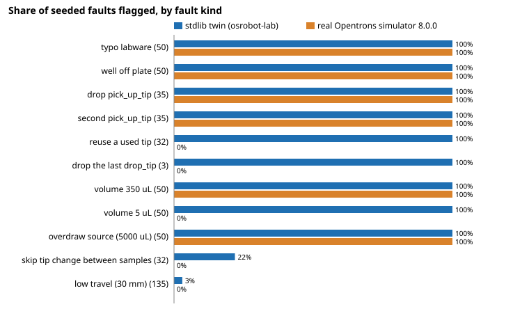

# Does the real Opentrons simulator catch the protocol faults a small stdlib liquid-handling twin catches? 270 of 522 seeded faults, against the twin's 366

Follow-up to `osrobot-lab` (track 9, open-source purpose-built robots), in the direction of the HIRO Group's robots in chemistry labs. It takes that project's first listed next step: run the same checks through the real Opentrons simulator and compare. Produced with AI assistance (Claude). Python standard library plus, for the real-simulator half only, `opentrons==8.0.0` (Apache-2.0). **Stylised and preliminary:** the 522 faults were written for the twin by the same author, so the comparison is on a fault set that favours the twin; nothing here is a claim about a physical robot.

**Live page:** https://duncan-haywood.github.io/monorepo-projects/research/osrobot-labreal/



## Result
Every one of the 522 mutants from `osrobot-lab` (three reference protocols, 11 fault kinds, each eligible site mutated once) was translated into an Opentrons Python API v2 script and simulated for an OT-2 with a `p300_single_gen2` pipette. The three clean protocols simulate without error in both tools.

| | mutants | twin flags | real simulator raises |
|---|---:|---:|---:|
| all faults | 522 | 366 | 270 |

- **Everything the real simulator raised, the twin also flagged** (270 of 270; none "real only"), and 96 more the twin flagged that the simulator accepted. That one-way containment is partly circular: the fault kinds were chosen alongside the twin.
- **Where they agree (270):** a mistyped labware name or a well off the plate (100, a `KeyError` at that script line), a missing or doubled `pick_up_tip` (70, `TipNotAttachedError` and `TipAttachedError`), and an aspirate of 350 µL or 5000 µL (100, `InvalidAspirateVolumeError`, which is a 300 µL tip-capacity limit, not a source-volume check).
- **What the real simulator accepts that the twin flags (96):** picking up a tip that was already used (32), ending with a tip still attached (3), a 5 µL dispense after a larger aspirate (50), swapping tips between different samples (7 of the 32 tip-skip mutants) and low-travel moves over a tall rack (4). Most of these are *policy* or out-of-vocabulary differences rather than simulator misses: the Python API lets a script name any tip well, does not require a tip off at the end, does not enforce the pipette's minimum volume, and has no travel-height or sample-identity concept; the twin was written to be stricter. A 5 µL dispense after a larger aspirate, or a reused tip, can still make the protocol do the wrong thing without the real simulator saying so.
- **Declaring the liquids changed nothing.** With each starting liquid declared through `load_liquid`, the verdict was identical on all 522 mutants. In a separate probe (200 µL aspirated twice from a well declared to hold 300 µL), the twin flags `SOURCE_EMPTY` and `DISPENSE_EXCESS`; the real simulator at API level 2.19 raises nothing, with or without declared liquids. In this version `load_liquid` is a label, not a volume check.
- **Neither tool sees 156 mutants** (25 same-liquid tip skips and 131 low-travel moves that cross nothing taller), the same equivalent mutants `osrobot-lab` listed; its README argues that most are not bugs.

**Reading it fairly.** The real simulator is a strong check on *scripting* mistakes (names, wells, tip state, capacity) and a weak one on *laboratory* mistakes (reused tips, carry-over, short-dispensing, source volume). A twin like `osrobot-lab` adds checks in that second group, but each one is a policy the protocol author must agree with, and this experiment cannot say whether real labs would. The honest conclusion is "the two catch different things", not "the twin is better".

## Reproduce
```bash
cd research/osrobot-labreal
python3.11 -m venv .venv && .venv/bin/pip install "opentrons==8.0.0" -e .     # Python 3.10 or 3.11 needed
PYTHONPATH=src:../osrobot-lab/src .venv/bin/python experiments/run.py          # about 30 s; writes results.txt and per_fault.tsv
python3 experiments/figure.py                                                   # detection.svg
PYTHONPATH=src:../osrobot-lab/src python3 -m unittest discover -s tests -v     # 5 tests with the stdlib, 7 with opentrons installed
```
`opentrons` 10.1.0 (the current release when this was run) refuses OT-2 protocols in `opentrons.simulate` ("designed for an OT-2 robot"), and its pydantic dependency fails on Python 3.11, so version 8.0.0 is pinned. A Flex version would need a different pipette (1000 µL, minimum 5 µL) and would change the volume results.

## Method
`src/osrobot_labreal/translate.py` turns an `osrobot-lab` deck, starting liquids and command list into the script a person would write: `load_labware` for each piece of labware (96-tip rack, 96-well flat plate, 12-well reservoir, 24-tube rack), a `p300_single_gen2` on the right mount with the tip rack, and one `pick_up_tip`, `aspirate`, `dispense` or `drop_tip` call per command, with labware looked up by name in a dict so a typo is a `KeyError`. `src/osrobot_labreal/sim.py` runs it through `opentrons.simulate.simulate` and returns the first error, whose exception class is recorded. Mutants are generated by `osrobot-lab`'s own `faults()`, imported unchanged, and the twin's verdict is its own `check()`. 780 distinct scripts were simulated (the 135 low-travel mutants change only a travel height that has no Python-API equivalent, so they translate to the clean script).

## Limitations
- Circular fault set: the faults were chosen by the same author as the twin. A fair comparison needs failures from real protocols, which this repository does not have.
- Labware definitions differ from the twin's assumed geometry (the plate holds 360 µL, not the twin's 200 µL), and the twin's collision, timing and error models have no counterpart in the simulator's error output, so they are compared only on whether anything is flagged.
- The simulator stops at the first error; the twin reports all of them. "Flags" therefore compares detection, not the number or correctness of messages.
- One pipette, one robot type, one package version (8.0.0), API level 2.19. Later versions may track liquid volume or tip use differently.
- Mutants that are equivalent (no real bug) count against both tools equally. Stylised, preliminary, simulated only.

## Next steps
Test the twin on failed protocols from a public repository of Opentrons protocols rather than seeded ones; check whether API level 2.20 or later liquid tracking catches the source-volume probe; add the Flex path; feed the twin's stricter checks (tip reuse, minimum volume) back as an optional linter for Python API scripts.

## Owner steps
None. Simulation only; no hardware, purchases or accounts.

## Outside dependencies
`opentrons==8.0.0` (Apache-2.0), installed with pip, used as an unmodified library in `src/osrobot_labreal/sim.py`. It is the only dependency, and the stdlib half runs without it. This project claims no affiliation with, or endorsement by, Opentrons, and it makes no claim that Opentrons hardware is open (the software is Apache-2.0; the OT-2's hardware is only partly published). The twin and the 522 mutants come from `osrobot-lab`; `HIRO Group`: <https://hiro-group.ronc.one/>.

MIT.
