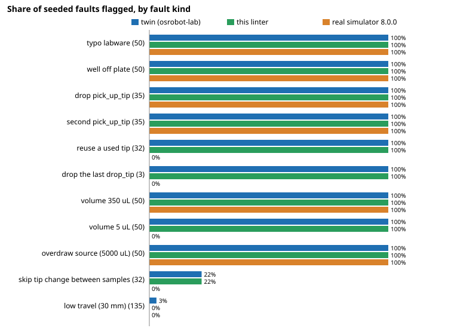

# Can a stdlib static linter catch the lab-protocol faults the Opentrons simulator accepts? It flags 362 of 522 seeded faults to the simulator's 270

Follow-up to `osrobot-labreal` (track 9, open-source purpose-built robots), taking the last item of its "Next steps": feed the twin's stricter checks back as an optional linter for Opentrons Python API scripts. In the direction of the HIRO Group's interest in robots in chemistry labs; nothing here is affiliated with or endorsed by it or by Opentrons. Produced with AI assistance (Claude). Pure Python standard library; it never imports `opentrons` and never runs the script. **Stylised: the seeded faults were written by the same author as the checks, and every volume, capacity and pipette limit in `lint.py` is an assumed value from memory of the published specifications, not checked against a datasheet.**

**Live page:** https://duncan-haywood.github.io/oss-monorepo/research/osrobot-lint/



`python3 -m osrobot_lint protocol.py` reads a script, follows its liquid-handling calls on a small abstract machine (tip state, used tip wells, volumes declared with `load_liquid`, the liquid in the tip) and prints findings.

- **It flags 362 of the 522 seeded faults; the simulator raises on 270 and the twin flags 366.** The 92 faults the linter adds over the simulator are a reused tip (32 of 32), a tip left on at the end (3 of 3), a 5 µL dispense below the p300 gen2 minimum (50 of 50) and a tip carried between different liquids (7 of 7 where the twin sees a difference). It agrees with the twin on 518 of 522 mutants.
- **The only gap to the twin is travel height.** The 135 "low travel" mutants are invisible to a linter, because the Python API has no travel-height argument; 4 of them are real collisions in the twin's geometry. A static check of a script cannot see them.
- **Clean protocols stay clean.** None of the three reference protocols draws a finding, and a loop over columns or `tips.wells()[i]` is followed without a skip. Anything the linter cannot evaluate (`transfer()`, `mix()`, `while`, a call it does not know) becomes an INFO `SKIPPED` line, tip state is then treated as unknown and tip-presence findings stop for the rest of the script. It says less rather than guess.
- **Declared volumes matter.** `SOURCE_EMPTY` only fires for a well given a volume with `load_liquid`; without it there is nothing to check. Osrobot-labreal found that the simulator (API 2.19) ignores that volume, so the linter is the only one of the three that uses it.

## Reproduce
```bash
cd research/osrobot-lint
PYTHONPATH=src python3 -m unittest discover -s tests -v                                     # 13 tests, under a second
PYTHONPATH=src:../osrobot-lab/src:../osrobot-labreal/src python3 experiments/run.py          # writes results.txt and per_fault.tsv
python3 experiments/figure.py                                                                # detection.svg
PYTHONPATH=src python3 -m osrobot_lint my_protocol.py                                        # lint your own script
```
The simulator column is read from `../osrobot-labreal/experiments/per_fault.tsv` (Opentrons 8.0.0, API 2.19), not re-run.

## Method
`src/osrobot_lint/lint.py` parses the script with `ast`, finds `run(protocol)`, and executes statements abstractly: assignments of constants, `load_labware`, `load_instrument`, `define_liquid`, `well.load_liquid`, `for` loops over a literal list or `range(...)`, f-strings, `labware["A1"]`, `labware.wells()[i]`, and the instrument calls `pick_up_tip` (with or without a well), `drop_tip`, `aspirate` and `dispense`. Codes: `TIP_REUSED`, `TIP_LEFT`, `TIP_PRESENT`, `NO_TIP`, `NO_TIPS_LEFT`, `VOLUME_RANGE`, `TIP_OVERFILL`, `SOURCE_EMPTY`, `DISPENSE_EXCESS`, `CARRY_OVER`, `OVERFLOW`, `BAD_REFERENCE`. The experiment feeds it the scripts that `osrobot-labreal` generates from `osrobot-lab`'s mutants, unchanged.

## Limitations
- Circular fault set: the faults were chosen alongside the twin, and the linter's checks were copied from the twin. Agreement with the twin (518 of 522) is therefore close to guaranteed and says the port is faithful, not that the checks matter. No failed protocol from a real lab was used.
- The generated scripts are straight-line. Real scripts use helper functions, `transfer()`/`distribute()`, `mix()`, parameters and Flex APIs, which are skipped here; the tests cover only a handful of hand-written idiomatic fragments.
- Each added check is a policy (a reused tip is not an error to the API; a 5 µL dispense with the p300 might be tolerable). A lab may not agree with all of them.
- Stylised, preliminary, simulated only. No finding here is a claim about a real robot.

## Next steps
Run it on scripts from a public repository of Opentrons protocols and count findings and false positives by hand (needs the owner or a run with that network access); add `transfer()` and `mix()` semantics; add the Flex pipettes with checked limits; make `CARRY_OVER` aware of `new_tip="always"`.

## Outside dependencies
Python 3 standard library only. Builds on `osrobot-lab` and `osrobot-labreal` (this repository). Opentrons' Python API is Apache-2.0; no Opentrons code is used or vendored.

MIT.
