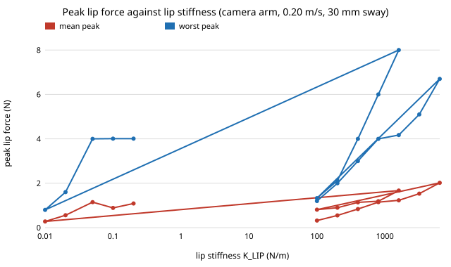

# Is the peak force of a feeding arm on the lips set by the lips' stiffness, the arm's force loop, or its approach lead?

Follow-up to `osrobot-assist` (track 9, open-source purpose-built robots), in the direction of the CAIRO Lab interest in assistive robotics. It tests the limitation that project named: its peak-force result "is nearly an identity of the chosen controller" and lip stiffness was never varied. Produced with AI assistance (Claude). Pure Python standard library. **Every constant is an assumed round number, not a measurement of any person or product, and the 2 N comfort limit is not a standard.**

**Live page:** https://duncan-haywood.github.io/monorepo-projects/research/osrobot-lipsweep/



Headline results (camera-tracked arm, 200 seeded trials per row, 30 mm sway; `experiments/results.txt`):

- **Lip stiffness matters a lot at 0.20 m/s.** Mean peak force rises from 0.32 N (100 N/m) to 1.15 N (800, the `osrobot-assist` value) to 2.02 N (6400); the worst trial from 1.2 N to 4.0 N to 6.7 N. Share of trials fed with peak at most 2 N: 1.00 at 100 and 200 N/m, 0.71 at 400 and 800, 0.70 above.
- **The controller's stall push is a ceiling for soft and medium lips, not for stiff ones.** The worst peak equals `KP × LEAD × speed` (4.0 N) at 800 N/m but exceeds it at 1600 N/m and above (4.17, 5.10, 6.70 N), so the impact at the lip plane adds to the push there.
- **A longer lead does not raise the worst peak without bound.** At LEAD 0.10 s and 0.20 s the stall push would be 8 and 16 N, but the worst observed peak stays 4.01 N. A plausible reason, not tested here, is that sway brings the mouth over the tip before the force builds to the stall value.
- **Loop stiffness trades touches against force.** From KP 100 to 800 N/m the share of trials touching the lips falls from 0.62 to 0.21 while the mean peak rises from 0.81 to 1.19 N. The safe share is not monotone (1.00, 0.60, 0.71, 0.80, 0.77); the 0.60 at KP 200 is left unexplained.
- **At 0.05 m/s every lip stiffness stays under the 2 N limit** (worst peak 0.82 to 1.72 N for 100 to 6400 N/m; safe share 1.00 throughout).

So the earlier statement that force is set by the controller needs a qualifier: it holds for the lip stiffness assumed there, and a stiffer or softer mouth moves the peak by a factor of several at speed.

## Reproduce
```bash
cd research/osrobot-lipsweep
PYTHONPATH=src python3 -m unittest discover -s tests -v   # 5 tests
PYTHONPATH=src python3 experiments/run.py                 # about 3 s; writes experiments/results.txt
python3 experiments/figure.py                             # experiments/lip_stiffness.svg, parsed from results.txt
```

## Method
`src/osrobot_lipsweep/model.py` is an unchanged copy of the `osrobot-assist` model (planar point-mass spoon, PD loop, Hunt-Crossley lip wall, swaying mouth). `experiments/run.py` overrides the module constants `K_LIP`, `KP` and `LEAD` per row. In the KP sweep `KD = 2.56 √(KP·M)` keeps the base damping ratio. Seeds 0 to 199 are the same in every row, so rows are paired.

## Limitations
- Same as `osrobot-assist`: a planar point mass, a passive user, no spoon geometry, no lateral edge contact, one assumed comfort threshold. Real lip stiffness is not measured here and is not claimed to span 100 to 6400 N/m.
- One sway amplitude and two approach speeds; the non-monotone KP row is a single configuration with no repeated seed sets to say whether it is noise.
- Counts are shares of 200 trials; no confidence intervals were computed, so differences of a few hundredths should not be read as real.

## Next steps
Add user anticipation (the mouth moving toward the spoon), run in MuJoCo or Assistive Gym, and compare a 2-DOF purpose-built arm with a 6-DOF arm with bills of materials.

## Owner steps
None taken. Building a feeding arm and testing it with people need a risk assessment, consent and the relevant standards.

## Outside dependencies
Python 3 standard library only.
