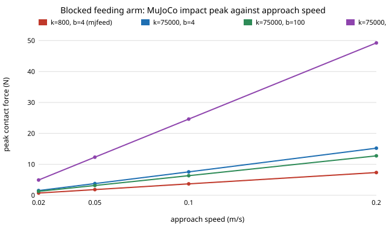

# Does the MuJoCo feeding-arm result change when the lips have the ISO/TS 15066 face stiffness and the safe force comes from the standard? `osrobot-mjface`

Follow-up to `osrobot-mjfeed` (track 9, open-source purpose-built robots), run under the "run the numbers" rule: `osrobot-mjfeed` used an assumed lip stiffness (800 N/m) and an assumed 2 N "comfort" limit. This project replaces both with a cited figure where one exists and sweeps the rest. In the direction of the CAIRO Lab interest in assistive robotics; nothing here is affiliated with or endorsed by it. Produced with AI assistance (Claude). Needs `pip install mujoco` (3.16.0 used). Simulation only; no robot was built or tested with anyone, and **this is not a safety case** (ISO 13482 and an owner risk assessment come first).

**Live page:** https://duncan-haywood.github.io/monorepo-projects/research/osrobot-mjface/



## Headline results (all from `experiments/results.txt`)
- **A 94-fold stiffer lip raises the impact peak about 2 ×, not 94 ×.** Blocked arm at 0.10 m/s: peak 3.68 N at 800 N/m (b = 4 N·s/m) against 7.56 N at 75,000 N/m; at 0.20 m/s, 7.35 N against 15.21 N. The steady push (2.0 N at 0.10 m/s) does not change, as the controller identity `KP × LEAD × speed` says.
- **Against the standard's face limits the design is nowhere near unsafe in this model; against the old 2 N it was.** Camera arm, 30 mm sway, 200 seeds, share fed with peak contact at most the limit: at 2 N it falls from 0.45 (k = 800) to 0.32 (k = 75,000) at 0.10 m/s; at 65 N and at 130 N it is 1.00 in every row. Worst case in the sweep: peak 53.3 N (0.20 m/s, 30 mm sway, b = 1000 N·s/m), 82 % of 65 N. Mean peaks are 2.9 to 8.0 N at b = 4 to 100 and 6.3 to 23.2 N at b = 1000.
- **So the 2 N number, not the physics, drove `osrobot-mjfeed`'s "unsafe" reading.** With the contact stiffness the standard lists the peaks roughly double, but the limits in the same document are 30 to 65 × higher than the 2 N that was assumed. Contact damping is the input that still moves the answer (blocked-arm peak 12.74 N to 49.25 N from b = 100 to b = 1000 at 0.20 m/s) and nothing found gives a value for a face; it is swept, not chosen.

## Where the numbers come from
| Input | Value | Source |
|---|---|---|
| Face effective spring constant | 75 N/mm = 75,000 N/m | ISO/TS 15066:2016 Table A.3, as reproduced in secondary sources (see below); original text not read |
| Face maximum permissible force | 65 N and 130 N | Same standard, Table A.2; **secondary sources disagree on which is quasi-static and which transient**, so both are used as limits |
| Contact damping b | 4, 100, 300, 1000 N·s/m | **Not sourced.** Swept; 300 N·s/m is the critical value for the 0.30 kg tip at 75,000 N/m |
| Tip mass, gains, speeds, sway, mouth size | as `osrobot-mjfeed` | Still assumed there; unchanged here to keep the comparison paired |

I could not open ISO/TS 15066 itself (paywalled; the egress proxy blocks the arXiv PDFs). The values above come from search-result excerpts of: a paper on variable-impedance control based on the standard ([arXiv:2311.13814](https://arxiv.org/abs/2311.13814), reproducing its body-model table with face 65 N and 75 N/mm and skull/forehead 130 N and 150 N/mm), [arXiv:2203.02706](https://arxiv.org/abs/2203.02706) on how interpretations of the standard differ, and vendor explainers; one vendor page gave different numbers and was set aside. The standard's Annex A tables moved to an informative Annex M of ISO 10218-2:2025. **Check the face row against the standard before using any figure here.**

## Method
`experiments/run.py` imports the `osrobot-mjfeed` model unchanged and rebuilds the MuJoCo world with `build(k, b)`. Sweep 1 blocks the arm (blind arm, mouth 30 mm off aim) and records the impact peak over speed, stiffness and damping; sweep 2 runs the camera arm against a swaying mouth (30 mm), 200 seeds, at four speeds and four (k, b) pairs.

## Reproduce
```bash
pip install mujoco
cd research/osrobot-mjface
python3 -m unittest discover -s tests -v   # 4 tests, about a second
python3 experiments/run.py                 # about 90 s; writes experiments/results.txt
python3 experiments/figure.py              # experiments/peak_force.svg, parsed from results.txt
```

## Limitations
- The lips are a kinematic mocap body, so they sweep into the tip whatever the force; a real face yields, which this model cannot show. The peaks are an upper-end rigid-face case.
- The standard's spring constant describes tissue loaded by a standard contact area; applying it to a 4 mm sphere's contact stiffness is a modelling choice, not a measurement. TS 15066 also states limits for transient and quasi-static contact and pressure limits per area, and a 4 mm tip concentrates force: **the pressure limits were not applied** and may bind before the force limits do.
- Damping is unsourced; tip mass, gains and sway are `osrobot-mjfeed`'s assumptions.
- Assistive Gym and a human model were not used.

## Next steps
Convert peak force to contact pressure using the tip's contact area and compare with the standard's pressure limits; find a measured soft-tissue damping for the lips (the biomechanics literature on facial tissue); replace the kinematic lips with a compliant body.
