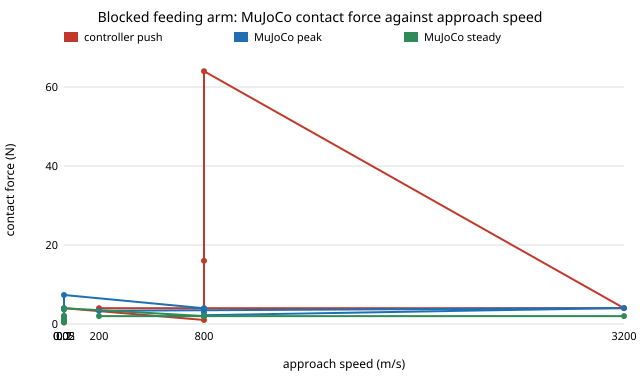

# Does the stylised feeding-arm lip-force result survive real contact physics? `osrobot-assist` re-run in MuJoCo

Follow-up to `osrobot-assist` (track 9, open-source purpose-built robots), taking the first "Next steps" item that chain left open: **run the same sweeps in MuJoCo.** In the direction of the CAIRO Lab interest in assistive robotics; nothing here is affiliated with or endorsed by it. Produced with AI assistance (Claude). Needs `pip install mujoco` (3.16.0 used). **Every constant (tip mass, gains, contact stiffness and damping, mouth size, sway, 2 N comfort limit) is an assumed round number, not a measurement, and no robot was built or tested with anyone.** All numbers are from `experiments/results.txt`. Simulation only; a stylised, preliminary study. **Assistive Gym and its human model were not used** (not installed): the lips are two rigid boxes moved along the prescribed sway, not a face.

**Live page:** https://duncan-haywood.github.io/oss-monorepo/research/osrobot-mjfeed/



- **The steady push matches the stylised result exactly; the peak does not.** With the arm blocked by the lips, MuJoCo's steady contact force equals the controller identity `KP × LEAD × speed` (0.40, 1.00, 2.00, 3.99 N at 0.02, 0.05, 0.10, 0.20 m/s). The peak, though, is 1.84 × that at every speed (0.73, 1.84, 3.68, 7.35 N): an impact transient at first touch that the stylised wall never produced. It falls with more contact damping (3.97 N at b = 1 N·s/m, 3.68 at 4, 2.96 at 16, 2.23 at 64, for a 2.00 N steady push) and is little changed by stiffness (3.33 at 200 N/m, 4.06 at 3200). So "force tracks speed" holds; "force equals `20 × speed`" understates what the lips feel by about 1.8 ×.
- **With a swaying mouth the stylised model's safety claim does not carry over.** Camera design, 30 mm sway, 200 paired seeds, share fed with peak force at most 2 N: at 0.05 m/s MuJoCo 0.88 against stylised 1.00; at 0.10 m/s **0.45 against 1.00**; at 0.20 m/s 0.64 against 0.71. Peak force reaches 11.7 N at 0.05 m/s and 22.9 N at 50 mm sway (the actuator limit is 20 N). The stylised twin's own worst case is 1.0 to 4.0 N.
- **Much of the extra force comes from the lips moving into the tip, which the stylised model leaves out.** Its README says later lateral edge contact is not modelled; here the sphere meets the box edges as the mouth sways onto it, and the force has a large axial part (mean peak along the approach axis 1.16 N against 1.26 N total at 0.05 m/s). The lips are kinematic (a mocap body that follows the sway whatever it pushes into), so this is the upper end of what a rigid, uncompliant face would do; a real face yields. Treat the 11 to 23 N peaks as "the geometry matters and the stylised number is optimistic", not as a prediction.
- **Touch share is higher too, partly by definition.** MuJoCo counts any contact (the 4 mm tip sphere meets the lip face 4 mm early and the box edges), the stylised model counts only the wall past the plane. At 0.05 m/s, 30 mm sway: camera 0.66 against 0.40; blind arm 0.86 against 0.72. The ordering (camera touches less than the blind arm; more sway touches more) is the same.
- **Latency still costs the camera its advantage, in the same order.** At 0.10 m/s and 30 mm sway the touch share rises 0.35 (no delay), 0.68 (0.10 s), 0.86 (0.40 s) in MuJoCo against 0.07, 0.47, 0.71 in the stylised model; the safe share falls 0.81, 0.45, 0.23.
- **Feeding time agrees within 4 %** in all rows but one (1.82 s against 1.77 s at 0.10 m/s; the blind arm at 50 mm sway is 12 % slower, 3.77 s against 3.36 s), so the approach dynamics are broadly the same; the difference is mostly in contact.

## Reproduce
```bash
pip install mujoco
cd research/osrobot-mjfeed
PYTHONPATH=src python3 -m unittest discover -s tests -v   # 6 tests, about a second
PYTHONPATH=src python3 experiments/run.py                 # about 35 s; writes experiments/results.txt
python3 experiments/figure.py                             # experiments/blocked_push.svg, parsed from results.txt
```
The paired comparison imports `research/osrobot-assist/src`, the stylised twin, unchanged.

## Motivation
A stylised twin is only worth the confidence it earns against a more detailed one. `osrobot-assist` found that lip force is set by the controller; whether that survives a physics engine decides if the feeding-arm design advice built on it (slow approach, force cap, camera) is sound.

## Builds on
The CAIRO Lab (<https://cairo-lab.com/>) interest in assistive robotics; no specific paper is reproduced. The controller, constants and sway are a copy of `osrobot-assist`. MuJoCo: Todorov, Erez and Tassa (2012), "MuJoCo: a physics engine for model-based control", IROS (Apache-2.0 software). Contact model: MuJoCo's soft constraint with `solref = (-k, -b)`, a direct stiffness and damping. Hunt and Crossley (1975) is the contact law of the stylised twin.

## Method
`src/osrobot_mjfeed/model.py`. A 0.30 kg sphere (4 mm radius) on two slide joints, driven by force motors with the `osrobot-assist` PD loop, carrot lead, camera latency, noise and rate. Two box lips on mocap bodies at x = 0 leave an opening of ±12 mm around the swaying mouth centre; contact stiffness 800 N/m and damping 4 N·s/m. Force is the sum of MuJoCo's contact normal forces (`mj_contactForce`), split into the part along the approach axis. A trial is fed when the tip centre passes x = 0 inside the opening. Steps of 2 ms, implicit integrator, no gravity, no friction.

## Limitations
- Planar, rigid kinematic lips, no tongue, teeth, head motion in response to contact, or friction; the user cannot yield, so peak forces are high-side. No Assistive Gym or human model.
- The contact damping (4 N·s/m) sets the impact peak and is assumed; sweep 2 shows the 1.84 × factor ranges from about 1.1 to 2.0 over b = 64 to 1.
- Touch counts differ by definition between the two models (see above), so compare orderings, not levels.
- The controller was designed for the stylised model and not retuned; a design that avoids the lateral squeeze (for example backing off when the sensed mouth moves) was not tried.
- Deterministic and seeded, but a single physics engine and version; no second engine cross-check.

## Next steps
Make the lips compliant (a mass-spring face) and see which of the stylised conclusions return; retune the controller to back off on lateral contact; the same trial in Assistive Gym with its human model once installable; repeat the force-cap and lip-stiffness sweeps in MuJoCo.

## Owner steps
None taken. Building a feeding arm and testing it with people need the owner's risk assessment, consent and the relevant standards (ISO 13482, personal-care robots).

## Outside dependencies
Python and `mujoco` (pip, Apache-2.0). Stiffness, damping, masses and the comfort limit are assumed; nothing was measured on a person or a product.
