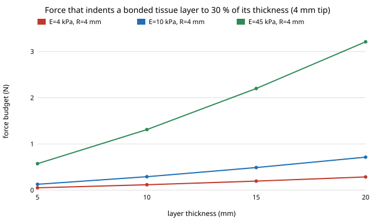

# How hard can a feeding-arm tip press on a lip before the tissue bottoms out? Bonded-layer force budget at 4 to 45 kPa, on `osrobot-mjmodulus`

Follow-up to `osrobot-mjmodulus` (track 9, open-source purpose-built robots), taking its "Next steps" item in part: put bone behind the tissue. That project showed the half-space Hertz model is out of range at published 4 to 45 kPa face moduli. Here the tissue is a layer of thickness h bonded to rigid bone, using published bottom-effect corrections, and the question is the **force budget**: the force at which the tip has indented 30 % of the layer. In the direction of the CAIRO Lab interest in assistive robotics; nothing here is affiliated with or endorsed by it. Produced with AI assistance (Claude). Stdlib Python only. Closed-form contact models, not a finite-element run; **not a safety case**.

**Live page:** https://duncan-haywood.github.io/monorepo-projects/research/osrobot-mjlayer/



## Headline results (all from `experiments/results.txt`)
- **The force budget is about 0.1 to 9 N, not 65 N.** Over 4 to 45 kPa, 5 to 20 mm of tissue and tip radii 4, 8 and 15 mm, the force that indents the layer by 30 % of its thickness runs from 0.05 N (4 kPa, 5 mm, 4 mm tip) to 9.4 N (45 kPa, 20 mm, 15 mm tip). For a 15 mm lip (the mean in the source below) and a 4 mm tip it is 0.2 N at 4 kPa, 0.5 N at 10 kPa and 2.2 N at 45 kPa.
- **The simulated trial forces (12.6, 20.2 and 53.3 N) are 1.3 to 1000 times that budget** in every cell of the sweep. In most cells the model's depth at those forces exceeds the layer thickness itself (for example 52.7 mm of indentation in a 15 mm lip at 10 kPa and 53.3 N), which means the tissue is fully compressed against bone and the formula is extrapolated past anything it describes. What happens at the bone, a much higher local pressure, is not computed here.
- **Two published corrections agree** to within about 40 % on the budget (largest gap at the biggest tip, 15 mm, thinnest layer, stiffest tissue: 2.2 N against 3.0 N), so the budget is a property of the geometry and not of one fit.
- **A larger tip helps by a factor of a few, not by orders of magnitude**: 4 to 15 mm raises the budget about 3 times. Together with `osrobot-mjmodulus` (Hertz is only valid for tips of 73 mm and up at 53 N), the design levers are a force limit of order newtons and a compliant pad, not a 65 N cap.
- This also says the `osrobot-mjpress` forces are not self-consistent with a soft face (its kinematic lips have stiffness 75,000 N/m): a real arm would meet the face at forces one to three orders of magnitude lower, which is what the next step should simulate.

## Where the numbers come from
| Input | Value | Source |
|---|---|---|
| Trial forces | 53.30, 20.20, 12.63 N | worst peaks from `osrobot-mjpress` via `osrobot-mjmodulus` (MuJoCo) |
| Moduli | 4, 10, 45 kPa | span of the in-vivo values tabulated in `osrobot-mjmodulus` (small studies, summaries only) |
| Layer thickness | 5, 10, 15, 20 mm | lip thickness means of 14.5 ± 2.7 mm (upper) and 16.3 ± 1.9 mm (lower) in a lateral-cephalometry study of young adults ([JIOM Nepal](https://jiomnepal.edu.np/index.php/jiomnepal/article/download/1349/1244/3578), seen only as a search summary; authors and year unchecked). It includes skin, muscle and mucosa, and the cheek is thinner, hence the sweep down to 5 mm |
| Bottom-effect polynomials | Dimitriadis (bonded, 4th coefficient sign as changed by Garcia) and Garcia (bonded) | Dal Fabbro et al., arXiv [2406.17157](https://arxiv.org/abs/2406.17157), Eqs. 9a and 12a, read from the PDF text; they cite Dimitriadis et al. (2002) and Garcia et al. (2018), which I did not read. Derived for ν = 0.5; χ = √(Rδ)/h |
| 30 % depth limit | δ ≤ 0.3 h | my choice as a small-strain limit; the budget scales roughly as that limit to the 3/2 power, so a 10 % limit would cut it about 5 times |
| Pressure limits | 20, 55, 110 N/cm² | still unconfirmed (see `osrobot-mjpress`); not used here |

## Method
`experiments/run.py` evaluates F = F_Hertz(δ) · (1 + c₁χ + c₂χ² + c₃χ³ + c₄χ⁴) with F_Hertz = 4E√R δ^(3/2) / (3(1−ν²)), inverts it by bisection for the depth at each trial force (Part 1) and evaluates it at δ = 0.3 h for the budget (Part 2). Tests check the thick-layer limit against Hertz, that the two models share their first-order term and agree at small χ, that thinner layers are stiffer, that the depth inverts the force, and that the 53.3 N trial force exceeds the budget by over 5 times in the 10 mm, 10 kPa case.

## Reproduce
```bash
cd research/osrobot-mjlayer
python3 -m unittest discover -s tests -v   # 6 tests
python3 experiments/run.py                 # instant; writes experiments/results.txt
python3 experiments/figure.py              # experiments/budget.svg
```

## Limitations
- A bonded, homogeneous, linear elastic layer on rigid bone. Real lips are layered, nonlinear, viscoelastic, have a cavity behind them (teeth, tongue), and the contact is not bonded to a flat substrate. The polynomials are fits for micro-scale indentation, applied here at tissue scale and past χ ≈ 1 for the deep cases; the budget (χ ≈ 0.3 to 0.6) is inside the range the source studies, the depth figures at trial forces are not.
- A 30 % depth limit is a judgement, and indentation depth is not a pressure or injury limit.
- Moduli and thicknesses come from small studies read as summaries; the thickness table is for the lip, not the cheek.
- No finite-element cross-check was run (no solver available in the container without numpy); the two published corrections are the only independent check.

## Next steps
Run the compliant-face simulation `osrobot-mjmodulus` asked for (MuJoCo soft contact or an FE patch with a bone backing) so the arm's force comes out of the same model, and re-run the feeding trials with a force cap near the budget. Read Annex A of ISO/TS 15066 for the pressure column.

## Owner steps
None; nothing was bought or built.

## Outside dependencies
Python 3 only. The original Dimitriadis and Garcia papers were not read; the face-thickness study was seen as a search summary.
