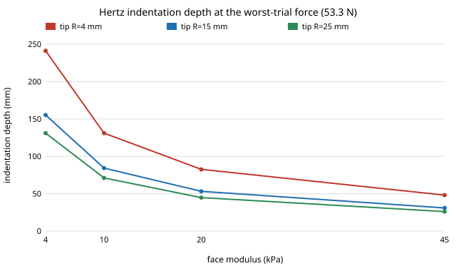

# Is the 4 mm feeding-arm tip's contact pressure computable at a measured face modulus? Hertz contact at 4 to 45 kPa, on `osrobot-mjpress`

Follow-up to `osrobot-mjpress` (track 9, open-source purpose-built robots), taking its "Next steps" item: **find a measured lip/skin elastic modulus to pin the Hertz row.** `osrobot-mjpress` swept an unsourced face modulus of 0.05 to 5 MPa and found the verdict flipped on it. This project replaces the sweep with published in-vivo values and asks whether the Hertz model it used is still valid there. In the direction of the CAIRO Lab interest in assistive robotics; nothing here is affiliated with or endorsed by it. Produced with AI assistance (Claude). Stdlib Python only. Simulation-derived forces plus a closed-form contact model; **not a safety case**.

**Live page:** https://duncan-haywood.github.io/oss-monorepo/research/osrobot-mjmodulus/



## Headline results (all from `experiments/results.txt`)
- **Every measured modulus is below the range `osrobot-mjpress` swept.** Published in-vivo values are 4 to 45 kPa (0.004 to 0.045 MPa); `osrobot-mjpress` swept 0.05 to 5 MPa. Its "flip" between pass and fail sat entirely in a stiffness range that no source here supports for facial soft tissue.
- **At those moduli the Hertz model that gave pressures is not valid for the 4 mm tip.** At the worst trial force (53.3 N) a 4 mm sphere on a 4 to 45 kPa half-space would have a contact radius of 14 to 31 mm (3.5 to 7.8 times the tip radius) and an indentation depth of 48 to 241 mm. The lightest-contact case (12.6 N, b = 100, 0.10 m/s) still gives 18 to 92 mm. Depth beyond the tip radius, and beyond the thickness of a lip or cheek, means the sphere is buried and the tissue bottoms out on bone or teeth: the half-space formula cannot give a pressure.
- **So "force under 65 N" is not the question at these stiffnesses; indentation depth is.** The formal Hertz pressures (1.8 to 8.8 N/cm² for the 4 mm tip at 53.3 N) are a lower bound for an infinitely deep tissue and are well under 20 N/cm², but they come with a physically impossible indentation, so they do not show the arm is safe. A real tip stops at the bone with a much higher local pressure the model cannot compute.
- **A tip would need radius about 73 to 245 mm for Hertz to apply** (contact radius at most half the tip radius) at 53.3 N: at 45 kPa 73 mm, at 4 kPa 245 mm. That is a face-sized pad, not a spoon, so the design lever is a compliant, large, force-limited contact surface, or a force limit far below 65 N, rather than a 4 mm tip.

## Where the numbers come from
| Input | Value | Source |
|---|---|---|
| Peak forces | worst of 200 trials per (b, speed); 53.30, 20.20 and 12.63 N used | `osrobot-mjpress/experiments/results.txt` (MuJoCo, from `osrobot-mjfeed`); a test checks 53.30 N |
| Upper lip, cheeks | 45, 4.0 and 9.9 kPa | Takemoto (2025), doctoral dissertation, Niigata University, "Development of a device specialized for measuring the elasticity of perioral soft tissues" ([repository record](https://repolab.lib.niigata-u.ac.jp/records/record-2002067/?lang=en)). **One healthy man in his 20s**; a device demonstration, not a population estimate |
| Facial and forearm skin | about 7 to 33 kPa | *Journal of Cosmetic Science*, Hertz fits to indentation on ten panelists ([library.scconline.org/v057n05](https://library.scconline.org/v057n05/61)); my conversion from the reported 0.7 to 3.3 × 10⁴ N/m². I read the search summary, not the full paper |
| Cheek, forehead, lower lip | about 31 to 42 kPa initial modulus | An aspiration-device study of facial soft tissue in 16 subjects ([HAL record hal-01092748](https://hal.archives-ouvertes.fr/hal-01092748)); the record page was blocked to me, so the range is from a search summary and the authors and year are unchecked |
| Contact model | sphere on elastic half-space, ν = 0.5, E* = E/(1−ν²) | Hertz; tests check the closed form and the p ∝ E^(2/3) scaling |
| Validity rule | a/R ≤ 0.5 | A rule of thumb for small-strain Hertz, my choice; the conclusion needs only that depth far exceeds R |
| Pressure limits | 20, 55, 110 N/cm² | Still unconfirmed (secondary sources conflict; see `osrobot-mjpress`) |

## Method
`experiments/run.py` reads the worst peak forces from `osrobot-mjpress`, computes Hertz contact radius, depth and mean pressure for tip radii 2 to 25 mm at each sourced modulus, flags where a/R exceeds 0.5, and solves for the smallest tip radius at which Hertz holds.

## Reproduce
```bash
cd research/osrobot-mjmodulus
python3 -m unittest discover -s tests -v   # 5 tests
python3 experiments/run.py                 # instant; writes experiments/results.txt
python3 experiments/figure.py              # experiments/depth.svg
```

## Limitations
- The moduli are from three small studies by different methods (indentation, aspiration, a one-subject device). They differ by method and depth, and indentation values are biased by underlying muscle. I read summaries, not the full papers.
- Hertz uses a linear elastic half-space; real tissue is nonlinear, layered and bounded by bone and teeth. The conclusion is that the model is out of range, not what the true pressure is.
- The forces come from a simulation whose lips are kinematic with a fixed stiffness (k = 75,000 N/m); a soft face would lower the peak force, so 53.3 N is not self-consistent with a 4 to 45 kPa face. That inconsistency is itself a finding for the next step.
- Pressure limits are unconfirmed.

## Next steps
Replace the kinematic lips with a compliant body whose stiffness follows these moduli (MuJoCo soft contact or a finite-element patch with a bone backing) so force, depth and pressure come out of one model; read Annex A of ISO/TS 15066 for the pressure column.

## Owner steps
Obtaining the standard and building or testing a feeding arm are owner steps; nothing was bought or built.

## Outside dependencies
Python 3 only. The standard's text and the full texts of the modulus studies were not read.
