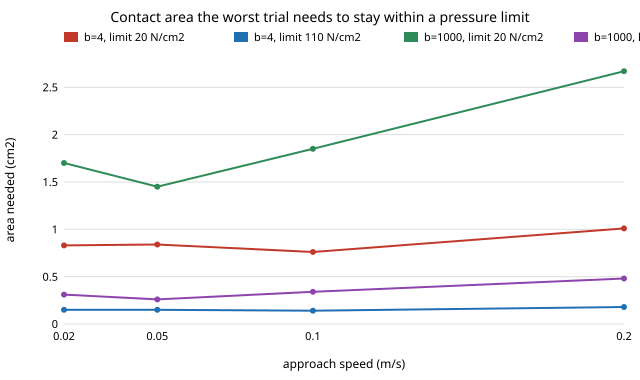

# Does the feeding arm's tip pressure, not its force, break the ISO/TS 15066 face limits? A contact-area sweep on `osrobot-mjface`

Follow-up to `osrobot-mjface` (track 9, open-source purpose-built robots), taking the first item of its "Next steps": **convert peak force to contact pressure and compare with pressure limits.** `osrobot-mjface` found every camera-arm trial under the 65 N and 130 N face force limits (worst 53 N) but said a 4 mm tip concentrates force, so pressure limits "may bind before the force limits do". In the direction of the CAIRO Lab interest in assistive robotics; nothing here is affiliated with or endorsed by it. Produced with AI assistance (Claude). Needs `pip install mujoco` (3.16.0 used). Simulation only; **not a safety case** (ISO 13482 and an owner risk assessment come first).

**Live page:** https://duncan-haywood.github.io/oss-monorepo/research/osrobot-mjpress/



## Headline results (all from `experiments/results.txt`)
- **Pressure binds before force does, unless the tip is wider than about 1 cm².** The worst of 200 trials (b = 1000 N·s/m, 0.20 m/s, 53.3 N) needs 0.48 cm² to stay within 110 N/cm², 0.97 cm² within 55 N/cm² and 2.67 cm² within 20 N/cm². A 4 mm sphere pressed into skin makes a small patch: the force limit of 65 N is met, the pressure limits need an area the model never computed.
- **A softer contact means a gentler fit, and the answer flips on the face modulus.** A Hertz contact of the 4 mm sphere at 53.3 N gives 0.41 cm² (128 N/cm²) for E = 5 MPa, 1.93 cm² (28 N/cm²) for 0.5 MPa and 8.9 cm² (6 N/cm²) for 0.05 MPa. So whether the worst trial passes a 55 N/cm² limit depends on a modulus nobody here sourced.
- **For lightly damped contact (b = 4 to 100) a spoon-edge-sized area is enough.** Worst peaks are 12.6 to 20.2 N, needing 0.11 to 0.18 cm² at 110 N/cm² and 0.63 to 1.01 cm² at 20 N/cm². At b = 4, 0.10 m/s, a 0.5 cm² contact keeps 94 % of trials within 20 N/cm² and a 0.25 cm² contact keeps 99 % within 55 N/cm². (Trials with no contact count as passing, so shares include the roughly one in three that never touch; read the changes between rows, not the floor.)
- **Contact damping again moves the answer most:** the area needed doubles to triples from b = 100 to b = 1000 at every speed.

## Where the numbers come from
| Input | Value | Source |
|---|---|---|
| Peak forces | 200 trials per (b, speed) | Run here, `osrobot-mjfeed` model at k = 75,000 N/m (ISO/TS 15066 face, as `osrobot-mjface`); worst peak reproduces `osrobot-mjface` (a test checks 53.30 N) |
| Pressure limits | 20, 55, 110 N/cm² | **Not confirmed.** Secondary sources disagree: one search found skull/forehead 110 N/cm² transient and 55 quasi-static, another 30 for skull/forehead and 20 for face, and a Fraunhofer/NIST preliminary table with unclear columns ([arXiv:2311.13814](https://arxiv.org/abs/2311.13814), [NIST head-toe thresholds](https://www.nist.gov/document/head-toe-biomechanical-thresholds-protect-robot-operators-against-injuries)). The three values span the range found; the standard itself was not read |
| Contact area | 0.05 to 5 cm² swept; Hertz sphere (R = 4 mm, ν = 0.5) | Swept, plus the textbook Hertz formula |
| Face modulus E | 0.05, 0.5, 5 MPa | **Not sourced.** Swept |
| Tip radius, mass, gains, sway | as `osrobot-mjfeed` | Assumed there |

## Method
`experiments/run.py` re-runs the `osrobot-mjface` camera-arm trial (30 mm sway, 200 seeds) at k = 75,000 N/m for b = 4, 100, 1000 and four speeds, keeps each trial's peak force, and divides by a contact area to get pressure. It reports the area each pressure limit needs, a Hertz area for the sphere, and the share of trials within each limit by area.

## Reproduce
```bash
pip install mujoco
cd research/osrobot-mjpress
python3 -m unittest discover -s tests -v   # 4 tests
python3 experiments/run.py                 # about 90 s; writes experiments/results.txt
python3 experiments/figure.py              # experiments/area_needed.svg
```

## Limitations
- Pressure is peak force over an assumed area; the model has no tissue, so the real patch is not computed. The Hertz row uses a linear elastic half-space, which a lip is not.
- The pressure limits could not be confirmed (paywalled standard, conflicting excerpts) and the face row may be 20, not 110 N/cm². The conclusion is stated as the area each limit needs, so a reader can plug in the true figure.
- Damping, face modulus, tip mass, gains and sway are unsourced; no human model.

## Next steps
Read the real Annex A/M table (pressure column, face row); find a measured lip/skin elastic modulus to pin the Hertz row; replace the kinematic lips with a compliant body so the patch comes from the simulation.

## Owner steps
Obtaining the standard and building or testing a feeding arm are owner steps; nothing was bought or built.

## Outside dependencies
Python 3 and `mujoco`. The standard's text and a measured face modulus were not available.
