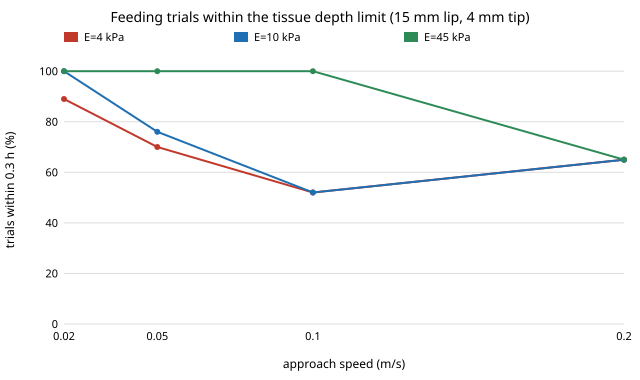

# What happens when the feeding arm meets a soft lip instead of a spring? A MuJoCo trial against a bonded tissue layer, with a force cap

Follow-up to `osrobot-mjlayer` (track 9, open-source purpose-built robots), taking its "Next steps" item: **run the compliant-face simulation so the arm's force comes out of the same model, and re-run the feeding trials with a force cap near the budget.** `osrobot-mjlayer` showed the force that indents a lip 30 % of its thickness is only 0.05 to 9 N, far below the 12.6 to 53 N peaks that `osrobot-mjpress` got from a 75,000 N/m kinematic spring. Here the spring is replaced by that tissue law, and the arm, controller and 30 mm mouth sway are those of `osrobot-mjfeed`. In the direction of the CAIRO Lab interest in assistive robotics; nothing here is affiliated with or endorsed by it. Produced with AI assistance (Claude). Needs `pip install mujoco` (3.16.0 used). Simulation only; **not a safety case** (ISO 13482 and an owner risk assessment come first).

**Live page:** https://duncan-haywood.github.io/oss-monorepo/research/osrobot-mjsoft/



## Headline results (all from `experiments/results.txt`; 100 seeds per cell, camera arm)
- **With a tissue-like lip the peak force is 1 to 3 N in most cells, not 12 to 53 N, but the depth limit is still broken in about half the trials.** For a 15 mm lip at 10 kPa the force budget is 0.49 N; the 95th-percentile peak is 1.0 to 1.9 N at 0.05 to 0.10 m/s, and only 52 to 76 % of trials keep the indentation within 30 % of the layer. A 5 mm, 4 kPa lip (budget 0.05 N) keeps 36 to 53 % of trials within the limit at every speed tried, and its worst peak reaches 20.6 N at 0.20 m/s with the bone stop engaged (depth about 0.94 of the layer).
- **Slowing down helps until the lip's own motion dominates.** For 10 kPa and 15 mm, 100 % of trials are within the limit at 0.02 m/s (mean feed time 8.7 s), 76 % at 0.05, 52 % at 0.10. For thin or soft lips slowing to 0.02 m/s does not get there (36 to 39 % at 5 mm for 4 and 10 kPa); my reading, not tested here, is that the swaying lip runs into the tip faster than the arm with its 0.1 s camera delay can move away.
- **A force cap does little for impacts and a lot for steady pushes.** Blocked against a still lip (a blind arm 20 mm off), the steady push is 1.00 N with no cap (the controller's own lead term, KP × v × LEAD = 400 × 0.05 × 0.05 N), which is 2 times the budget at 10 kPa and 15 mm and 5 times at 4 kPa. A 0.5 N cap brings the indentation from 0.45 to 0.31 of the layer there, a 0.2 N cap to 0.18; for the softest case (4 kPa, 15 mm, budget 0.20 N) only the 0.2 N cap reaches the 30 % limit (0.30). For fast approaches the cap trims the peak only partly (4 kPa, 5 mm, 0.20 m/s: 20.6 N to 8.6 N) because the kinetic energy of the tip, not the drive, sets the impact.
- **The depth at a steady push equals the `osrobot-mjlayer` law**: 6.8 mm predicted and 0.45 of 15 mm (6.8 mm) simulated at 1 N, 10 kPa, so the simulator and the closed form agree (a test checks the 0.5 N case).
- **Damping is the other lever and it cuts both ways.** At 10 kPa, 15 mm, 0.10 m/s, raising the lip's viscous damping from 10 to 100 N·s/m takes trials within the limit from 52 % to 85 % but multiplies the peak force by about 8 (median 0.92 to 7.1 N). The damping is assumed here, not measured.
- **Success is 100 % in every cell**, so within these conditions the safe design costs time, not feeds: 0.02 m/s takes about 8.7 s a spoonful against 0.9 s at 0.20 m/s.

## Where the numbers come from
| Input | Value | Source |
|---|---|---|
| Force law | Hertz sphere on a bonded layer, Dimitriadis polynomial, ν = 0.5 | `osrobot-mjlayer` (Dal Fabbro et al., arXiv 2406.17157); the force is evaluated at every step |
| Moduli, thicknesses | 4, 10, 45 kPa; 5 and 15 mm | as `osrobot-mjlayer` (small studies, read as summaries) |
| Tip, mass, gains, sway, camera | as `osrobot-mjfeed` | assumed there |
| Tissue damping | 10 N·s/m (1 and 100 swept in Part 3) | **assumed**, no source |
| Bone stop | 1e5 N/m beyond 0.9 of the layer | **assumed**; bone is far stiffer, so depths past 0.9 h are not meaningful |
| Depth limit | 30 % of layer | my choice (`osrobot-mjlayer`) |

## Method
`experiments/soft.py` keeps `osrobot-mjfeed`'s controller and sway but switches MuJoCo's contact off: MuJoCo (implicit integrator) integrates the sphere's two slide joints under the actuators plus an applied force, and each step the lip force comes from the sphere-to-box penetration, the layer law, a viscous term on the penetration rate and the bone stop. So MuJoCo supplies the rigid-body dynamics, not the contact. `experiments/run.py` sweeps modulus, thickness, speed and arm force cap (Part 1), blocked steady pushes against caps (Part 2) and damping (Part 3). Tests check the force against the layer law, the contact geometry, the bone stop, and that a capped blocked push settles at the cap and at the depth the law predicts.

## Reproduce
```bash
pip install mujoco
cd research/osrobot-mjsoft
python3 -m unittest discover -s tests -v   # 6 tests
python3 experiments/run.py                 # about 5 minutes; writes experiments/results.txt
python3 experiments/figure.py              # experiments/within_budget.svg
```

## Limitations
- The lip is a homogeneous, linear, bonded layer with a viscous term, a flat rigid block with a stiff bone stop; real lips are layered, nonlinear and viscoelastic with a cavity behind. The law is evaluated well past its fitted range in the bone-stop cases.
- The peak force in most cells is set by the arm's own lateral stiffness (KP = 400 N/m) resisting the swaying lip, so it depends on the assumed controller as much as on the tissue; this is why peaks barely change with modulus at 0.02 m/s.
- Depth, not pressure, is the safety proxy; pressure limits remain unconfirmed (`osrobot-mjpress`). Damping, controller gains and sway are unsourced; no human model or spoon geometry.
- No friction, no tongue or teeth, a planar two-axis tip, no comparison with a physical measurement.

## Next steps
Use a depth-aware controller (slow down on contact, step back when depth exceeds the limit) rather than a fixed cap, and compare it with the best cap here; measure or source tissue damping and a face stiffness from a published indentation study; or move to Assistive Gym's human model.

## Owner steps
None; nothing was bought or built.

## Outside dependencies
MuJoCo (Apache-2.0) and Python 3. The bottom-effect polynomials come from papers I read only through a third source (see `osrobot-mjlayer`).
