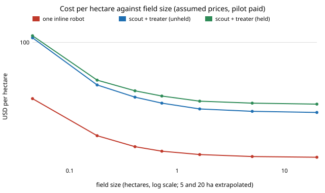

# osrobot-pairprice: is a scout drone plus a ground treater cheaper per hectare than one weeding robot?

Follow-up to `osrobot-scoutpair` (track 9, open-source purpose-built robots). That project showed the pair is faster at matched kill but priced nothing, and named "price both machines and ask for the break-even field size" as a next step. This one does, and says up front that **every price is an assumed round number, not a quote**, so the headline is a break-even structure, not a dollar figure. In the direction of the ARPG, RECUV and Autonomous Systems IRT interest in field robots; nothing here is affiliated with or endorsed by them. Produced with AI assistance (Claude). Pure Python standard library. Simulation only; nothing was built or flown.

**Live page:** https://marisstella.app/research/osrobot-pairprice/



**Correction, 2026-11-14.** The first version of this project left the drone pilot unpaid and concluded that the pair is cheaper above about half a hectare. Under FAA Part 107 a remote pilot must keep the drone in sight for the whole flight (14 CFR 107.31), so the scout's flight minutes are a person's minutes. Charged at the project's own 20 USD/h, they reverse the headline: **the pair costs 2.3 to 2.6 times as much as one inline robot at every field size from 0.4 to 20 ha, with no break-even at any scout price from 1,000 to 6,000 USD.** The quality audit that found this is [`portfolio/quality/audits/2026-11-13-osrobot-pairprice.json`](../../portfolio/quality/audits/2026-11-13-osrobot-pairprice.json); the post is [`docs/posts/2026-11-14-quality-fix-the-drone-pilot-was-free.md`](../../docs/posts/2026-11-14-quality-fix-the-drone-pilot-was-free.md).

- **Time is linear in area, so cost per field is a fixed part plus a per-hectare part.** Over five simulated fields from 0.045 to 1.62 ha the pair's flight minutes, treater minutes, matched-kill inline minutes and energy all fit a straight line with R² of at least 0.9999 (Sweep 2). Per hectare: scout 56.8 min, treater 91.2 min, inline 227.6 min.
- **With the pilot paid, the pair never wins at the reference prices.** Each machine charged only for the minutes it works ("unheld"), the pair costs 2.54 times the inline robot at 0.405 ha, 2.46 at 0.72 ha and 2.35 at 1.62 ha; the straight-line fit gives 2.34 at 5 ha and 2.32 at 20 ha (extrapolated). Held for the whole job, 2.7 to 2.9 times (Sweep 3). Sweep 4 scans 0.01 to 200 ha for every scout price from 1,000 to 6,000 USD and finds no crossing. The scout's 56.8 flight min/ha cost 18.9 USD/ha in a person's time, more than the inline robot's whole cost per hectare (11.6 to 13.0 USD at 0.72 to 20 ha).
- **The pair pays only if the pilot's time is nearly free** (Sweep 6): the highest pilot cost per flight hour at which the unheld pair is no dearer than the inline robot is 0.22 USD at 0.72 ha, 2.68 at 1.62 ha and 3.88 at 20 ha (extrapolated); at 0.405 ha it is dearer even with an unpaid pilot. So the architecture is only worth pricing further where one person's flight time is genuinely shared with other paid work, or where rules allow one pilot to supervise several aircraft or beyond-line-of-sight operation (Part 107 waivers or a Part 108 rule), neither of which is modelled here.
- **Without the pilot (the first version's assumption), break-even is not one number.** Battery swaps make the cost difference a sawtooth that crosses zero up to 9 times between 0.01 and 200 ha. At a 2,500 USD scout the unheld pair first matches the inline robot at 0.54 ha and is cheaper for good above 0.70 ha; at 6,000 USD the first crossing is 1.03 ha and the last 1.77 ha (extrapolated). The first version's single bisection reported 1.28 ha for the 6,000 USD scout and 2.65 ha for the held pair at 1,500 USD, which were arbitrary members of these sets (Sweep 4, "pilot no" rows).
- **The verdict is fragile to utilisation and labour, and labour now dominates.** Pair over inline at 0.72 ha with the pilot paid: 0.87 at 100 occupied hours a year (the only single change in Sweep 5 that tips it to the pair, because so few hours make capital dominate), 6.45 at 2,000; 0.42 with free labour, 4.11 at 40 USD/h; 2.23 with a 45 min battery; 2.39 with a 1,000 USD scout.

## Reproduce
```bash
cd research/osrobot-pairprice
PYTHONPATH=src python3 -m unittest discover -s tests -v   # 16 tests, a second
PYTHONPATH=src python3 experiments/run.py > experiments/results.txt   # about 15 min; writes experiments/fits.json
PYTHONPATH=src python3 experiments/run.py --from-fits    # Sweeps 3-6 only, from fits.json, in a second
python3 experiments/figure.py                             # experiments/usd_per_ha.svg, parsed from results.txt
```

## Motivation
A second platform only pays if its extra capital and handling cost less than the time it saves. `osrobot-scoutpair` measured the time; this prices it, and asks the question a farmer would: at what field size does the pair stop losing?

## Builds on
`osrobot-scoutpair` (this repository): `model.py` is copied unchanged, so the field, detector, mud, scout, tour and energy model are identical. New is `econ.py` (cost per field, battery swaps, pilot time, interpolation, line fit, every sign change of a cost difference) and the experiment. Annualised capital charged against occupied machine-hours is a standard machine-hour costing convention; no particular source's numbers are used.

## Method
Five fields (30x15 to 180x90 m, same weed density, 20 seeds each, fields shared across rows) are simulated for the pair (scout 1 m/s, 3 m swath, treater 1.5 m/s, straight-line tour) and for the inline robot at six speeds. The inline minutes and Wh at the pair's kill share are interpolated along the inline speed curve, as in `osrobot-scoutpair`. Each quantity is fitted as `c + m * hectares`, and cost is computed from the fits so that field sizes outside the simulated range can be read off (marked extrapolated). Cost per field: capital times 30% a year spread over 500 occupied hours, charged by occupied minutes; a person's time at 20 USD/h for set-up (3 min ground, 8 min scout), battery swaps (20 min per battery, 3 min per swap) and every scout flight minute (the remote pilot; swap minutes are not counted twice); electricity at 0.15 USD/kWh. Capital is 5,000 USD for the inline robot, 2,500 scout plus 3,500 treater for the pair. All of these are ASSUMED in `econ.py`.

## Limitations
- Prices, duty, labour, battery and set-up times are assumed round numbers; no product was quoted. Only the structure (fixed overhead against per-hectare saving, and the held-versus-unheld split) is the finding.
- Extrapolation to 5 and 20 ha is a straight line fitted to fields up to 1.62 ha; a large field would add terrain, wind and multi-battery logistics that are not simulated. Break-even sizes of 0.5 to 1.3 ha are inside the simulated range.
- Inherits `osrobot-scoutpair`'s limits: no registration error between map and treater, no wind, an assumed motion-blur law and detector, one weed density and mud share, no overlap between the stages.
- Kill is matched only on average; the inline interpolation is linear between six speeds. Scout set-up and swaps are charged as labour, not as scout downtime in the unheld case beyond the swap minutes.
- The ground robots are charged no supervision or battery labour while the scout's pilot and swaps are; a site that must also watch a ground robot would narrow the gap. Regulation, safety and other real costs (insurance, the pilot's Part 107 certificate, which is an owner step) are not priced.
- Weed kill is matched at about 34% per pass (Sweep 1), the pair's kill share in `osrobot-scoutpair`; cost at an agronomic control target (repeat passes) is not modelled.

## Known gaps (quality audit 2026-11-13)

From [`portfolio/quality/audits/2026-11-13-osrobot-pairprice.json`](../../portfolio/quality/audits/2026-11-13-osrobot-pairprice.json).

- Fixed 2026-11-14: the pilot's flight time is charged (`econ.PILOT_ATTENDED`), and break-even reports every crossing (`econ.crossings`) with extrapolated values marked. `econ.cost_model`, which all of Sweeps 3 to 6 use, is now tested against the audit's recomputation.
- Open: kill matched at about 34% per pass; no prior work cited (Pedersen et al. 2006; Lowenberg-DeBoer et al. 2020; ASABE D497); prices assumed where public list prices exist; one-factor sweeps only; `model.py` is a verbatim copy of `osrobot-scoutpair`'s rather than an import.

## Next steps
Price the one regime where the pair could win: a pilot whose time is shared, under a multi-aircraft or beyond-line-of-sight waiver, with the waiver's own costs. Pipeline the stages with one scout serving several fields or treaters, and price that; add a registration error with a treater camera; replace assumed prices with sourced ones for an open drone and an open ground platform.

## Owner steps
None taken. Quoting parts, buying or flying anything is the owner's step.

## Outside dependencies
None: Python 3 standard library only. A real system would need a drone and camera, a ground platform, a detector, registration and a treatment tool that this project could not make or run.

MIT.
