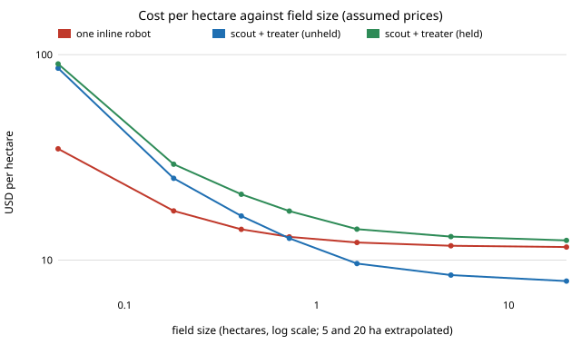

# osrobot-pairprice: is a scout drone plus a ground treater cheaper per hectare than one weeding robot?

Follow-up to `osrobot-scoutpair` (track 9, open-source purpose-built robots). That project showed the pair is faster at matched kill but priced nothing, and named "price both machines and ask for the break-even field size" as a next step. This one does, and says up front that **every price is an assumed round number, not a quote**, so the headline is a break-even structure, not a dollar figure. In the direction of the ARPG, RECUV and Autonomous Systems IRT interest in field robots; nothing here is affiliated with or endorsed by them. Produced with AI assistance (Claude). Pure Python standard library. Simulation only; nothing was built or flown.

**Live page:** https://duncan-haywood.github.io/monorepo-projects/research/osrobot-pairprice/



- **Time is linear in area, so cost per field is a fixed part plus a per-hectare part.** Over five simulated fields from 0.045 to 1.62 ha the pair's flight minutes, treater minutes, matched-kill inline minutes and energy all fit a straight line with R² of at least 0.9999 (Sweep 2). Per hectare: scout 56.8 min, treater 91.2 min, inline 227.6 min.
- **Each machine charged only for the minutes it works ("unheld"):** the pair costs 2.47 times the inline robot on 0.045 ha, 1.44 times on 0.18 ha, 0.98 times at 0.72 ha and 0.79 times at 1.62 ha (Sweep 3). Beyond the simulated sizes the straight-line fit gives 0.72 at 5 ha and 0.68 at 20 ha (extrapolated). The break-even field size is 0.54 ha at the 2,500 USD scout, 0.81 ha at 4,000 and 1.28 ha at 6,000 (Sweep 4). It exists because the pair carries an extra 8 min of scout set-up and battery swaps per field.
- **Both machines held for the whole job ("held", a dedicated pair that waits on each other):** 1.34 times at 0.72 ha, 1.16 times at 1.62 ha and 1.08 times at 20 ha. It breaks even only for a scout at 1,500 USD or less (2.65 ha) and never at 2,500 USD. So the pair wins only if the scout and treater can each be used elsewhere while the other works, such as a scout serving several treaters or several fields in sequence; a pipelined schedule is not modelled.
- **The verdict is fragile to utilisation and labour.** Pair over inline at 0.72 ha: 0.54 at 100 occupied hours a year, 2.09 at 2,000 (more occupied hours spread capital thinner, so the pair's extra set-up and swap labour dominates; few hours make capital dominate, where the pair's cheaper machines win); 0.42 with free labour, 1.44 at 40 USD/h; 0.75 with a 45 min battery, 1.21 with 10 min (Sweep 5). Which constant matters changes with field size, so treat one cost per hectare as untrustworthy.

## Reproduce
```bash
cd research/osrobot-pairprice
PYTHONPATH=src python3 -m unittest discover -s tests -v   # 13 tests, a second
PYTHONPATH=src python3 experiments/run.py > experiments/results.txt   # about 15 min
python3 experiments/figure.py                             # experiments/usd_per_ha.svg, parsed from results.txt
```

## Motivation
A second platform only pays if its extra capital and handling cost less than the time it saves. `osrobot-scoutpair` measured the time; this prices it, and asks the question a farmer would: at what field size does the pair stop losing?

## Builds on
`osrobot-scoutpair` (this repository): `model.py` is copied unchanged, so the field, detector, mud, scout, tour and energy model are identical. New is `econ.py` (cost per field, battery swaps, interpolation, line fit, bisection) and the experiment. Annualised capital charged against occupied machine-hours is a standard machine-hour costing convention; no particular source's numbers are used.

## Method
Five fields (30x15 to 180x90 m, same weed density, 20 seeds each, fields shared across rows) are simulated for the pair (scout 1 m/s, 3 m swath, treater 1.5 m/s, straight-line tour) and for the inline robot at six speeds. The inline minutes and Wh at the pair's kill share are interpolated along the inline speed curve, as in `osrobot-scoutpair`. Each quantity is fitted as `c + m * hectares`, and cost is computed from the fits so that field sizes outside the simulated range can be read off (marked extrapolated). Cost per field: capital times 30% a year spread over 500 occupied hours, charged by occupied minutes; a person's time at 20 USD/h for set-up (3 min ground, 8 min scout) and battery swaps (20 min per battery, 3 min per swap); electricity at 0.15 USD/kWh. Capital is 5,000 USD for the inline robot, 2,500 scout plus 3,500 treater for the pair. All of these are ASSUMED in `econ.py`.

## Limitations
- Prices, duty, labour, battery and set-up times are assumed round numbers; no product was quoted. Only the structure (fixed overhead against per-hectare saving, and the held-versus-unheld split) is the finding.
- Extrapolation to 5 and 20 ha is a straight line fitted to fields up to 1.62 ha; a large field would add terrain, wind and multi-battery logistics that are not simulated. Break-even sizes of 0.5 to 1.3 ha are inside the simulated range.
- Inherits `osrobot-scoutpair`'s limits: no registration error between map and treater, no wind, an assumed motion-blur law and detector, one weed density and mud share, no overlap between the stages.
- Kill is matched only on average; the inline interpolation is linear between six speeds. Scout set-up and swaps are charged as labour, not as scout downtime in the unheld case beyond the swap minutes.
- Regulation, safety and real costs (insurance, pilot licensing under FAA rules, which is an owner step) are not priced.

## Next steps
Pipeline the stages with one scout serving several fields or treaters, and price that; add a registration error with a treater camera; replace assumed prices with sourced ones for an open drone and an open ground platform.

## Owner steps
None taken. Quoting parts, buying or flying anything is the owner's step.

## Outside dependencies
None: Python 3 standard library only. A real system would need a drone and camera, a ground platform, a detector, registration and a treatment tool that this project could not make or run.

MIT.
