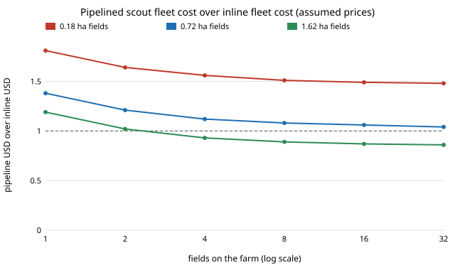

# osrobot-pipeline: if one scout drone feeds ground treaters in a pipeline, can a held fleet beat inline weeding robots?

Follow-up to `osrobot-pairprice` (track 9, open-source purpose-built robots). That project found a scout plus treater beats one inline robot per hectare only if each machine is charged just for the minutes it works, and loses by 1.1 to 1.3 times if both are held for the whole job; it listed "pipeline the stages" as the next step. This one does, as a deterministic scheduling model over `osrobot-pairprice`'s fitted per-field minutes. **Every price is an assumed round number, not a quote; no new simulation was run.** In the direction of the ARPG, RECUV and Autonomous Systems IRT interest in field robots; nothing here is affiliated with or endorsed by them. Produced with AI assistance (Claude). Pure Python standard library. Simulation only; nothing was built or flown.

**Live page:** https://duncan-haywood.github.io/monorepo-projects/research/osrobot-pipeline/



- **One scout can feed barely more than one treater.** Per field the scout is tied up 18.8, 55.5 and 112.6 min (0.18, 0.72, 1.62 ha), the treater 18.7, 67.9 and 150.0 min, so one scout keeps 0.99 to 1.33 treaters busy (Sweep 1). Set-up and battery swaps make the scout nearly as slow as the treater. Sweep 2's cheapest pipeline is always one scout and one treater.
- **Pipelining recovers most of the held-fleet penalty.** With one scout and one treater overlapping, cost per hectare against the cheapest held inline fleet is 1.04 at 0.72 ha fields (32 fields) and 0.86 at 1.62 ha (32 fields), against 1.34 and 1.16 for `osrobot-pairprice`'s held pair (one field at a time, no overlap) (Sweep 2).
- **It still loses on small fields and small farms.** At 0.18 ha fields the pipeline costs 1.48 to 1.81 times the inline fleet at every farm size up to 32 fields; at 0.72 ha it never gets below 1.04. It wins only for 1.62 ha fields with four or more fields (0.93, falling to 0.86).
- **Adding treaters to match the finish time only costs more.** For 16 fields of 0.72 ha, k = 2 to 5 treaters finish in 15.9 h against 19.0 h for k = 1 (the scout is the floor) but raise cost per hectare from 13.92 to 15.85 to 24.56 USD (Sweep 3).
- Inline cost per hectare is flat in fleet size when the fleet size divides the field count, because robots are charged for the whole makespan and the work is the same.

## Reproduce
```bash
cd research/osrobot-pipeline
PYTHONPATH=src python3 -m unittest discover -s tests -v   # 9 tests, a second
PYTHONPATH=src python3 experiments/run.py > experiments/results.txt   # a second
python3 experiments/figure.py                             # experiments/ratio.svg, parsed from results.txt
```

## Motivation
A farmer with several fields would hold the scout and treater all season. Whether overlapping the two stages pays decides if the pair architecture is worth building as a fleet.

## Builds on
`osrobot-pairprice` and, through it, `osrobot-scoutpair`: the per-field minutes and Wh are the straight-line fits of `osrobot-pairprice` Sweep 2 (`test_fitted_lines_match_pairprice_results` checks the constants against that project's committed `results.txt`), and prices, duty, labour, battery and set-up are the same assumed constants as its `econ.py`. New is `fleet.py`: list scheduling of one scout and k treaters (or n inline robots), held-fleet costing over the makespan.

## Method
Fields are equal and processed in a fixed order. The scout takes 8 min set-up plus flight plus 3 min per battery swap (20 min endurance) per field and never waits; each mapped field goes to the next free treater, which takes 3 min set-up plus the fitted treating minutes. The inline fleet of n robots takes 3 min set-up plus the fitted inline minutes per field (matched to the pair's kill share, as in `osrobot-pairprice`). Cost = capital times 30% a year over 500 hours, charged for the whole makespan of every machine, plus labour for set-up and swaps (20 USD/h) plus electricity (0.15 USD/kWh). The best fleet size is searched over 1 to 8, ties going to the shorter makespan.

## Limitations
- Prices, duty, labour and times are assumed round numbers; only the structure is the finding.
- Per-field minutes are straight-line fits from fields of 0.045 to 1.62 ha; scheduling is deterministic, with no weather, failures, travel between fields, or deadlines (a pest window would favour more machines). Fields are equal.
- The scout set-up is counted as busy time; if a second person prepared the next flight during the previous one, the scout could serve more treaters and the result would change. That variant is not modelled.
- Inherits `osrobot-scoutpair`'s limits: no registration error between the map and the treater, an assumed detector and blur law, one weed density.
- A held-for-the-season fleet is charged only for the job modelled; other work for the same machines would lower both fleets' cost.

## Next steps
Let a second person prepare the next flight during the current one; add a registration error with a treater camera; replace assumed prices with sourced ones for an open drone and an open ground platform.

## Owner steps
None taken. Quoting parts, buying or flying anything is the owner's step.

## Outside dependencies
None: Python 3 standard library only. A real system would need a drone and camera, a ground platform, a detector, registration and a treatment tool that this project could not make or run.

MIT.
