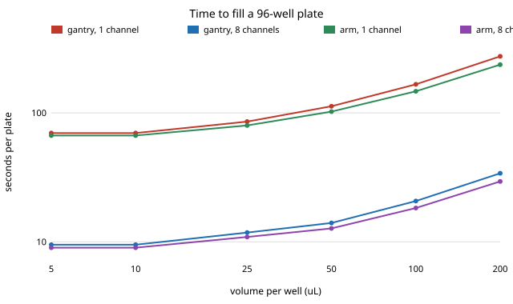

# How fast can a purpose-built robot fill a 96-well plate, and does the robot or the number of channels matter more?

Track 9 (open-source purpose-built robots), the liquid-handling task that `osrobot-specialise` named in its "Next steps" and did not model. In the direction of the HIRO Group's interest in robots in chemistry labs; nothing here is affiliated with or endorsed by it. Produced with AI assistance (Claude). Pure Python standard library. **Every cost, speed, accuracy and layout figure is an assumption written into `model.py` (marked ASSUMED); none is a measurement or quote for any real product.**

**Live page:** https://duncan-haywood.github.io/oss-monorepo/research/osrobot-plate/



- **Channel count, not robot geometry, sets the plate time.** At 10 µL per well, one channel takes 69.7 s on the gantry and 66.7 s on the arm; eight channels take 9.5 s and 9.0 s. Switching robot type moved the time by 4 to 14 % across volumes (arm faster in every row); switching to 8 channels cut it by 86 to 88 %.
- **Most of the time is fixed pipetting actions, not travel.** At 10 µL, 96 dispenses × 0.5 s plus 5 aspirations × 1.0 s is 53 s of the gantry's 69.7 s (76 %) and of the arm's 66.7 s (79 %). Well order therefore barely matters: serpentine saves 2.4 % (gantry) and 2.2 % (arm) against row-by-row.
- **Here the arm's shorter joint moves beat the gantry's axes, and it is a matter of the assumed speeds.** The deck is 0.3 m across, so a joint moves a few tenths of a radian. Raising the gantry's speed and acceleration from 0.4 m/s and 3 m/s² to 0.8 and 6 takes it from 69.7 to 64.1 s, below the arm's 66.7 s; halving the arm's joint limits takes it to 73.5 s, above the gantry.
- **On capital per plate-per-hour the eight-channel gantry is cheapest, by a small margin.** USD 8.0 against 8.3 for the arm with 8 channels, and 29.1 and 33.3 with one channel (assumed prices: gantry 1,200, arm 1,500, 1-channel head 300, 8-channel head 1,800). The 8-channel head's extra price is repaid several times over by the throughput it adds.
- **Accuracy is where the geometries differ, if the arm's joint noise is as assumed.** With 0.1° per-joint noise and a 1.5 mm landing radius the arm hits each well with probability at least 0.92, so it hits all 96 wells of a plate with probability 0.005 (one channel) while the gantry (0.2 mm noise) hits every well. This follows from the two assumed noise figures and would change with real repeatability data or per-well calibration.

## Reproduce
```bash
cd research/osrobot-plate
PYTHONPATH=src python3 -m unittest discover -s tests -v   # 7 tests, under a second
PYTHONPATH=src python3 experiments/run.py                 # under a second; writes experiments/results.txt
python3 experiments/figure.py                             # experiments/plate_time.svg, parsed from results.txt
```

## Motivation
Milestone 1 of track 9 asks where a robot built for one job beats a general one, with pipetting as one of its tasks. `osrobot-specialise` did pick-and-place. Pipetting differs: moves are short (9 mm pitch) and the machine spends most of its time in actions rather than travel, so the usual intuition that a gantry's travel time or an arm's reach decides the choice may not hold.

## Builds on
The HIRO Group's interest in robots in chemistry labs (<https://hiro-group.ronc.one/>); no paper from it is reproduced. The 96-well plate pitch is the ANSI/SLAS microplate standard (9 mm). Burger et al. (2020), a mobile robotic chemist, *Nature* 583:237, is the task context and was not reproduced. Liquid-handling checks against the real Opentrons simulator are in `osrobot-labreal`; this project makes no claim about any Opentrons machine.

## Method
`src/osrobot_plate/model.py`. A trough at (0.25, 0.15) m and well A1 of a plate at (0.30, −0.10) m, with an arm base at the origin (ASSUMED layout, all within reach). Each trip: move to the trough, aspirate (1.0 s), then visit up to `min(20, ⌊200 µL / volume⌋)` wells, dispensing 0.5 s each, and return. One channel visits all 96 wells; eight channels visit the 12 columns, the head centred mid-column. The gantry's X and Y move together under trapezoidal speed profiles (0.40 m/s, 3 m/s² per axis); the arm is a two-link planar arm (0.35 m links, elbow up) with the same profile per joint (2 rad/s, 12 rad/s²). Positioning accuracy treats the tip error as isotropic Gaussian: 0.2 mm for the gantry; for the arm, joint noise of 0.1° mapped through the Jacobian.

## Limitations
- Planar kinematics, no tip pickup and ejection, no liquid-level sensing, no plate or trough height, no collision, no vibration or settling time, no volume error. Action times are single assumed numbers.
- Eight channels on a two-link arm would need a wrist to hold the head's orientation; that is not modelled or priced, so the arm's 8-channel rows flatter it. The 8-channel accuracy figure treats the column as one position.
- The accuracy row is two assumed noise figures; the arm's 0.005 is not a prediction about any real arm (real arms are calibrated and many are far more repeatable).
- Prices are round numbers, not quotes.

## Next steps
Replace the assumed numbers with a sourced bill of materials and datasheet repeatability (owner step); add tip handling and a wrist for the arm; add the milestone's weeding task as a third case; let `osrobot-lab` schedule real protocols on these timings.

## Owner steps
Pricing a gantry-based and an arm-based liquid handler from open designs, with dated sources, and measuring their landing accuracy, are owner steps; no purchases or hardware were made or priced here.

## Outside dependencies
Python 3 standard library only.

MIT.
