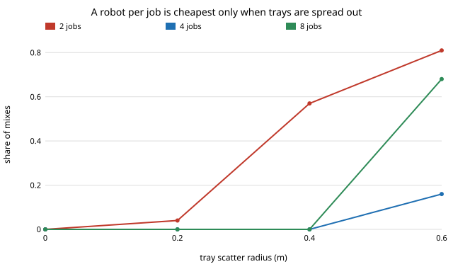

# When does one shared robot beat a dedicated robot per job? Reach, precision and changeover in a stylised pick-and-place shop

Follow-up to `osrobot-specialise` (track 9, open-source purpose-built robots), taking the "value of reconfigurability that the single scalar leaves out" next step. That project priced one job at a time; a real shop has several, and the general robot's selling point is that one of it can serve them all. This asks when that is true. Produced with AI assistance (Claude). Pure Python standard library; it imports `osrobot-specialise` unchanged. **Every cost, speed, accuracy, demand and changeover figure is an assumption from `osrobot-specialise` or written into the experiment; none is a price or a measurement of a real product.** All numbers below are from `experiments/results.txt`. Simulation only; a stylised, preliminary study. It builds on none of the CU Boulder groups in `prompt.md` beyond the general interest of HIRO and CAIRO in manipulation workcells.

**Live page:** https://duncan-haywood.github.io/monorepo-projects/research/osrobot-reconfig/



**Model.** A shop has J trays (side 0.1 to 0.4 m, tolerance 1, 2 or 5 mm, centres scattered within a radius around a common origin). Each job's demand is a fraction φ of what a dedicated gantry would deliver on it. Three ways to equip the shop, compared on capital cost: **dedicated** (the cheapest feasible gantry or arm for each job, as many units as the load needs); **one shared gantry** spanning the bounding box of all trays; **one shared arm** at the origin with the reach to the farthest tray corner. Shared robots lose a changeover time per job per 8 h shift, and a robot below 90% success on a job cannot do it.

## Headline results (200 random job mixes per row, seed 7)
- **Sharing only helps while the shared robot's total load fits one machine.** With 4 jobs at scatter 0.4 m, a shared robot is cheapest in every mix at φ ≤ 0.2 (0.20 per job, total load 0.8 before changeover), and a robot per job is cheapest in 99 to 100% of mixes from φ = 0.3. The break-even is a step, not a slope: a shared robot at total load above one machine costs a second unit, and that doubles its cost. The rule of thumb is J·φ/(1 − changeover share) ≲ 1.
- **Changeover time moves the line.** At 4 jobs, scatter 0.4 m and φ = 0.2, a shared robot is cheapest in 100% of mixes at no changeover and at 600 s per job per shift, but a robot per job is in 99% at 1,800 s (four changeovers then take 25% of the shift, and the total load no longer fits).
- **Scatter decides between sharing and dedicated.** At φ = 0.2 and 600 s: with 4 jobs, dedicated is cheapest in 0% of mixes when trays are within 0.4 m of the origin and 16% at 0.6 m; with 8 jobs, 0% to 0.4 m and 68% at 0.6 m. The shared gantry's cost grows with the perimeter of the bounding box of all trays, so spreading the trays out erodes its saving.
- **Precision keeps the shared arm out of most mixes.** The arm's position error is its angle error times its reach (`osrobot-specialise`), so an arm long enough to reach scattered trays cannot hold 1 or 2 mm on small ones. With the default tolerances (1, 2 or 5 mm) the shared arm can do the 4-job, scatter 0.4 m mix in only 13% of cases and is cheapest in 7%. With loose tolerances only (5 and 10 mm) it can do all mixes and is cheapest in 55% (4 jobs, scatter 0.4 m) and 48% (8 jobs, scatter 0.2 and 0.4 m), against 45% (4 jobs) and 52% (8 jobs) for the shared gantry, so the two are roughly level there. So **the arm's reconfigurability pays where tolerances are loose and trays are scattered; the gantry's where they are tight or clustered.**
- **One job is not a sharing problem.** For J = 1 the shared options are the dedicated ones, and a robot per job is cheapest (by tie) in all 200 mixes at every scatter. At 2 jobs the answer depends on spread: sharing wins in 96% of mixes at scatter 0.2 m and 43% at 0.4 m.

## Reproduce
```bash
cd research/osrobot-reconfig
python3 -m unittest discover -s tests -v   # 8 tests, about 1 s
python3 experiments/run.py                 # about 4 min; prints the tables
python3 experiments/figure.py              # experiments/dedicated_share.svg, parsed from results.txt
```
Run it as `python3 experiments/run.py > experiments/results.txt`. The scripts add `../src` and `../../osrobot-specialise/src` to the path themselves.

## Builds on
`osrobot-specialise` (the gantry and arm models, imported unchanged, with all their assumed parameters). Reconfigurable and shared-resource workcells are a long-standing topic in flexible manufacturing; this project cites no paper for the model and reproduces none. It is the author's own construction and unreviewed.

## Method
`src/osrobot_reconfig/fleet.py`. A job mix is drawn at random (side uniform 0.1 to 0.4 m, tolerance uniformly from {1, 2, 5} mm, centre at a uniformly random angle and an area-uniform distance up to the scatter radius). Rates come from 200 sampled pick-and-place pairs per job: the gantry's from `osrobot_specialise.evaluate`, the arm's by running the real joint moves of an arm of the shared reach at the tray's actual offset. Load on a robot is demand over its rate; units are `ceil(load / (1 − J·changeover / 8 h))`. The dedicated option takes the cheaper of a gantry and a centred arm for each job. Tests check that one centred job gives the shared gantry the dedicated gantry's cost, the reach geometry, unreachable and imprecise arms, the effect of changeover and demand, and reproducibility. A tie within 1e-9 goes to dedicated, then to the shared gantry.

## Limitations
- **Capital cost only.** No floor space, programming and set-up labour, utilisation of a spare unit, maintenance, or the cost of one machine failing and stopping every job. The changeover is a flat time; a real one depends on tooling and fixtures.
- **Assumed everything.** The costs, speeds and accuracies are `osrobot-specialise`'s assumptions, whose conclusions flex strongly with the cost coefficients; the demand levels and changeover times here are round numbers. A different gantry cost per metre would move every row.
- **A shared gantry is modelled as the dedicated gantry's speed on a larger frame.** A longer frame would be heavier and less stiff, and its position error would grow; the model keeps both fixed, which favours the shared gantry.
- **Stylised geometry.** Square trays in one plane, no obstacles between trays, no wrist, no tool changes; the arm sits at the origin and is never repositioned.
- **Load is a step function.** Because units are whole machines, the break-even lands on a load of exactly one machine; the 200-mix shares near that step are sensitive to the demand levels chosen.
- Simulated results are not claims about physical machines, and nothing here is a safety case for working near people.

## Next steps
Source dated prices for real gantry and arm bills of materials (owner step) and re-run with them; add set-up labour and a failure-correlated downtime term; let the shared arm move between bases; add track 4's SO-101 model for the arm.

## Owner steps
Bills of materials for a gantry and an open arm with a source and date for every price (as in `osrobot-specialise`). No prices were checked in this run, so none are given.

## Outside dependencies
None: Python standard library only, plus the sibling project `osrobot-specialise`. Everything physical is an owner step and was not done.

MIT.
