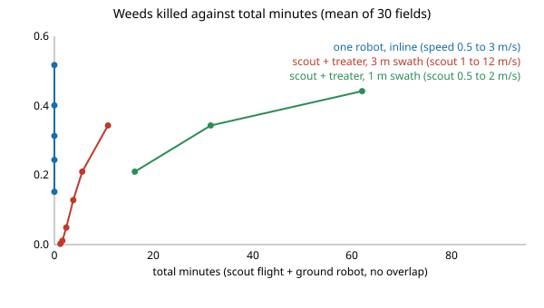

# Does a fast scout plus a ground treater beat one weeding robot? Only through the scout's wider swath, and a mud-aware tour adds nothing

Follow-up to `osrobot-fieldtour` (track 9, open-source purpose-built robots). It took that project's two open next steps, "let the scout stage be a second, faster platform" and "price a mud-aware tour", and asked a different question from the tour-rule one it had been answering: does a second platform change the cost structure? In the direction of the ARPG, RECUV and Autonomous Systems IRT interest in field-robot simulation; nothing here is affiliated with or endorsed by them. Produced with AI assistance (Claude). Pure Python standard library. **Every constant is an assumed round number (marked ASSUMED in `src/osrobot_scoutpair/model.py`; the ground-robot ones are copied unchanged from `osrobot-field`), not a measurement of any robot, drone, camera or crop, and nothing was built or flown.** All numbers are from `experiments/results.txt` (30 simulated fields per row; fields and random draws are shared across rows). Simulation only; a stylised, preliminary study.

**Live page:** https://duncan-haywood.github.io/oss-monorepo/research/osrobot-scoutpair/



- **Speed trades against kill for everyone, so compare at matched kill.** The assumed motion-blur law (`exp(-v/2)`) makes a faster pass see fewer weeds. One inline robot goes from 0.517 killed in 91.6 min (0.5 m/s) to 0.152 in 19.9 min (3 m/s); at the reference 1 m/s it kills 0.401 in 51.7 min (sweep 6). A scout at 5 m/s kills 0.049 of the weeds in 7.6 min total, which is fast only because it finds almost nothing (sweep 1), so that row says nothing for the pair.
- **With a 3 m scout swath the pair wins at matched kill.** Scout at 1 m/s, 3 m swath: 0.343 killed in 26.6 min (10.8 flying, 15.8 on the ground). Linear interpolation along the one-robot curve gives 42.0 min for that kill, so the pair is about 37% faster. At scout 2 m/s it is 0.210 in 16.8 min against 25.4 min interpolated for one robot.
- **With the scout's swath cut to the ground robot's 1 m, the win goes.** At 1 m/s the pair kills the same 0.343 but takes 47.3 min, 13% slower than the interpolated 42.0 min (sweep 8; at 0.5 m/s and 2 m/s the one robot is also ahead: 81.2 against about 65.8, and 27.6 against 25.4). Sweep 7 holds speed fixed at 1 m/s: total minutes fall 47.3, 31.7, 26.6, 24.5, 21.3 as the swath goes 1, 2, 3, 4, 6 m, while kill stays at 0.343 to 0.345. So the saving comes from fewer lanes, not from the second vehicle being fast; the model's one lever for the pair is the ratio of the scout's swath to the treater's lane width.
- **The ground robot's own time falls a lot.** The treater needs 15.8 min against 51.7 min inline (at scout 1 m/s) because it drives to the targets and no lanes. That frees it, or lets it be a cheaper machine with no camera; this study does not price either. Energy follows the same split: 117 Wh for the pair (scout assumed at 150 W) against 189 Wh inline.
- **A mud-aware tour gains almost nothing here.** Pricing mud in the 2-opt cost changes the total from 7.7 to 7.6 min at the reference (sweep 1), and by 0.1 min or less at 0%, 20%, 50% and 80% mud (sweep 5). Mud costs the same per metre whichever route is chosen, and the tour is short next to the cost of the treatments themselves.
- **Sweep 4 (weed density) is not a comparison.** It runs at scout 5 m/s, where the pair kills 0.05 against 0.40, so it shows only that both scale with the number of targets; do not read it as a speed advantage.

## Reproduce
```bash
cd research/osrobot-scoutpair
PYTHONPATH=src python3 -m unittest discover -s tests -v   # 6 tests, a second
PYTHONPATH=src python3 experiments/run.py > experiments/results.txt   # about 5 min
python3 experiments/figure.py                             # experiments/frontier.svg, parsed from results.txt
```

## Motivation
`osrobot-fieldtour` showed that a better tour cannot rescue scout-then-treat when one robot does both stages, and named a second, faster platform as the one change that could. Scouting by air is how field robots are usually imagined to pay. This project tests that on the same field and ground robot, and finds that the answer depends on one assumption that `osrobot-field` never had to make: how wide a strip the scout sees per pass.

## Builds on
`osrobot-fieldtour` and `osrobot-field` (this repository): the field, ground detector, mud, lane and energy model are copied unchanged. New are the scout platform (`scout_flight`), the mud-priced 2-opt (`two_opt_matrix`, `leg_seconds`) and `run_pair`. 2-opt is Croes (1958), *Operations Research* 6(6). The field-robot interest of ARPG (<https://arpg.colorado.edu/>), RECUV (<https://www.colorado.edu/recuv/>) and the Autonomous Systems IRT (<https://www.colorado.edu/irt/autonomous-systems/>) is the direction; no paper from them is reproduced.

## Method
The scout flies lanes of width `swath` across the 60 x 30 m field at speed `v`, over mud and dry alike. A weed inside a lane is seen with probability `p_max * exp(-v / 2)`, plus false positives at 0.01 per m². Its time is lane length over `v` plus 2 s per turn, its energy 150 W times time. The treater, with no camera, then drives from the field corner to each mapped point at 1.5 m/s through the mud model, stopping 3 s to treat (95% kill), in an order from nearest neighbour then 2-opt. `plan="euclid"` plans on straight-line distance; `plan="mud"` plans on seconds of driving with mud included. "Total" is scout minutes plus treater minutes, with no overlap, so a scout could in principle work ahead of the treater (a pipelined schedule would shorten the total; not modelled). The baseline is `osrobot-field`'s inline robot (one platform, 1 m swath, treats where it sees).

## Results
`experiments/results.txt` has eight sweeps; the bullets above name them. Everything is a mean of 30 fields. The inline minutes at the pair's kill share are interpolated linearly between the sweep 6 points (computed by hand from the printed rows), so they are approximate; no two-sided test is run.

## Limitations
- Stylised and uncalibrated; absolute minutes are artefacts of the constants. The scout's swath, detection ceiling (0.6), blur law (shared with the ground robot), power (150 W) and turn time are assumed. A real multirotor has a battery limit (a 60 x 30 m field is well inside one flight; a large one would not be) and wind, and a camera at height sees smaller weeds; none are modelled.
- The scout's detection falling off with speed follows the ground robot's assumed law. A gimballed or global-shutter camera would weaken that.
- No scout-to-treater registration error: the treater is assumed to arrive exactly on the mapped point. Any real map has localisation error, and a treater needs its own camera to correct it, which would claw back some of the saving.
- The scout and the treater do not overlap in time, and no capital cost is priced: the second platform is an extra machine to buy, charge and licence-check (flying is an owner step under FAA rules; see track 9 guardrails). Whether the pair is cheaper than one robot is not shown, only whether it is faster at matched kill.
- Kill share differences between scout rows come from the detector, not the planner. Safety, regulations and hardware are out of scope.

## Next steps
Pipeline the stages so the treater starts on the first lanes' targets while the scout is still flying; add a map error and a treater camera that corrects it; price both machines and ask for the break-even field size.

## Owner steps
None taken. Building or flying anything is the owner's step.

## Outside dependencies
None: Python 3 standard library only. A real system would need a scout drone and camera, a detector, a registration method, a ground treater and a treatment tool that this project could not make or run.

MIT.
