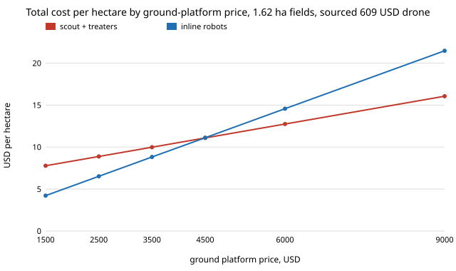

# osrobot-sourcedprices: does the scout-and-treater weeding fleet still lose to inline robots when the machines are priced from published list prices?

Follow-up to `osrobot-deadlineloss` (track 9, open-source purpose-built robots), whose "Next steps" asked to "source prices for an open drone and ground platform". Its fleet prices (5,000 USD inline robot, 2,500 USD scout, 3,500 USD treater) were round numbers I chose. This project replaces them with two list prices read on 2026-10-23 and re-runs the sweep. **Sourced: a Holybro X500 V2 PX4 development kit, 609 USD with Pixhawk 6C, no battery, about 18 min hover, 1.5 kg payload (holybro.com/products/px4-development-kit-x500-v2); an AgileX Scout Mini ground robot, 4,500 USD, 10 or 20 kg payload (robotlab.com/store/agilex-scout-mini/).** Still not sourced and therefore swept: the battery, camera and sprayer or other weeding tool, and the drone's flight time under load. Yield loss (2% per leaf stage late) is Knezevic, Evans & Mainz 2003, *Crop Management* 2(1), doi:10.1094/CM-2003-0219-01-RS, as in `osrobot-deadlineloss`. In the direction of the ARPG, RECUV and Autonomous Systems IRT interest in field robots; nothing here is affiliated with or endorsed by them. Produced with AI assistance (Claude). Pure Python standard library. Simulation only; nothing was built, bought or flown.

**Live page:** https://duncan-haywood.github.io/monorepo-projects/research/osrobot-sourcedprices/



- **Real list prices moved the ratios a little and flipped nothing.** Pipeline cost over inline cost, assumed prices to sourced platforms, 16 fields, 8 h window, 2,000 USD/ha revenue: 0.18 ha 1.49 to 1.54; 0.72 ha 1.11 to 1.14; 1.62 ha 1.07 to 1.15 (at 1,000 USD/ha: 1.09 to 1.12 at 0.72 ha and 1.00 to 1.07 at 1.62 ha). At a 24 h window and 1.62 ha the pipeline stays cheaper (0.89 assumed, 0.96 sourced).
- **The cheap drone is not what decides it; the price of the inline robot over the bare platform is.** Pricing the inline robot 1,500 USD above the bare ground platform (an assumed premium for its camera and compute) makes the pipeline cheaper in every row at 0.72 and 1.62 ha (0.82 to 0.88) but not at 0.18 ha (1.26). With no premium the inline fleet is cheaper at 0.18 and 0.72 ha.
- **At 1.62 ha, 12 h window, the two fleets tie when the ground platform costs 4,500 USD** (11.09 against 11.12 USD/ha, the Scout Mini price); below it inline is cheaper (4.22 against 7.78 at 1,500), above it the pipeline is (16.06 against 21.47 at 9,000). So the verdict at large fields sits at the price of the one sourced ground robot, which is the least comfortable place to report it from: treat it as a tie.
- **A drone that flies 12 min under load instead of 18 raises the ratio by 0.12** wherever fields need battery swaps (0.72 ha: 1.14 to 1.26 at 8 h; 1.62 ha: 1.15 to 1.27 at 8 h), and at 1.62 ha and a 24 h window it flips the verdict from pipeline cheaper (0.96) to inline cheaper (1.07). The unsourced loaded endurance matters as much as the sourced prices.

## Reproduce
```bash
cd research/osrobot-sourcedprices
PYTHONPATH=src python3 -m unittest discover -s tests -v   # 6 tests, under a second
PYTHONPATH=src python3 experiments/run.py > experiments/results.txt   # a few seconds
python3 experiments/figure.py                             # experiments/breakeven.svg, parsed from results.txt
```

## Motivation
A farmer, or a grant reviewer, asks what such a fleet would cost to buy. Round numbers cannot answer that; a quoted price can be checked. This is the smallest step from assumed to sourced prices, and it shows which unsourced input still decides the answer.

## Builds on
`osrobot-deadlineloss` (model copied into `src/osrobot_sourcedprices/fleet.py` with a `configure()` for prices and endurance; with defaults it reproduces `osrobot-deadlineloss`'s 13.92 USD/ha at 0.72 ha, tested), `osrobot-deadline`, `osrobot-pipeline`, `osrobot-pairprice`.

## Parameters
| Parameter | Value | Source |
|---|---|---|
| Scout drone | 609 USD (X500 V2 kit, Pixhawk 6C, M10 GPS, radio; no battery) | holybro.com product page, read 2026-10-23 |
| Drone flight time | 18 min hover, no payload; 12 min loaded swept | same page for 18; loaded value unsourced |
| Ground platform (treater; inline robot in most rows) | 4,500 USD (Scout Mini with remote, battery, charger) | robotlab.com, read 2026-10-23 |
| Scout add-ons (battery, camera) | 0 or 400 USD | not sourced; swept |
| Inline-robot tool premium | 0 or 1,500 USD | not sourced; swept |
| Treater tool (sprayer or actuator) | 0 | not sourced; the rows leave it out |
| Yield loss | 2% per leaf stage late | Knezevic, Evans & Mainz 2003 |
| Leaf stage 4 days, 8 h day, revenue 1,000 or 2,000 USD/ha | as stated | not sourced (swept in `osrobot-deadlineloss`) |
| Annual capital charge 30%, 500 h/yr, labour 20 USD/h, electricity 0.15 USD/kWh, times | as `osrobot-deadlineloss` | assumed / `osrobot-pairprice` fits |

## Limitations
- Two retail list prices, one per machine; no quantity discount, tax, shipping or resale value. The Holybro price is its own store's; other sellers list the kit higher.
- The Scout Mini is a research ground robot, not a weeding robot; its running speed and the per-field minutes (from `osrobot-pairprice`'s simulation) are not matched to it. The treater and the inline robot are not priced with any weeding tool, which makes both too cheap; the inline-premium rows are one way to bracket that and are not sourced.
- The 2% loss rate applies to corn and soybean up to canopy closure; equal fields, one window, no weather or failures; fleets capped at four scouts, 16 treaters, 32 inline robots (as before).
- Endurance of 18 min is a hover figure with no payload; a camera lowers it.

## Next steps
Source a weeding tool (sprayer or mechanical) and a camera-and-compute module to price the treater and inline premium; give fields staggered windows; ask a fixed-budget question.

## Owner steps
None taken. Buying or flying anything is the owner's step.

## Outside dependencies
None: Python 3 standard library only.

MIT.
