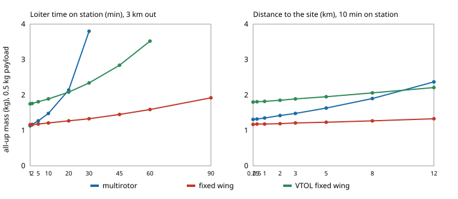

# How heavy must a purpose-built UAV for targeted observation be, and when does a hover-capable airframe stop being worth its weight?

Fourth milestone (`osrobot-uav`) of track 9, open-source purpose-built robots, in the direction of the RECUV and Autonomous Systems IRT interest in UAV simulation and targeted observation. Produced with AI assistance (Claude). Pure Python standard library. **Every technology constant (pack energy density, efficiencies, drag, structural mass fractions) is an assumed round number in `model.py` (marked ASSUMED), not a measurement of any product, and no UAV was designed for flight or flown.** All numbers below are from `experiments/results.txt`. Simulation only; **a stylised, preliminary sizing study. The PX4 or ArduPilot software-in-the-loop flight that the milestone mentions was not attempted in this run.**



- **Reference mission** (3 km out, 20 min on station, 0.5 kg and 5 W payload, 20% energy reserve): the lightest closed design is a plain fixed wing at 1.27 kg (wing 0.14 m², 19 Wh pack), against 2.14 kg for a quadrotor (33 cm rotors, 95 Wh) and 2.08 kg for a fixed wing with a vertical-lift system (VTOL, 41 Wh).
- **Hovering is what costs the mass.** The multirotor grows fast with time on station: 1.13 kg at 1 min, 2.14 at 20 min, 3.80 at 30, and no closure under 60 kg at 45 min or more. The fixed wing orbiting in a 20° bank grows slowly (1.16 kg at 1 min, 1.59 at 60, 1.92 at 90). The multirotor is the lightest design only at about 1 min on station; from 2 min the plain fixed wing is lighter.
- **A VTOL wing beats the quadrotor at long stays and long legs, not short ones.** At 3 km it is heavier than the quadrotor at 10 min on station (1.89 against 1.48 kg), about level at 20 min (2.08 against 2.14), and lighter from 30 min (2.34 against 3.80). At 10 min on station it overtakes the quadrotor between 8 and 12 km (2.06 against 1.90 at 8 km, 2.21 against 2.37 at 12). It is always heavier than a fixed wing that can be launched by hand and landed on its belly, the price of vertical take-off and landing at the reference mission being 0.81 kg (2.08 against 1.27).
- **Payload scales the gap.** At the reference mission a 0.1 kg payload gives 0.83 kg (multirotor), 0.76 (fixed wing) and 1.20 (VTOL); at 2 kg, 7.73, 3.20 and 6.08; at 4 kg the multirotor does not close and the VTOL needs 13.09 kg against 5.75 for the fixed wing.
- **A design built for one mission, flown on another.** The reference quadrotor and fixed wing with their batteries frozen keep about 20 min on station at 3 km (by construction), but at 9 km the quadrotor has 11.7 min and the fixed wing 6.6; at 12 km the fixed wing cannot reach the site and return, and the quadrotor has 7.6 min. A design built for each mission at 12 km weighs 4.16 kg (multirotor) and 1.40 kg (fixed wing). Reusing a design costs range and endurance, or carries extra mass, relative to one built for the mission.
- **Assumption sensitivity** (reference mission, one change at a time): pack energy density of 150 or 250 Wh/kg moves the multirotor from 2.14 kg to 2.70 or 1.65 and the fixed wing from 1.27 to 1.30 or 1.22; rotor figure of merit of 0.6 or 0.8 moves the multirotor to 2.64 or 1.88. The ordering at the reference mission (fixed wing lightest) does not change under any of these.

## Reproduce
```bash
cd research/osrobot-uav
PYTHONPATH=src python3 -m unittest discover -s tests -v   # 8 tests, a few seconds
PYTHONPATH=src python3 experiments/run.py                 # about 80 s; writes experiments/results.txt
python3 experiments/figure.py                             # experiments/mass_sweeps.svg, parsed from results.txt
```

## Motivation
Targeted observation (flying a sensor to a feature, such as a storm cell edge or a field plot, and holding there) has two opposed airframe answers: a multirotor that can hover but pays for it in every watt, and a fixed wing that is efficient but can only orbit and needs somewhere to launch and land. A purpose-built design is whichever closes lightest for its mission. This project asks how the mission, rather than taste, picks the airframe.

## Builds on
The UAV and field-robot simulation and targeted-observation directions of RECUV (<https://www.colorado.edu/recuv/>) and the Autonomous Systems IRT (<https://www.colorado.edu/irt/autonomous-systems/>); no specific paper from either is reproduced, and nothing here is affiliated with or endorsed by them. Rotor hover power is actuator-disc (momentum) theory with a figure of merit, as in Leishman (2006), *Principles of Helicopter Aerodynamics*, 2nd ed., Cambridge University Press. The fixed-wing power model is the parabolic drag polar (Stevens, Lewis and Johnson 2016, *Aircraft Control and Simulation*, 3rd ed., Wiley). The mass-closure loop (all-up mass equals fixed masses plus a battery sized to a mission whose energy depends on the mass) is the standard conceptual-design iteration (e.g. Raymer, *Aircraft Design: A Conceptual Approach*, AIAA). Design by search over body parameters follows the spirit of `osrobot-morph` and `osrobot-bodysearch`. Companion to `uav-energy-twin` (wind and battery margin) and `targeted-observation-twin`. Open flight stacks the milestone names: Meier, Honegger and Pollefeys (2015), PX4, *ICRA*; ArduPilot. Neither was run.

## Method
`src/osrobot_uav/model.py`. A mission is a distance, a loiter time, a payload mass and a payload power. *Multirotor:* four rotors of free diameter; hover power from momentum theory over figure of merit 0.70 and drive efficiency 0.81; level-flight power from the induced-velocity relation `v_i = v_h² / sqrt(v² + v_i²)` plus parasite power with an assumed drag area; cruise at the speed of least energy per metre; rotor and arm mass grow as `d^2.5`; motor mass scales with twice hover power. *Fixed wing:* a free wing area at aspect ratio 8, polar `C_D0 = 0.03`, Oswald factor 0.8; cruise at best L/D, loiter at minimum power in a 20° bank; speeds raised to 1.3 times the stall speed and capped at 35 m/s; a wing-loading cap of 15 kg/m²; wing, fuselage and motor mass assumed. *VTOL:* the fixed wing plus a lift system of 20% of all-up mass, four 0.30 m lift rotors, 90 s of hover per sortie and 10% extra cruise power. Every design is closed by fixed-point iteration on all-up mass with a battery sized for the mission energy plus a 20% reserve at 80% depth of discharge and 180 Wh/kg, and the free dimension (rotor diameter or wing area) is chosen by grid search for least mass. `frozen_max_loiter` flies a closed design on another mission with its battery fixed.

## Limitations
- Stylised and untested against any real aircraft: no component was checked against a data sheet or a flight log. Masses of motors, frames and wings are assumed fractions, so absolute masses are not predictions, and the ordering rests on the same assumptions (see the sensitivity list; structural constants and the VTOL penalty were not varied).
- The comparison is not a like-for-like service: a fixed wing cannot hover or launch without a runway or a hand launch, and an orbit at a 20° bank keeps a sensor on a target only if its field of regard allows it. The VTOL numbers are one assumed lift system, not a survey of designs.
- No wind, gusts, climb, altitude, temperature, battery discharge curve, payload gimbal, regulations or safety margins beyond the energy reserve. Flying outdoors is an owner step under FAA rules (14 CFR Part 107, or 49 U.S.C. § 44809), and nothing here is a safety case.
- The search is a one-dimensional grid per airframe; aspect ratio, number of rotors and motor choice are fixed. No weapons or harmful payloads are modelled.
- PX4 or ArduPilot software-in-the-loop flight was not attempted, so no claim is made about controllability or about flying the mission.

## Next steps
Calibrate the constants against published data sheets for open-hardware airframes (checking each licence); vary the structural and VTOL assumptions in the sensitivity table; add wind through `uav-energy-twin`; fly the closed designs in PX4 or ArduPilot SITL if it installs; add a sensor field-of-view model so the orbit can be scored on how long the target stays in view.
