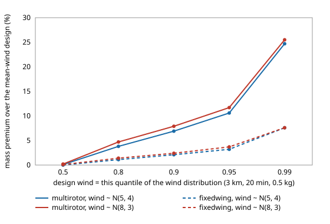

# How much heavier must an observation UAV be if the wind is uncertain, and is designing to a wind quantile cheaper than a bigger battery reserve?

Follow-up to `osrobot-uavwind` (track 9, open-source purpose-built robots), taking its "wind uncertainty" next step, in the direction of the RECUV and Autonomous Systems IRT interest in UAV simulation and targeted observation. Worth doing because `osrobot-uavwind` sized every airframe for one known wind, while a real mission meets a forecast with an error. Produced with AI assistance (Claude). Pure Python standard library; it imports the sizing models of `osrobot-uav` and `osrobot-uavwind`. **Every technology constant is an assumed round number from those projects, and the wind distributions are scenario inputs, not measurements of any site; no UAV was designed for flight or flown.** All numbers below are from `experiments/results.txt`. Simulation only; a stylised, preliminary study.

**Live page:** https://duncan-haywood.github.io/monorepo-projects/research/osrobot-uavgust/



- **Designing to the 95th-percentile wind costs the fixed wing 1 to 4% in mass and the multirotor 3 to 12%.** Mission 3 km out, 20 min on station, 0.5 kg payload, wind magnitude per mission drawn from Normal(mu, sigma). For mu = 8, sigma = 3 m/s the 95% design wind is 12.9 m/s: fixed wing 1.333 kg against 1.286 kg for the mean-wind design (+3.7%), multirotor 2.518 against 2.254 kg (+11.7%). At the 99th percentile the premium is 7.6% and 25.5%.
- **The multirotor pays far more because its mass rises steeply with wind** (`osrobot-uavwind`): the same extra wind costs it about three times the mass fraction. With a calm mean (mu = 0, sigma = 3) the premium is small for both (0.7% and 2.6% at the 95th percentile).
- **The standard 20% battery reserve already hedges most of the uncertainty, if it may be spent.** Counting the reserve as usable, a design sized for the mean wind still finishes the 20 min stay with probability 0.991 (multirotor) and 0.970 (fixed wing) at mu = 5, sigma = 4, and 0.990 and 0.952 at mu = 8, sigma = 3. With the reserve held back as a rule, a mean-wind design succeeds only about half the time, as it must. Whether the reserve may be spent on station is a policy choice that this model does not make for the operator.
- **A wind-distribution design is not clearly cheaper than a bigger reserve.** Reaching about 0.99 (reserve spent) at mu = 5, sigma = 4 costs the fixed wing 1.313 kg (95th-percentile design wind) or 1.303 kg (40% reserve), and at mu = 8, sigma = 3 the multirotor 2.433 kg (90th percentile, 0.996) or 2.487 kg (30% reserve, 0.997). The two routes are within a few percent of each other in these cases; the model does not show one dominating.
- **The airframe ordering can flip once the design wind is a high quantile.** For a short 1 min stay at 3 km the multirotor is lightest at the median design wind in every case tried. At mu = 8, sigma = 3 the 95th-percentile design wind (12.9 m/s) makes the fixed wing lighter (1.215 against 1.257 kg), which the mean-wind design would not show (multirotor 1.170 against 1.176 kg).

## Reproduce
```bash
cd research/osrobot-uavgust
python3 -m unittest discover -s tests -v   # 8 tests, about 6 s
python3 experiments/run.py                 # about 2 min; writes experiments/results.txt
python3 experiments/figure.py              # experiments/premium_vs_quantile.svg, parsed from results.txt
```
The tests and scripts add `../src`, `../../osrobot-uavwind/src` and `../../osrobot-uav/src` to the path themselves.

## Motivation
A battery is sized once; the wind is met later. A design for the forecast mean fails about half the time if no reserve may be spent. The question is what it costs, in mass, to buy a stated probability of finishing the stay, and by which route (design wind or reserve).

## Builds on
`osrobot-uavwind` (steady-wind sizing and frozen-design stay time, imported unchanged), `osrobot-uav` (mass closure), and the headwind-uncertainty idea of `uav-energy-twin`. The UAV and targeted-observation directions of RECUV (<https://www.colorado.edu/recuv/>) and the Autonomous Systems IRT (<https://www.colorado.edu/irt/autonomous-systems/>); no specific paper from either is reproduced, and nothing here is affiliated with or endorsed by them. Rotor power is actuator-disc theory (Leishman 2006, *Principles of Helicopter Aerodynamics*, 2nd ed., Cambridge University Press), the fixed-wing polar is Stevens, Lewis and Johnson (2016), *Aircraft Control and Simulation*, 3rd ed., Wiley, and the mass-closure loop is the conceptual-design iteration of Raymer, *Aircraft Design: A Conceptual Approach*, AIAA.

## Method
`src/osrobot_uavgust/gust.py`. The along-track wind of a mission is one draw `w ~ Normal(mu, sigma)`, held steady during that mission; the out-and-back model is sign-symmetric so `|w|` is used. The distribution is discretised exactly into 0.25 m/s bins with the normal CDF, so every probability is a deterministic sum, with no sampling noise. A *design wind* `wd` is a quantile `q` of `|w|`; the airframe is closed for a steady `wd` with `osrobot_uavwind` (no translational-lift credit). A design *succeeds* in wind `w` if the frozen airframe has at least the required stay left (`osrobot_uavwind.frozen_loiter`). With the reserve kept, the battery usable is the sized energy without its 20% reserve; with the reserve spent, the reserve counts too. A design closed for `wd` succeeds in every wind up to `wd`, so its success probability is at least `q` by construction (the first, "reserve kept" column of sweep 1 is therefore close to `q`, which is a check, not a finding). The "bigger reserve" route re-closes the mean-wind design with the reserve fraction set to 0.3, 0.4 or 0.6.

## Limitations
- Stylised and untested against any real aircraft or weather. Constants are assumed; absolute masses are not predictions.
- One steady wind per mission, drawn from a normal distribution with chosen mean and spread. Real winds vary in time and with altitude, are skewed and have gusts and turbulence that this steady model cannot show; the name "gust" here means a wind that differs from the forecast, not a turbulence model. Crosswind and direction are not modelled.
- Only the multirotor and the plain fixed wing are evaluated; the VTOL has no frozen-design model in `osrobot-uavwind` and was left out.
- Success means only "enough stay time on station": no launch or landing wind limit, no loss of control, no sensor field of view, no cost of failure. Spending the reserve on station is optimistic for a safe-landing rule.
- A "bigger reserve" is raised as a fraction of mission energy at the same design wind; other reserve rules (time-based, distance-based) were not tried. The comparison covers a few (mu, sigma) cases and no confidence statement is made beyond them.
- Flying outdoors is an owner step under FAA rules (14 CFR Part 107, or 49 U.S.C. § 44809); nothing here is a safety case. No weapons or harmful payloads are modelled.

## Next steps
Replace the steady draw with a time-varying wind (Dryden or von Karman turbulence on a mean) in a short trajectory simulation; add a launch and landing wind limit and VTOL; test a time-based reserve rule; fly the closed designs in PX4 or ArduPilot SITL if it installs.

## Outside dependencies
None: pure Python standard library, plus the sibling projects `osrobot-uav` and `osrobot-uavwind`. Everything physical (airframes, motors, batteries, flight tests) is an owner step and was not done.

MIT.
