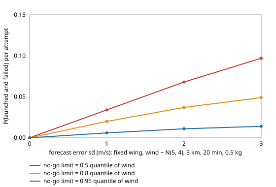

# If an observation UAV only launches when the forecast wind is below a limit, how much does forecast error bring failures back, and what does it cost in scrubbed missions?

Follow-up to `osrobot-uavgust` (track 9, open-source purpose-built robots), taking its "launch wind limit" next step, in the direction of the RECUV and Autonomous Systems IRT interest in UAV simulation and targeted observation. Worth doing because `osrobot-uavgust` hedged wind uncertainty only by building a heavier airframe or a bigger reserve; a crew can also just not fly in strong wind, which costs missions instead of mass. Produced with AI assistance (Claude). Pure Python standard library; it imports the sizing models of `osrobot-uav`, `osrobot-uavwind` and `osrobot-uavgust`. **Every technology constant is an assumed round number from those projects, and the wind and forecast-error distributions are scenario inputs, not measurements of any site; no UAV was designed for flight or flown.** All numbers below are from `experiments/results.txt`. Simulation only; a stylised, preliminary study.



- **With a perfect forecast a no-go limit converts every failure into a scrub.** Airframe sized for limit wind L, launch only if the wind is at most L: P(fail) is 0 in all 12 cases, and the price is the share of missions scrubbed (fixed wing, wind ~ N(5, 4) m/s: 48% at the median limit, 19% at the 80th percentile, 4.6% at the 95th) plus the mass of the airframe sized for L (1.274, 1.288, 1.313 kg).
- **Forecast error brings failures back, mostly at low limits.** With a 2 m/s forecast error the fixed wing at the median limit fails 6.8% of attempts and completes only 43%; at the 95th-percentile limit it fails 1.1% and completes 92%. At a 3 m/s error: 9.7% against 1.4%.
- **Forecast error also scrubs more missions** (4.6% to 9.3% at the 95th-percentile limit as the error goes from 0 to 3 m/s), because a margin-free limit throws away good days on bad forecasts.
- **Multirotor and fixed wing behave the same way;** the multirotor just pays more mass for each step of limit (N(8, 3): 2.258, 2.359, 2.518 kg against 1.286, 1.304, 1.333 kg).
- **Reading across to `osrobot-uavgust`:** a high limit (95th percentile) with a forecast error up to 2 m/s keeps the per-attempt failure rate near or below 2% and scrubs under 9% of attempts, at the same airframe mass as designing to that quantile; a low limit does not buy safety once the forecast is wrong by more than about 1 m/s.

## Reproduce
```bash
cd research/osrobot-uavnogo
python3 -m unittest discover -s tests -v   # 5 tests, about 7 s
python3 experiments/run.py                 # about 1 min; writes experiments/results.txt
python3 experiments/figure.py              # experiments/fail_vs_forecast_error.svg, parsed from results.txt
```
The tests and scripts add the sibling `src` directories to the path themselves.

## Motivation
A crew that checks the forecast before launch trades missions for safety. How good the forecast must be for that trade to work, and how it compares with building a heavier aircraft, decides whether the cheap lever (a rule) can replace the expensive one (mass).

## Builds on
`osrobot-uavgust` (wind distribution, sizing for a wind, frozen-design stay; imported unchanged), `osrobot-uavwind` and `osrobot-uav`. The UAV and targeted-observation directions of RECUV (<https://www.colorado.edu/recuv/>) and the Autonomous Systems IRT (<https://www.colorado.edu/irt/autonomous-systems/>). Where the ideas are not from those groups, they are the author's own and unreviewed by them.

## Method
`src/osrobot_uavnogo/nogo.py`. The mission wind magnitude |w| is the discretised folded normal of `osrobot-uavgust`. The forecast is |w| + e, e ~ Normal(0, sf); the crew launches if the forecast is at most the limit L, so P(launch | w) = Phi((L - w) / sf) (a step for sf = 0). The airframe is sized for L with the `osrobot-uavgust` sizing, and a launched mission fails if the frozen design's stay on station falls short of the requirement (battery reserve kept, not spent). Per attempt: scrub + fail + complete = 1, computed exactly over the bins, so there is no sampling noise. A 0.01 s tolerance on the stay avoids counting a design exactly at its limit as failed (sizing closes only to about 1e-4 s; without it two multirotor rows showed spurious failures of 1 to 3% at sf = 0).

## Limitations
- Stylised and untested against any real aircraft or weather. Constants are assumed; absolute masses are not predictions.
- One steady wind per mission; no gusts, turbulence or change between forecast and flight time. A forecast error independent of wind speed and normally distributed is an assumption; real error is usually larger in strong, gusty wind.
- A scrub is counted as a neutral outcome with no cost beyond the lost attempt; no rescheduling, no cost of a delayed observation and no value on the data of a completed mission.
- Only the multirotor and plain fixed wing; the VTOL has no frozen-design model. Only a few (mu, sigma) cases and no confidence statement beyond them.
- Flying outdoors is an owner step under FAA rules (14 CFR Part 107, or 49 U.S.C. § 44809); nothing here is a safety case. No weapons or harmful payloads are modelled.

## Next steps
Make the forecast error grow with wind speed and lead time; let a scrubbed mission be retried later in the day (a Markov wind model); put a value on a completed observation and optimise limit and mass together; fly closed designs in PX4 or ArduPilot SITL.

## Outside dependencies
None: pure Python standard library, plus the sibling projects `osrobot-uav`, `osrobot-uavwind` and `osrobot-uavgust`. Everything physical (airframes, motors, batteries, flight tests, forecasts) is an owner step and was not done.

MIT.
