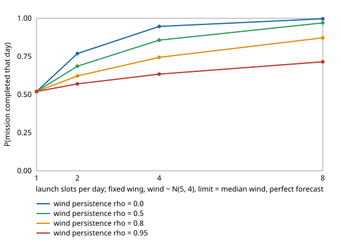

# If a scrubbed observation-UAV launch can be retried later the same day, how much does persistent wind limit what retrying buys, and does retrying bring failures back?

Follow-up to `osrobot-uavnogo` (track 9, open-source purpose-built robots), taking its "let a scrubbed mission be retried later (a Markov wind model)" next step, in the direction of the RECUV and Autonomous Systems IRT interest in UAV simulation and targeted observation. Worth doing because `osrobot-uavnogo` counted a scrub as a lost mission; a crew can wait and look again, but a windy morning tends to be followed by a windy noon, so the gain from retrying depends on how persistent the wind is. Produced with AI assistance (Claude). Pure Python standard library; it imports the sizing and go/no-go models of `osrobot-uavnogo`, `osrobot-uavgust`, `osrobot-uavwind` and `osrobot-uav`. **Every technology constant is an assumed round number from those projects, and the wind persistence, forecast-error and slot structure are scenario inputs, not measurements of any site; no UAV was designed for flight or flown.** All numbers below are from `experiments/results.txt`. Simulation only; a stylised, preliminary study.

**Live page:** https://duncan-haywood.github.io/monorepo-projects/research/osrobot-uavretry/



- **Retries are worth much less when wind persists.** Fixed wing, wind ~ |N(5, 4)| m/s, airframe and limit at the median wind, perfect forecast: one slot completes 52.0% of days. Eight independent slots (rho = 0) reach 99.7%; with persistence rho = 0.5, 0.8 and 0.95 eight slots reach 97.0%, 87.2% and 71.5%. At rho = 0.95, doubling from 4 to 8 slots adds 8 points (63.4% to 71.5%).
- **A high limit needs few retries.** At the 95th-percentile limit with a perfect forecast, eight slots complete 99.9% to 100% of days for rho up to 0.8 and 98.9% at rho = 0.95.
- **With forecast error, retrying brings failures back.** Each fresh forecast is another draw of the error, so a retry can launch on an optimistic forecast in wind the frozen design cannot hold. Forecast error 2 m/s, 80th-percentile limit: per-day failure is 3.7% with one slot and 4.8% (rho = 0), 6.3% (0.5), 8.6% (0.8) and 11.1% (0.95) with eight slots, while completion rises from 73.6% to 95.2%, 93.6%, 90.3% and 84.7%. At the median limit with the same error, failures rise from 6.8% to 13.6% (rho = 0) and 23.7% (rho = 0.95) of days.
- **Persistence adds failures as well as removing completions,** consistent with the days that wait longest being persistently windy days, where each further forecast draw is a chance to launch on a lucky error (a reading of the numbers, not separately tested): expected attempts per day at the median limit and 2 m/s error rise from about 2 (rho = 0) to 3.2 (rho = 0.95) of 8 slots.
- **Reading across to `osrobot-uavnogo`:** its per-attempt scrub rates overstate the lost missions when the crew can retry, and understate the failure rate when the forecast is noisy. Either build a margin into the limit or take the first-launch failure rate as the cost of each additional retry.

## Builds on
`osrobot-uavnogo` (go/no-go limit and forecast-error launch probability, imported unchanged), `osrobot-uavgust`, `osrobot-uavwind` and `osrobot-uav`. The UAV and targeted-observation directions of RECUV (<https://www.colorado.edu/recuv/>) and the Autonomous Systems IRT (<https://www.colorado.edu/irt/autonomous-systems/>). Where the ideas are not from those groups, they are the author's own and unreviewed by them.

## Method
`src/osrobot_uavretry/retry.py`. Wind magnitude is the discretised folded normal of `osrobot-uavgust`. Between slots it follows a Markov chain built as a Gaussian copula: a latent AR(1) variable with correlation rho, mapped to the bin whose quantile interval contains it, so each row of the transition matrix sums to 1. A day has K slots; at each slot the crew draws a fresh forecast |w| + e (e ~ Normal(0, sf), independent between slots) and launches if it is at most L; the first launch ends the day as completed or failed (frozen design, battery reserve kept, 0.01 s tolerance as in `osrobot-uavnogo`). Completed + failed + no launch = 1, propagated exactly over the bins, so there is no sampling noise. Tests check row sums, that the three outcomes sum to 1, that K = 1 reproduces `osrobot-uavnogo`'s single attempt, that rho = 0 gives the geometric no-launch probability, that persistence lowers the benefit of retries, and that retries with forecast error add failures.

## Limitations
- Stylised and untested against any real aircraft or weather. Constants are assumed; absolute masses are not predictions.
- The chain's stationary law is only approximate (the latent value is taken at each bin's mid-quantile); the largest deviation from the marginal is 0.0013 in probability (`stationary_err` column). Slots are equally spaced and there is no daily cycle in wind.
- The forecast error is independent between slots and of wind speed; real forecasts made hours apart share errors, which would make retries less harmful than shown here for failures, and no more useful for completions.
- A day ends at the first launch. No abort and recovery, no value on a completed mission or cost of a lost aircraft or a delayed observation, one (mu, sigma) case and the fixed wing only.
- Flying outdoors is an owner step under FAA rules (14 CFR Part 107, or 49 U.S.C. § 44809); nothing here is a safety case. No weapons or harmful payloads are modelled.

## Reproduce
```bash
cd research/osrobot-uavretry
python3 -m unittest discover -s tests -v   # 7 tests, under 1 s
python3 experiments/run.py                 # about 3 s; writes experiments/results.txt
python3 experiments/figure.py              # experiments/complete_vs_slots.svg, parsed from results.txt
```

## Next steps
Share forecast error between slots and make it grow with wind speed and lead time; add abort and recovery so a failure loses less than the airframe; put a value on a completed day and optimise limit, mass and slots together; fly closed designs in PX4 or ArduPilot SITL.

## Outside dependencies
None: pure Python standard library, plus the sibling projects named above. Everything physical (airframes, motors, batteries, flight tests, forecasts) is an owner step and was not done.

MIT.
