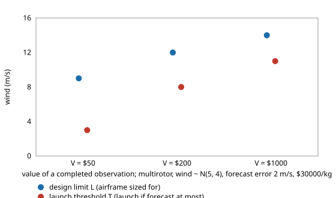

# What is a UAV launch wind limit worth in money, and should the launch threshold sit below the design limit when the forecast is wrong?

Follow-up to `osrobot-uavnogo` (track 9, open-source purpose-built robots), taking its "put a value on a completed observation and optimise limit and mass together" next step, in the direction of the RECUV and Autonomous Systems IRT interest in UAV simulation and targeted observation. Worth doing because `osrobot-uavnogo` scored a rule only by failure and scrub rates, so it could not say which limit to pick; money does. Produced with AI assistance (Claude). Pure Python standard library; it imports `osrobot-uavnogo` and its siblings. **Every technology constant comes from those projects and every money figure ($/kg, $ per scrub, value of an observation) is an assumed round number, not a price or market data; no UAV was designed for flight or flown.** All numbers below are from `experiments/results.txt`. Simulation only; a stylised, preliminary study.



Model: per attempted mission the operator earns V for a completed observation, loses the aircraft (price P per kg times its mass) on a failure, pays $10 for a scrubbed day, and carries the aircraft price spread over 100 attempts. Two knobs are searched on a 3 to 16 m/s grid in 1 m/s steps: the **design limit L** (airframe sized for wind L) and the **launch threshold T** (launch if the forecast is at most T). `osrobot-uavnogo` tied T = L.

- **When the airframe is cheap ($1,500/kg) the best rule is to build for nearly every wind and launch nearly always.** In 17 of 18 cases the best L is 14 m/s or more, and 11 of them sit on the 16 m/s grid edge, so the true optimum may be higher still. Mass costs little here (a fixed wing grows from 1.36 to 1.42 kg between L = 14 and 16), so the launch rule barely matters.
- **When the airframe is expensive ($30,000/kg) the optimum is interior and the rule matters.** With a perfect forecast, T = L, and the best L rises with V: for the multirotor in N(5, 4) wind, 6, 9, 12 m/s at V = $50, $200, $1,000, scrubbing 40%, 16%, 4% of attempts, with failures near 0.
- **A forecast error opens a gap between L and T.** At a 2 m/s forecast error and $30,000/kg, the best T is below the best L in all 9 cases that have a 2 m/s error (by 1 to 6 m/s, which is 0.5 to 3 times the error). Letting T differ from L is worth up to $284 per attempt over tying them (multirotor, V = $50; the T = 3 m/s there is also on the grid floor) and $12 to $50 for the fixed wing. In every best rule the failure rate stays at or below 0.1%: the optimum buys a margin rather than accepting risk.
- **"Design for the 95th percentile and always launch" is a poor baseline once a failure destroys the aircraft:** it is $1,771 to $3,358 per attempt worse than the best rule at $30,000/kg, and its net value is negative at V = $50 (both airframes) and for the multirotor at V = $200 even at $1,500/kg. This baseline assumes every failure loses the airframe; a crew that can abort and recover would lose far less.

## Reproduce
```bash
cd research/osrobot-uavvalue
python3 -m unittest discover -s tests -v   # 4 tests, about 4 s
python3 experiments/run.py                 # about 10 min; writes experiments/results.txt
python3 experiments/figure.py              # experiments/limit_vs_threshold.svg, parsed from results.txt
```
The tests and scripts add the sibling `src` directories to the path themselves.

## Builds on
`osrobot-uavnogo` (outcome probabilities under a launch threshold, imported unchanged), `osrobot-uavgust`, `osrobot-uavwind` and `osrobot-uav`. The UAV and targeted-observation directions of RECUV (<https://www.colorado.edu/recuv/>) and the Autonomous Systems IRT (<https://www.colorado.edu/irt/autonomous-systems/>). The value model is the author's own and unreviewed by them.

## Method
`src/osrobot_uavvalue/value.py`. Net value per attempt = V·P(complete) − P·m·P(fail) − c_scrub·P(scrub) − P·m/N, where m is the mass of the airframe sized for L and the three probabilities come from `osrobot_uavnogo.outcomes` with launch threshold T. The probabilities are exact over the discretised wind distribution, so there is no sampling noise. `best_rule` is an exhaustive search over the (L, T) grid (or T = L when tied).

## Limitations
- Money figures are assumptions. Only two airframe prices, three observation values and two forecast errors were tried, over three wind and airframe cases; no confidence statement. The $30,000/kg row is chosen to make mass matter, not taken from any vendor.
- Many best rules sit on the grid edge (L = 16 m/s, or T = 3 m/s), so those optima are lower or upper bounds on the true ones.
- A failure is assumed to destroy the whole airframe and the payload; no abort, recovery, insurance, or partial data. A scrub costs a flat $10 and cannot be retried the same day.
- One steady wind per mission; forecast error independent of wind speed and normal. Only the multirotor and plain fixed wing.
- Flying outdoors is an owner step under FAA rules (14 CFR Part 107, or 49 U.S.C. § 44809); nothing here is a safety case. No weapons or harmful payloads are modelled.

## Next steps
Let a scrubbed mission be retried later (a Markov wind model); allow abort and recovery so a failure loses less than the airframe; extend the grid beyond 16 m/s to close the edge cases; fly closed designs in PX4 or ArduPilot SITL.

## Outside dependencies
None: pure Python standard library, plus the sibling projects `osrobot-uavnogo`, `osrobot-uavgust`, `osrobot-uavwind` and `osrobot-uav`. Everything physical (airframes, prices, flight tests, forecasts) is an owner step and was not done.

MIT.
