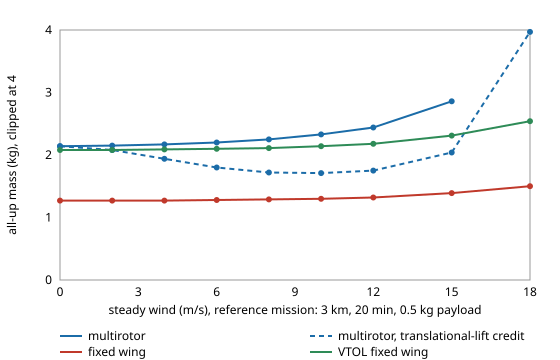

# Does a steady wind change which purpose-built observation UAV is lightest, and what is wind worth to a multirotor?

Follow-up to `osrobot-uav` (track 9, open-source purpose-built robots), taking its "add wind" next step, in the direction of the RECUV and Autonomous Systems IRT interest in UAV simulation and targeted observation. Worth doing because `osrobot-uav` ordered the airframes with no wind at all, and the multirotor's only win (very short stays) is exactly the case a wind could flip. Produced with AI assistance (Claude). Pure Python standard library; it imports the sizing model of `osrobot-uav`. **Every technology constant is an assumed round number (marked ASSUMED in `osrobot-uav/src/osrobot_uav/model.py` and in `src/osrobot_uavwind/wind.py`), not a measurement of any product; no UAV was designed for flight or flown.** All numbers below are from `experiments/results.txt`. Simulation only; a stylised, preliminary study. PX4 or ArduPilot software-in-the-loop flight was not attempted.



- **Wind does not change the reference ordering.** For 3 km out, 20 min on station and a 0.5 kg payload, the plain fixed wing stays lightest at every wind from 0 to 18 m/s (1.27 kg at 0, 1.30 at 10, 1.50 at 18). The quadrotor, with no credit for translational lift, goes 2.14 → 2.33 kg at 10 m/s → 2.86 at 15 → 7.0 at 18, as it must hold position at airspeed `w` and runs out of speed near its assumed 20 m/s cap. The VTOL wing goes 2.08 → 2.14 → 2.31 → 2.54.
- **The multirotor's one win goes at about 10 m/s.** At 1 min on station it is lightest up to 8 m/s (1.17 against 1.18 kg for the fixed wing), and the fixed wing is lighter from 12 m/s (1.23 against 1.21 kg is the closest row; 1.36 against 1.24 at 15).
- **The VTOL-against-multirotor crossover is not helped by wind.** At 8 km and 10 min on station the plain fixed wing is lightest at 0, 6 and 12 m/s, the multirotor goes 1.90 → 2.02 → 2.59 kg and the VTOL 2.06 → 2.10 → 2.25, so the VTOL overtakes the multirotor between 6 and 12 m/s (it was heavier at no wind).
- **A design that ignores wind loses stay time, and the fixed wing loses it first.** Reference designs sized for no wind, flown at 3 km in wind: at 9 m/s the multirotor has 18.5 min of its 20 and the fixed wing 17.2; at 12 m/s, 17.1 and 14.7; at 15 m/s, 13.8 and 8.8. They fall to 10 min at 16.5 m/s (multirotor) and 14.5 m/s (fixed wing). A design built for 15 m/s costs 2.86 kg (multirotor) and 1.39 kg (fixed wing), 34% and 9% above their no-wind masses.
- **A caution about translational lift.** If a station-keeping multirotor is credited with the momentum-theory power drop of flying at airspeed `w` (steady, perfectly known wind, no extra drag from tilt), its mass *falls* with wind, from 2.14 kg to a minimum of 1.71 at 10 m/s, then rises again (2.04 at 15, 3.97 at 18). That is a property of the model's assumptions, not a finding about real aircraft: gusts, attitude margin and rotor-wake interaction are not modelled, so the conservative no-credit column is the headline and the credited one is an upper bound on the benefit. Even credited, the multirotor (1.71 kg at best) stays heavier than the fixed wing (1.30 kg at 10 m/s).

## Reproduce
```bash
cd research/osrobot-uavwind
PYTHONPATH=src:../osrobot-uav/src python3 -m unittest discover -s tests -v   # 8 tests, about 12 s
PYTHONPATH=src:../osrobot-uav/src python3 experiments/run.py                 # about 80 s; writes experiments/results.txt
python3 experiments/figure.py                                                # experiments/mass_vs_wind.svg, parsed from results.txt
```

## Motivation
Targeted observation often means flying into weather. A UAV that is lightest in still air could be the wrong airframe at the wind speeds the mission exists for. This project asks whether wind moves the airframe choice of `osrobot-uav`, how much mass a design pays to carry a given wind, and how much stay time a still-air design gives up.

## Builds on
`osrobot-uav` (mass closure, imported unchanged) and its companion `uav-energy-twin` (headwind uncertainty and battery margin; this project uses a deterministic steady wind rather than a random one). The UAV and targeted-observation directions of RECUV (<https://www.colorado.edu/recuv/>) and the Autonomous Systems IRT (<https://www.colorado.edu/irt/autonomous-systems/>); no specific paper from either is reproduced, and nothing here is affiliated with or endorsed by them. Rotor power is actuator-disc theory (Leishman 2006, *Principles of Helicopter Aerodynamics*, 2nd ed., Cambridge University Press), the fixed-wing polar is Stevens, Lewis and Johnson (2016), *Aircraft Control and Simulation*, 3rd ed., Wiley, and the mass-closure loop is the conceptual-design iteration of Raymer, *Aircraft Design: A Conceptual Approach*, AIAA.

## Method
`src/osrobot_uavwind/wind.py`. A steady uniform wind `w` blows along the line to the site: headwind out, tailwind back. At airspeed `v` the out-and-back time per metre of one-way distance is `2v/(v² − w²)`, and the transit airspeed is re-optimised for each wind (golden-section search, above `1.05 w + 0.5` m/s, below an assumed 20 m/s multirotor cap or the 35 m/s fixed-wing cap). On station the multirotor holds position at airspeed `w` with power equal to the larger of hover and forward-flight power (or forward-flight power alone with the translational-lift credit); the fixed wing orbits at its minimum-power speed, raised to `1.2 w` (ASSUMED) when the wind is stronger. The fixed-wing motor mass is sized for the windy transit power. The VTOL lift system and its hover phase are unchanged by wind (ASSUMED). Designs are closed with `osrobot_uav.model.close`; at `w = 0` the three airframes reproduce `osrobot-uav`'s masses (a test).

## Limitations
- Stylised and untested against any real aircraft. Constants are assumed; absolute masses are not predictions.
- A steady, known, uniform wind along the leg: no gusts, crosswind, turbulence, wind shear, wind variation over time or altitude, and no uncertainty (see `uav-energy-twin` for that). A crosswind leg costs less than head-plus-tail in this model, so the transit result is a worst case for line-of-flight wind, and the station results are for a wind that never changes.
- The fixed-wing station model (orbit airspeed `1.2 w`) is a rule of thumb, not a trajectory simulation; a real orbit in strong wind is a trochoid and the sensor's field of view is not modelled.
- Wind does not affect the VTOL hover phase or take-off and landing here, which is optimistic: small rotor aircraft are often grounded by moderate winds, and nothing here is a launch or landing limit.
- The translational-lift result depends on the credit assumption (see above); the conservative column ignores it.
- Motor and rotor masses for the multirotor are not resized for wind. Flying outdoors is an owner step under FAA rules (14 CFR Part 107, or 49 U.S.C. § 44809); nothing here is a safety case. No weapons or harmful payloads are modelled.

## Next steps
Add gusts and wind uncertainty (reusing `uav-energy-twin`'s margin analysis) so a battery reserve is sized to a wind distribution; model a launch and landing wind limit; replace the orbit rule with a simulated trochoid and a sensor field of view; fly the closed designs in PX4 or ArduPilot SITL if it installs.

## Outside dependencies
None: pure Python standard library, plus the sibling project `osrobot-uav`. Everything physical (airframes, motors, batteries, flight tests) is an owner step and was not done.
