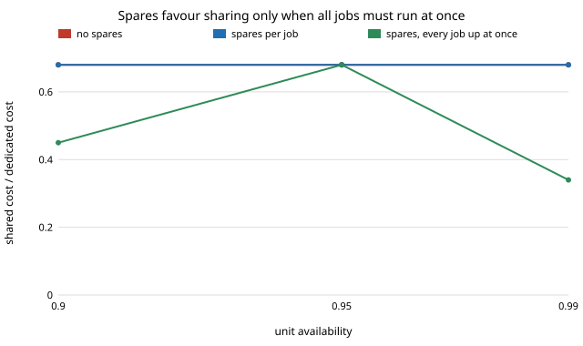

# What does a shared robot cost once it has to stay up? Spares and availability in a pick-and-place shop

Follow-up to `osrobot-reconfig` (track 9, open-source purpose-built robots), taking its "cost of one machine failing and stopping every job" next step. That project priced a shared robot against a robot per job on capital cost with every machine working. A shared robot is one point of failure for every job; a dedicated fleet fails one job at a time. This asks what buying the spares to hold a service target does to the comparison. Produced with AI assistance (Claude). Pure Python standard library; it imports `osrobot-reconfig` and `osrobot-specialise` unchanged. **Every cost, speed, accuracy, demand, changeover and availability figure is an assumption from those projects or written into the experiment; none is a price or a measurement of a real product.** All numbers below are from `experiments/results.txt`. Simulation only; a stylised, preliminary study. It builds on none of the CU Boulder groups in `prompt.md` beyond the general interest of HIRO and CAIRO in manipulation workcells.

**Live page:** https://duncan-haywood.github.io/monorepo-projects/research/osrobot-uptime/



**Model.** Each unit (a gantry or an arm) is up with probability A = MTBF / (MTBF + MTTR), independently of the others, with unlimited repair crews; a spare takes over instantly at no cost. A job (or the shared robot) that needs m units is *served in full* with probability P(Binomial(n, A) ≥ m) when n units are installed; the n − m extra units are spares. Two service targets T are priced: **per job** (each job on its own is served in full with probability ≥ T) and **every job at once** (all jobs are served together with probability ≥ T, as when they feed one product). Dedicated jobs fail independently, so the second target asks each job for T^(1/J); a shared robot fails for every job at once, so both targets are the same requirement for it. Everything else is `osrobot-reconfig`: 200 random job mixes per row, seed 7, changeover 600 s per job per shift.

## Headline results (200 job mixes per row, seed 7; "sh/ded" is the median cost of the cheapest shared fleet over a robot per job)
- **While the shared robot's load fits one machine, spares leave the per-job comparison unchanged.** At 4 jobs, scatter 0.4 m, demand 0.2 of a gantry per job, a robot per job is cheapest in 0% of mixes with no spares and with spares, and sh/ded is 0.68 in all three readings at A = 0.95 and target 0.99. Both sides need one machine per unit of load, so both double (one spare each) and the ratio holds. A shared robot has one spare to buy, a dedicated fleet four, but each of the four is a cheaper machine.
- **Asking every job to be up at once favours sharing.** At A = 0.90 and target 0.99, sh/ded falls from 0.68 to 0.45 (target 0.99) and 0.51 (target 0.999). At A = 0.99 and target 0.99 it falls to 0.34: one shared robot meets 0.99 on its own, while four independent jobs need 0.9975 each, which takes a spare on every job. The effect is not monotone in A (at A = 0.95 both targets give 0.68), because it depends on where the whole-number spare counts of the two sides jump.
- **More jobs widen the gap.** At 8 jobs, A = 0.95, target 0.99: sh/ded is 0.81 bare, 0.61 with spares per job and 0.41 for every job up at once.
- **Two jobs are a different case.** At 2 jobs a robot per job is cheapest in 57% of mixes under all three readings, and sh/ded is 1.03.
- **Spares can close the gap that load opened.** At demand 0.3 per job (4 jobs, A = 0.95, target 0.99) a shared robot's load needs two machines, so with no spares sh/ded is 1.34 and a robot per job is cheapest in 99% of mixes. Once spares are bought for the target, sh/ded is 1.01 and a robot per job is cheapest in 52%. The dedicated fleet then pays a spare for each of four jobs, where the shared fleet adds one to a pair.

## Reproduce
```bash
cd research/osrobot-uptime
python3 -m unittest discover -s tests -v   # 8 tests, about 1 s
python3 experiments/run.py > experiments/results.txt   # about 40 s
python3 experiments/figure.py              # experiments/spare_ratio.svg, parsed from results.txt
```
The scripts add `../src`, `../../osrobot-reconfig/src` and `../../osrobot-specialise/src` to the path themselves.

## Builds on
`osrobot-reconfig` (job mixes, unit costs, load and changeover, imported unchanged) and through it `osrobot-specialise`. The binomial k-out-of-n availability model is textbook reliability engineering; no paper is cited and none is reproduced here. The model is the author's own construction and unreviewed.

## Method
`src/osrobot_uptime/uptime.py`. For each mix it recovers each option's unit cost and the number of units the load needs (the tests check that these reproduce `osrobot_reconfig.fleet.compare` exactly with no spares), then adds the fewest units that meet the target. Tests also check the binomial values by hand, that spares never lower cost, that the every-job-at-once cost is at least the per-job cost, that it equals the per-job cost for a shared robot, that A = 1 adds nothing, and that the survey is reproducible. A tie within 1e-9 goes to dedicated, then the shared gantry.

## Limitations
- **"Served in full" is all or nothing.** A shared fleet of two machines with one down still serves most of its load; here it counts as failed. That penalises shared fleets with load above one machine (the demand 0.3 row) and was not relaxed. A throughput-weighted measure would favour them.
- **Independent failures, no repair queue.** Real failures share causes (power, software, one operator) and repairs wait for a technician; a shared robot's repair is also likely to take longer than a simple gantry's. Unlimited crews favour whichever side has more machines.
- **Availability is a single assumed number** for every unit (0.90 to 0.99), the same for a gantry and an arm, and the same for a long shared gantry as a short dedicated one. No MTBF or MTTR was measured or sourced.
- **Spares are hot and free.** A spare takes over instantly. A cold spare on a shared robot would need its own changeover; spares also cost floor space, and none of that is priced.
- **Capital cost only,** with the stylised geometry and assumed costs of `osrobot-reconfig` and `osrobot-specialise`, whose conclusions flex strongly with the cost coefficients.
- Simulated results are not claims about physical machines, and nothing here is a safety case for working near people.

## Next steps
Replace the binary "served in full" with expected throughput lost; add a repair queue with a fixed number of technicians; source dated MTBF figures for an open gantry and arm (owner step); let a failed dedicated robot's job be picked up by a neighbour.

## Owner steps
Dated reliability figures (MTBF, MTTR) for an open gantry and arm, and bills of materials with prices as in `osrobot-specialise`. None were checked in this run.

## Outside dependencies
None: Python standard library only, plus the sibling projects `osrobot-reconfig` and `osrobot-specialise`. Everything physical is an owner step and was not done.

MIT.
