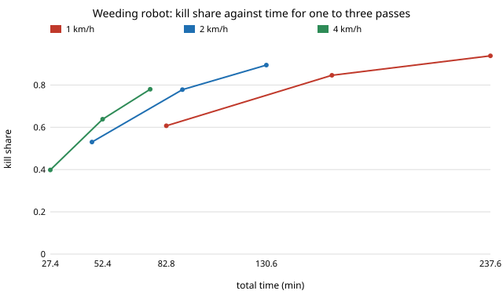

# Is one slow weeding pass better than several fast ones, and does treating on the move change that? `osrobot-weedpass`

Follow-up to `osrobot-fieldreal` (track 9, open-source purpose-built robots), in the direction of the ARPG, RECUV and Autonomous Systems IRT interest in field robots. Produced with AI assistance (Claude). Pure Python standard library. **Why this project:** `osrobot-fieldreal` listed two next steps: let the robot make a second pass over missed weeds, and treat on the move instead of stopping. This does both, on its sourced-constant model (copied so the project stays self-contained). **Inputs still assumed, not from a source:** detector hit rate (0.7, swept 0.5 to 0.9) and motion-blur law, false positives, mud share, energy per metre, beam-steering speed, 4 s turns, independence of detections between passes (relaxed in sweep 4). No robot was built or driven; simulation only.

**Live page:** https://duncan-haywood.github.io/monorepo-projects/research/osrobot-weedpass/



All numbers are from `experiments/results.txt` (60 × 30 m field, 20 seeds per row, fields and random draws shared across rows). A one-pass stop-and-treat row reproduces `osrobot-fieldreal` exactly (0.607 kill, 82.8 min at 1 weed/m², 1 km/h).

## Results
- **Several fast passes beat one slow pass.** At 1 weed/m²: one pass at 1 km/h kills 0.607 in 82.8 min; three passes at 4 km/h kill 0.780 in 75.1 min (less time, 17 points more kill); two passes at 2 km/h kill 0.778 in 90.5 min. The assumed detector loses hits as speed rises (`exp(-v/2 m/s)`), but a second look at the survivors recovers more than the speed costs. Energy is higher: 605 Wh against 403 for the three fast passes, since there are 1,379 treatments against 1,044 (false positives and re-treatments).
- **Passes have diminishing returns.** At 2 km/h on the move, kill 0.530, 0.778, 0.894 for 1, 2, 3 passes (hit rate 0.7); time is linear in passes (34.7, 71.8, 109.0 min).
- **Treating on the move saves time with identical kill, and more at high density.** One pass at 1 km/h, stop against move: 71.7 against 67.2 min at 0.3 weeds/m² (−6%), 82.8 against 68.4 at 1 (−17%), 110.8 against 68.1 at 3 (−39%), 210.6 against 145.2 at 10 (−31%). At 10 weeds/m² the laser (0.73 s per weed) becomes the bottleneck and speed adds little: 4 km/h on the move takes 95.2 min.
- **A better detector shifts kill, not the shape.** At 2 km/h on the move, one pass kills 0.373, 0.530, 0.678 for hit rates 0.5, 0.7, 0.9; three passes kill 0.755, 0.894, 0.966.
- **Weeds the detector never sees cap what passes can do.** With 0, 10 and 30% hidden, three passes at 2 km/h kill 0.894, 0.804 and 0.627, and two passes 0.778, 0.698, 0.546. The ordering of pass counts is unchanged, but the independence assumption flatters multi-pass: real misses are likely correlated (small, shaded or occluded weeds), so read the 0.9+ figures as upper bounds.

## Params (source column)
Time per weed 0.73 s and kill probability 0.992 ([1] below, via `osrobot-fieldreal`), swath 2 m ([3]), speeds 1 to 4 km/h (commercial 0.5 to 2 km/h [2]; 4 km/h is an extrapolation). Everything else in the assumed list above has no source found.

Sources (opened for `osrobot-fieldreal` only as search-result summaries; check before citing):
1. Frontiers in Plant Science (2024), review of laser weeding, doi 10.3389/fpls.2024.1469098
2. Future Farming, commercial LaserWeeder, <https://futurefarming.com/crop-solutions/weed-pest-control/dutch-grower-this-is-the-machine-that-gives-us-excellent-results/>
3. Environmental performance of an autonomous laser weeding robot (life-cycle assessment), <https://www.springerprofessional.de/environmental-performance-of-an-autonomous-laser-weeding-robot-a/26957880>

## Reproduce
```bash
cd research/osrobot-weedpass
PYTHONPATH=src python3 -m unittest discover -s tests -v   # 7 tests
PYTHONPATH=src python3 experiments/run.py > experiments/results.txt   # about 15 s
python3 experiments/figure.py                             # experiments/kill_vs_time.svg
```

## Method
`src/osrobot_weedpass/model.py` is `osrobot-fieldreal`'s model plus `run_passes`: lane-by-lane coverage repeated `passes` times, each pass re-detecting the weeds still alive. Stop mode treats every detection where it stands. Move mode never stops: a lane takes `max(drive time, queued treatment time)`, with the beam steering sideways in parallel, and only per-treatment energy is added. `hidden_share` marks a fixed share of weeds the detector never sees.

## Limitations
- On-the-move treatment assumes perfect tracking of a target while driving and a queue that never loses a target; real systems need target tracking and have a limited look-ahead. It is an upper bound on the saving.
- Detections are independent between passes except in sweep 4; the passes are assumed to cost the full lane time again, with no cheaper revisit of only the lanes that had survivors.
- The sources were read from search summaries, and per-weed laser time depends on weed size and power. No density source was found. 4 km/h is beyond the sourced speeds.
- Not compared with scout-then-treat here; `osrobot-fieldreal` found it never won with a single pass.

## Next steps
A revisit that returns only to lanes with detected survivors; a speed that adapts to the live detection count; a sourced weed-density and detector-miss distribution from agronomy and weed-detection datasets.

## Owner steps
None taken. Building or flying a laser weeder involves laser safety (IEC 60825-1 classes and eyewear) and a risk assessment before any hardware test.

## Outside dependencies
Python 3 standard library only.
