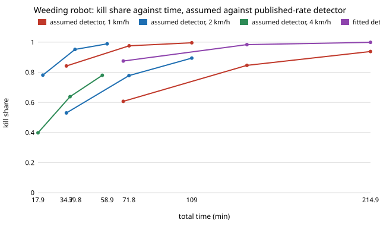

# Do several fast laser-weeding passes still beat one slow pass when the detector's hit rate comes from published field trials? `osrobot-weedsrc`

Follow-up to `osrobot-weedpass` (track 9, open-source purpose-built robots), in the direction of the ARPG, RECUV and Autonomous Systems IRT interest in field robots. Produced with AI assistance (Claude). Pure Python standard library. **Why this project:** `osrobot-weedpass` assumed a detector hit rate of 0.7 that falls as `exp(-v / 2 m/s)`, and its README listed "a sourced detector-miss distribution" as the next step. Two published laser-weeding field trials report detection rates, so the assumed detector is replaced by one fitted to them and the sweeps are re-run. **Headline: the ranking survives and gets stronger (two passes at 4 km/h kill 0.952 in 39.8 min against 0.875 in 68.4 min for one pass at 1 km/h), but the absolute numbers move a lot, and the finding that matters is the share of weeds the detector never sees: at 10% hidden, three passes cap at 0.897.** No robot was built or driven; simulation only.

**Live page:** https://duncan-haywood.github.io/oss-monorepo/research/osrobot-weedsrc/



All numbers are from `experiments/results.txt` (60 × 30 m field, 20 seeds per row, 1 weed/m² unless stated, treating on the move; fields and random draws shared across rows). Detector A is `osrobot-weedpass`'s; the A rows reproduce its results (0.778 kill, 71.8 min for two passes at 2 km/h).

## Params (source column)
| Parameter | Value | Source |
|---|---|---|
| Weed detection rate at 0.2 m/s | 0.8894 | Frontiers in Plant Science (2022), blue-laser weeding robot with YOLOX in corn: average detection rate 88.94% for weeds (92.45% for seedlings), doi 10.3389/fpls.2022.1017803 |
| Weed detection rate at 0.425 m/s | 0.862 | arXiv 2512.10319 (2025), six-wheeled laser weeding robot: 86.2% at its best speed of 42.5 cm/s (laser hit rate 97%) |
| Time per weed 0.73 s, kill 0.992, swath 2 m | | via `osrobot-fieldreal` (Frontiers review doi 10.3389/fpls.2024.1469098; Springer LCA) |
| Fitted `p(v) = p_max exp(-v/v_blur)` | p_max 0.914, v_blur 7.19 m/s | two-point fit in `model.fit_detector` (test-checked) |
| Mud, energy, false positives, turns, hidden share | | still ASSUMED (hidden share is swept) |

The two points come from two different robots and crops, were read from search-result snippets (the proxy blocked arXiv and PMC, so the papers were not opened: check them before citing), and span only 0.2 to 0.425 m/s (0.7 to 1.5 km/h). The model's 2 and 4 km/h rows extrapolate the fitted law beyond them. The "detection rate" in each paper is not necessarily recall over every weed in the plot.

## Results
- **The sourced detector is much better than the assumed one.** At 1, 2 and 4 km/h the fitted rate is 0.880, 0.846, 0.784 against the assumed 0.609, 0.530, 0.402. One pass at 2 km/h kills 0.842 instead of 0.530.
- **Speed costs far less kill than assumed.** One pass: 0.875, 0.842, 0.781 at 1, 2, 4 km/h in 68.4, 34.7, 20.8 min (assumed detector: 0.607, 0.530, 0.398). Since the two published points differ by only 3 points of detection over a 2× speed change, the fit is nearly flat; with two points it is a slope, not a law.
- **The pass-count ranking holds.** Two passes at 4 km/h kill 0.952 in 39.8 min, against 0.875 in 68.4 min for one pass at 1 km/h. A second pass lifts kill from 0.842 to 0.976 at 2 km/h (+0.134 for 37 min); a third adds only 0.020. With this detector, two passes is the sweet spot; with the assumed one, three still paid.
- **Density barely changes what a second pass buys** (2 km/h: +0.133, +0.134, +0.134 at 0.3, 1, 3 weeds/m²); density changes the time (34.1, 34.7, 61.4 min for one pass) because the laser queue becomes the limit.
- **Hidden weeds, not speed, now set the ceiling.** With the share never seen in any pass at 0, 5, 10, 20, 30%: one pass kills 0.842, 0.801, 0.758, 0.675, 0.594; three passes 0.996, 0.946, 0.897, 0.799, 0.700. At 10% hidden a third pass adds only 0.019 over two (0.897 against 0.878), so extra passes stop paying once misses are correlated. Real misses (small, shaded, occluded weeds) are very likely correlated, so the independent-detection rows (0 hidden) are upper bounds; no source for the hidden share was found, so it stays swept.

## Reproduce
```bash
cd research/osrobot-weedsrc
PYTHONPATH=src python3 -m unittest discover -s tests -v   # 6 tests
PYTHONPATH=src python3 experiments/run.py > experiments/results.txt   # about 5 s
python3 experiments/figure.py                             # experiments/kill_vs_time.svg
```

## Method
`src/osrobot_weedsrc/model.py` is `osrobot-weedpass`'s model (copied so the project is self-contained) plus `fit_detector`, which fits `p_max · exp(-v / v_blur)` through two (speed, rate) points. `experiments/run.py` sets the module's blur constant and `p_max` for detector B and runs the same multi-pass, on-the-move sweeps.

## Limitations
- Two points from two different robots, read from snippets; the speed law is a two-parameter fit with no error bar and is extrapolated to 4 km/h. A different crop, weed size or lighting would shift the level.
- Detections are independent between passes except through the swept hidden share; the passes cost the full lane time again.
- On-the-move treatment assumes perfect target tracking, so time savings are an upper bound. False positives, mud and energy figures are still assumed.
- Not a validation of the weeding model against any trial's weed-kill result.

## Next steps
Open the two papers and read the detection-rate definitions and per-size breakdowns; fit a hidden share from a weed-size distribution; a revisit that returns only to lanes with detected survivors; fly or drive it (owner step).

## Owner steps
None taken. Building a laser weeder involves laser safety (IEC 60825-1 classes and eyewear) and a risk assessment before any hardware test.

## Outside dependencies
Python 3 standard library only.
