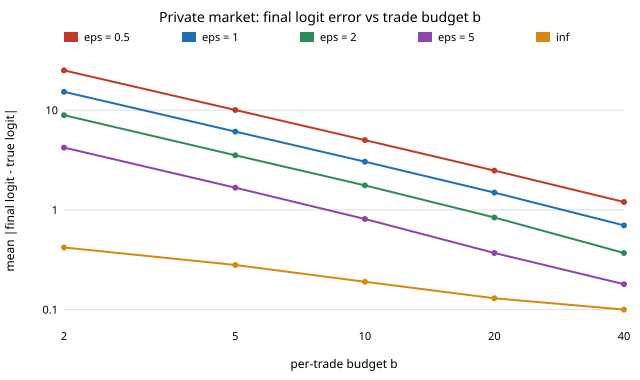

# Private markets: the subsidy cost of privacy in prediction markets

Stdlib-only Python. Binary LMSR whose public state is a differentially private (binary-tree mechanism) running
total of trades. Path-wise market-maker loss bound `b ln2 + Σ|x_t||e_{t-1}|/(4b)`, tree-vs-naive noise comparison,
and an (ε, b) accuracy/subsidy frontier. Builds on Waggoner–Frongillo–Abernethy (NeurIPS 2015). See `paper/whitepaper.md`.

```bash
cd research/private-markets
PYTHONPATH=src python3 -m unittest discover -s tests -v   # 6 tests
PYTHONPATH=src python3 experiments/run.py
```


The figure is parsed from `experiments/results.txt` by `python3 experiments/figure.py` (stdlib only), so it cannot drift from the committed run.

Stylised simulations; limitations in the paper. MIT.
