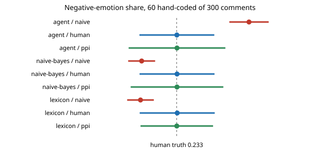

# qual-agent: how well does an LLM-style coder count negative emotion in real comments, and does the correction still pay?

**On 300 real Reddit comments with rater-majority emotion labels, an LLM coder (here, the Claude session agent itself, coding blind to the human labels) over-codes: it flags 44% of comments as negative-emotion against a human 23%, the opposite error direction from the two classical stand-ins in [`qual-real`](../qual-real), which undercount by 10 points. Its accuracy (0.71, kappa 0.37) is no better than a naive-Bayes coder's and clearly worse than a 38-word list's (0.84), and prediction-powered inference stays valid but is 29% wider than hand-coding alone at 60 hand-coded items.**

**Live page:** https://duncan-haywood.github.io/oss-monorepo/research/qual-agent/

Track 19 (`qual`, [`PROJECTS.md`](../PROJECTS.md)), milestone 2's open item: "a model behind `ANTHROPIC_API_KEY` ... without a key, label any session-agent coding as such." There is no key in this session, so the coder is **the Claude session agent that wrote this project, reading each comment once and answering 0/1 from the codebook, with the human labels hidden**. It is one reader, one pass, one day; it is *not* an API-called model and the numbers are not a benchmark of any named model. This is the first project in the track where the coder is a language model at all; the question the track kept deferring ("run an LLM coder on the same items and compare") now has a first, small, labelled answer.



## Data and protocol

- Corpus: GoEmotions (Demszky et al. 2020), same loader, 40/60 split and human code as [`qual-real`](../qual-real) (rater majority marked any of 11 negative emotions). No comment text is committed; `agent_codes.json` maps comment id to the agent's 0/1 code.
- Sample: 300 comments drawn at random (seed 20261023) from the 3,188-item evaluation corpus. Truth on the sample is known: prevalence 0.233; short comments (at most 10 words, n = 118) 0.178, long (n = 182) 0.269, gap short minus long −0.091.
- Codebook given to the coder: *1 = the comment expresses a negative emotion (anger, annoyance, disappointment, disapproval, disgust, sadness, fear, embarrassment, grief, remorse, nervousness), else 0.* The agent saw the comment text only, never the human labels or the other coders' output, and coded all 300 before any comparison was run.
- Comparators on the same 300: the `qual-real` naive-Bayes (trained on the 2,125 training items) and 38-word lexicon coders, unchanged.
- Estimators: naive count, human-only, prediction-powered (`../qual-correction/qualml.py`), 2,000 random hand-coded samples of 30, 60 and 100 items.

## Results

Copied from [`results.txt`](experiments/results.txt).

| coder | coded positive | sensitivity | specificity | accuracy | kappa |
|---|---:|---:|---:|---:|---:|
| agent | 132 of 300 | 0.814 [0.71, 0.89] | 0.674 [0.61, 0.73] | 0.707 [0.65, 0.76] | 0.373 |
| naive-bayes | 40 | 0.229 [0.15, 0.34] | 0.896 [0.85, 0.93] | 0.740 [0.69, 0.79] | 0.146 |
| lexicon | 39 | 0.443 [0.33, 0.56] | 0.965 [0.93, 0.98] | 0.843 [0.80, 0.88] | 0.482 |

Share of negative emotion, 60 hand-coded of 300 (true 0.233):

| coder | naive | human-only (width) | PPI (width) | PPI coverage |
|---|---:|---:|---:|---:|
| agent | 0.440 (coverage 0) | 0.234 (0.214) | 0.234 (0.276) | 0.979 |
| naive-bayes | 0.133 (coverage 0) | 0.234 (0.214) | 0.234 (0.265) | 0.982 |
| lexicon | 0.130 (coverage 0) | 0.235 (0.214) | 0.234 (0.207) | 0.973 |

1. **The LLM-style coder fails in the other direction.** The two classical coders miss emotion they cannot see (low sensitivity); the agent reads emotion into sarcasm, profanity, criticism and sympathy ("sorry for your loss" coded as sadness) that the raters did not mark as one of the 11 negative emotions. 75 of its 132 positives are false positives and only 13 of 70 human positives are missed. The naive prevalence is 0.206 too high, with zero coverage, in every sample size.
2. **Better kappa did not mean a better estimate.** Against naive Bayes the agent's accuracy is statistically indistinguishable (right-where-the-other-is-wrong 51 against 61, exact McNemar p = 0.4); against the word list it is worse (35 against 76, p = 0.0001). Kappa ranks it above naive Bayes only because the two have opposite error mixes.
3. **Differential error, again, but flipped.** The agent's sensitivity is 0.95 on short comments and 0.76 on long ones, and its specificity is 0.78 short and 0.59 long. The naive short-minus-long gap is −0.153 against a true −0.091 (width 0.226, so its interval covers the truth: wrongly sized but not wrongly signed here, which the data would not tell you without a hand-coded sample).
4. **PPI remains valid and did not pay.** Coverage is 0.97 to 0.996 for prevalence and 0.96 to 0.99 for the gap, bias under 0.006 in every case. It is 29% wider than hand-coding alone at 60 items for the agent (0.276 against 0.214) and 24% for naive Bayes, and it narrows the interval only for the lexicon coder at 60 and 100 items (0.207 against 0.214 and 0.168 against 0.166, a tie). The correction repairs bias; it only saves hand-coding when the coder's agreement with the humans is high.

## Limitations

- **One coder, one pass, one sample of 300.** This is a single reading by a model that is also the author of the experiment. It is a labelled measurement of that reading, not of a model family; a different prompt, an explicit codebook with examples, or an API-called model could land anywhere. A second agent pass or a differently-worded codebook would show how much of the 44% is the wording of "expresses a negative emotion".
- **Possible contamination.** GoEmotions is a public dataset that a model may have seen in training. I did not recall labels, and the agent's errors look like a codebook mismatch, not memorisation, but this cannot be ruled out.
- **Codebook mismatch is part of the result.** The raters labelled 27 emotions with a neutral option and a rater majority; the agent answered a yes/no question. Much of the over-coding is the gap between "a reader senses negativity" and "three raters marked one of 11 specific emotions". That gap is exactly what a hand-coded sample is for.
- **Finite-population effect.** The corpus is only 300 items, so a hand-coded sample of 100 is a third of it: the human-only and PPI intervals are conservative (coverage up to 0.996). Widths are comparable across estimators and coders, absolute coverage is not a test of nominal level.
- Binary code, English Reddit, length as a crude group, rater majority treated as gold: as in [`qual-real`](../qual-real).

## Next steps

Repeat with an API-called model behind `ANTHROPIC_API_KEY` (swap it into `agent_codes.json`'s place; the runner takes any 0/1 vector keyed by comment id), a second pass with an example-bearing codebook to measure prompt sensitivity, and the full 3,188 items so the finite-population effect goes away.

## Reproduce

```
python3 research/qual-agent/experiments/run.py      # seconds after the shared ~14 MB download (cache shared with qual-real), writes results.txt
python3 research/qual-agent/experiments/figure.py   # writes the SVG
python3 -m unittest discover research/qual-agent
```

Citations: Demszky et al. (2020), "GoEmotions: A dataset of fine-grained emotions", ACL, arXiv:2005.00547; Angelopoulos et al. (2023), "Prediction-powered inference", *Science* 382, arXiv:2301.09633.
