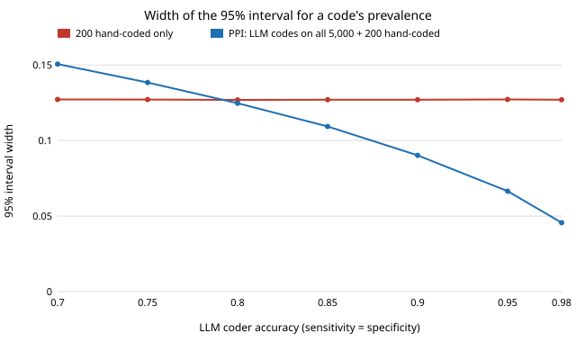

# qual-correction: can you do machine learning on qualitative data with an LLM, and when can you trust the numbers?

**Yes, but an LLM's codes need a statistical correction before you count them, and a few hundred
hand-coded examples make that correction possible.** An LLM can turn interview transcripts,
open-ended survey answers, reviews or support tickets into codes ("does this answer mention cost
as a barrier?"), and the codes can then be counted, compared and modelled like numbers. In a
seeded simulation, an LLM coder that is **89% accurate** (Cohen's κ = 0.72 against humans, which
many studies would report as "substantial agreement") still **understates a 30% code at 26%**, and
its naive 95% interval **covers the truth in 0 of 1,000 studies**. Comparing two groups whose
answers the LLM reads with different accuracy is worse: the true gap is −4 points and the naive
estimate is **+3.6 points, the wrong sign, and "significant" in 80% of studies**. Prediction-powered
inference (PPI; Angelopoulos et al. 2023) corrects both from a random sample of 200 hand-coded
answers per group. The bias goes to ~0, coverage is 95–98%, and the interval is 23–26% narrower
than using the hand-coded answers alone. **The correction does not always help.** Below about 80%
coder accuracy, the PPI interval is *wider* than the human-only one. Produced with AI assistance
(Claude). Every result is from simulated coders with known error rates, not from a real LLM or a
real corpus.

**Live page:** https://duncan-haywood.github.io/monorepo-projects/research/qual-correction/

Track 19 (`qual`, [`PROJECTS.md`](../PROJECTS.md)), milestone 1. Blog post:
[`docs/posts/2026-10-20-machine-learning-on-qualitative-data-with-llms.md`](../../docs/posts/2026-10-20-machine-learning-on-qualitative-data-with-llms.md).

## Why this question

Machine learning has always needed numbers. Qualitative data could take part only after a person
coded it by hand, which is slow, or after crude features such as word counts and topic models,
which miss meaning. LLMs remove that bottleneck. They read text the way a coder does, follow a
codebook written in plain language, and cost a fraction of a cent per item. Gilardi et al. (2023)
found ChatGPT more accurate than crowd workers on four of five annotation tasks at about a
thirtieth of the cost.

That shifts the risk. Once coding is cheap, a study can code a million answers, so sampling error
almost disappears. What is left is the coder's own error, and nothing in the pipeline measures it
unless someone does so on purpose. Egami et al. (2023) showed that LLM labels plugged straight
into a downstream regression can be badly biased, with invalid intervals, even at 80–90% label
accuracy. This project measures that failure in the simplest settings a qualitative researcher
meets (one prevalence, one group comparison), turns the fix into a small stdlib tool, and says
where the fix stops paying.

## What an LLM makes possible with qualitative data

The experiment below tests one link in a longer chain. The five patterns here are the ones the
literature has started to use. Each one is a candidate for future work in this track.

1. **Deductive coding at scale.** A human writes the codebook, the LLM applies it to every item,
   and the codes become variables. This is classic content analysis without the hand-coding
   bottleneck. It is what this project corrects. (Gilardi et al. 2023; Ziems et al. 2024 measured
   13 models on 24 computational-social-science benchmarks and found fair agreement with humans,
   though below the best fine-tuned models on classification.)
2. **Inductive coding and concept induction.** The LLM proposes the codebook itself. TopicGPT
   (Pham et al. 2024) returns topics as natural-language labels and descriptions instead of word
   lists. LLooM (Lam et al. 2024) induces high-level concepts with explicit inclusion criteria.
   This is grounded theory with a fast, tireless and fallible assistant.
3. **Qualitative data as features in ordinary ML.** Free text becomes columns a model can learn
   from: codes, scored dimensions ("how urgent is this ticket, 1–5") or embeddings. TabLLM
   (Hegselmann et al. 2023) goes the other way. It serialises table rows into sentences and lets
   an LLM classify them, which helps most when labelled rows are scarce.
4. **Hypothesis generation.** Ludwig and Mullainathan (2024) used a model trained on unstructured
   data (mugshots) to surface a pattern in judges' decisions that people then put into words and
   tested. LLMs can do the putting-into-words step directly, proposing human-readable explanations
   of what separates two sets of documents.
5. **Simulated respondents.** Argyle et al. (2023) conditioned GPT-3 on real survey respondents'
   backstories and reproduced subgroup response distributions ("algorithmic fidelity"). This is
   useful for piloting a survey. It is dangerous as a substitute for one.

All five feed the LLM's output into a later statistical step. So all five carry the problem
measured here: the output is a measurement with error, and the error can differ between groups.

## Method

`qualml.py` (stdlib only) has three parts:

- **Agreement:** percent agreement, Cohen's κ, and Krippendorff's α (nominal, missing ratings
  allowed). The α implementation reproduces the 0.743 of Krippendorff's published worked example.
- **Three prevalence estimators,** each returning an estimate and a standard error:
  - `naive`: the share the LLM coded 1, over the whole corpus;
  - `human_only`: the share humans coded 1, on a random hand-coded sample;
  - `ppi`: the LLM share over the corpus plus the mean human-minus-LLM correction on the
    hand-coded sample. Its variance is var(LLM)/N + var(correction)/n.
- **A simulated coder** with set sensitivity and specificity, per group, so every estimate can be
  scored against a known truth.

`experiments/run.py` runs three experiments, seeded, with 500–1,000 simulated studies per row.
The target is the true share in the 5,000-item corpus. "Coverage" is how often the 95% interval
contains it, and "width" is the mean interval width. "Effective n" is how many hand-coded items a
human-only study would need to match the PPI interval.

## Results

Numbers are copied from [`experiments/results.txt`](experiments/results.txt).

**E1. One code's prevalence.** 5,000 answers, true share 0.30. The coder has sensitivity 0.75 and
specificity 0.95: it misses a quarter of real mentions and rarely invents one, so it is 89%
accurate.

| hand-coded n | naive bias | naive coverage | human-only width | PPI bias | PPI coverage | PPI width | κ | PPI effective n |
|---:|---:|---:|---:|---:|---:|---:|---:|---:|
| 50 | −0.040 | 0.000 | 0.253 | +0.001 | 0.951 | 0.180 | 0.72 | 130 |
| 100 | −0.040 | 0.000 | 0.179 | +0.001 | 0.948 | 0.131 | 0.72 | 199 |
| 200 | −0.040 | 0.000 | 0.127 | −0.001 | 0.960 | 0.094 | 0.73 | 374 |
| 400 | −0.040 | 0.000 | 0.090 | −0.001 | 0.976 | 0.069 | 0.73 | 689 |
| 800 | −0.040 | 0.000 | 0.064 | −0.000 | 0.979 | 0.052 | 0.73 | 1,214 |

The naive interval is narrow (0.024) and always wrong. A big corpus makes it confidently wrong,
not right. PPI with 200 hand-coded answers matches a 374-answer human-only study. As the
hand-coded share grows, PPI coverage rises above 95% because its variance formula treats the
corpus as a sample from a larger population, so it is conservative for the corpus share.

**E2. A group comparison with differential error.** Two groups of 2,500 answers. Group B has the
higher true share (0.34 against 0.30, a gap of −0.04). The LLM is worse at recognising the code in
group B's answers (sensitivity 0.65 against 0.85), as it might be for dialect, translated or less
fluent text. 200 hand-coded answers per group.

| estimator | mean gap (A − B) | bias | coverage | width | wrong-sign "significant" |
|---|---:|---:|---:|---:|---:|
| naive | +0.036 | +0.076 | 0.000 | 0.049 | 80.4% |
| human-only | −0.039 | +0.001 | 0.965 | 0.183 | 0.5% |
| PPI | −0.039 | +0.001 | 0.973 | 0.140 | 0.0% |

This is the case that matters most in practice. A paper that reports "group A raises cost more
often than group B (p < 0.05)" from naive LLM codes would be wrong four times in five, and the
error comes from the coder, not from the people.

**E3. How good must the coder be?** 200 hand-coded answers, sensitivity = specificity = accuracy.

| coder accuracy | naive coverage | human-only width | PPI width | PPI coverage | PPI effective n |
|---:|---:|---:|---:|---:|---:|
| 0.70 | 0.000 | 0.127 | 0.151 | 0.958 | 144 |
| 0.75 | 0.000 | 0.127 | 0.138 | 0.958 | 170 |
| 0.80 | 0.000 | 0.127 | 0.125 | 0.966 | 210 |
| 0.85 | 0.000 | 0.127 | 0.109 | 0.946 | 275 |
| 0.90 | 0.000 | 0.127 | 0.090 | 0.968 | 409 |
| 0.95 | 0.014 | 0.127 | 0.067 | 0.976 | 781 |
| 0.98 | 0.994 | 0.127 | 0.046 | 0.980 | 1,757 |



PPI stays valid at every accuracy, but it only saves effort above roughly 80%. Below that, the
human-minus-LLM correction is noisier than the human codes themselves, and the plain human-only
estimate is better. (Power-tuned PPI, "PPI++", Angelopoulos et al. 2024, down-weights a poor coder
automatically. It is not implemented here.) At 98% accuracy with symmetric errors, even the naive
estimate covers, because its 0.8-point bias fits inside its interval. That holds only while the
corpus is small. With 50,000 answers the same bias would fall outside.

## What to do with this in a real study

1. Write the codebook. Have the LLM code everything.
2. Hand-code a **simple random sample** (200 is a reasonable start; per group if you compare
   groups) without looking at the LLM's codes.
3. Report κ or α on that sample, but **do not stop there**. Agreement does not tell you the
   direction of the error, and direction is what biases a count.
4. Estimate with `ppi` (or DSL, Egami et al. 2023, for regressions). If the PPI interval is wider
   than the human-only one, your coder is too weak: improve the prompt or the codebook, or use
   the human codes.

## Limitations

- **Simulated coder.** Errors are independent across items given the true code. A real LLM's
  errors cluster: on sarcasm, on long answers, on one respondent's style. PPI's guarantee needs
  only a random hand-coded sample, so it survives that. The widths here would change.
- **Binary codes and means only.** Multi-class codes, regressions and the inductive patterns
  (2–5 above) are not tested. DSL (Egami et al. 2023) covers regression coefficients.
- **Human codes are treated as truth.** Real human coders disagree too. α between two humans is
  the ceiling an LLM can be measured against.
- **No real LLM was run.** The environment has no model API key. Nothing here is a benchmark of
  any model's coding accuracy.

## Next steps: future research (track 19)

This is the first project in a new track, marked by the owner on 2026-10-20 as an interesting topic
for future research and applications. The next steps are listed under track 19 in
[`PROJECTS.md`](../PROJECTS.md). They include: run the pipeline on a public, hand-coded corpus with
a real model behind `ANTHROPIC_API_KEY`; measure how LLM coding error differs across dialects
and languages (E2's mechanism) on real data; validate inductive codebooks (TopicGPT/LLooM style)
against human ones; and turn qualitative codes into predictive features alongside numeric ones.

## Reproduce

```
python3 research/qual-correction/experiments/run.py      # ~30 s, writes results.txt
python3 research/qual-correction/experiments/figure.py   # writes the SVG
cd research/qual-correction && python3 -m unittest test_qualml
```

## References

- Angelopoulos, Bates, Fannjiang, Jordan, Zrnic (2023). Prediction-powered inference. *Science*
  382:669–674. arXiv:2301.09633.
- Angelopoulos, Duchi, Zrnic (2024). PPI++: Efficient prediction-powered inference.
  arXiv:2311.01453.
- Argyle, Busby, Fulda, Gubler, Rytting, Wingate (2023). Out of one, many: using language models
  to simulate human samples. *Political Analysis*. doi:10.1017/pan.2023.2.
- Egami, Hinck, Stewart, Wei (2023). Using imperfect surrogates for downstream inference:
  design-based supervised learning for social science applications of large language models.
  *NeurIPS 36*. arXiv:2306.04746.
- Gilardi, Alizadeh, Kubli (2023). ChatGPT outperforms crowd workers for text-annotation tasks.
  *PNAS* 120(30):e2305016120.
- Hegselmann, Buendia, Lang, Agrawal, Jiang, Sontag (2023). TabLLM: few-shot classification of
  tabular data with large language models. *AISTATS*, PMLR 206:5549–5581.
- Krippendorff (2011). Computing Krippendorff's alpha-reliability. University of Pennsylvania
  ScholarlyCommons.
- Lam, Teoh, Landay, Heer, Bernstein (2024). Concept induction: analyzing unstructured text with
  high-level concepts using LLooM. *CHI '24*. arXiv:2404.12259.
- Ludwig, Mullainathan (2024). Machine learning as a tool for hypothesis generation. *QJE*
  139(2):751–827.
- Pham, Hoyle, Sun, Resnik, Iyyer (2024). TopicGPT: a prompt-based topic modeling framework.
  *NAACL*, 2956–2984.
- Ziems, Held, Shaikh, Chen, Zhang, Yang (2024). Can large language models transform
  computational social science? *Computational Linguistics* 50(1). arXiv:2305.03514.

References checked by web search on 2026-10-20, except PPI++, Krippendorff (2011) and the Ziems
journal version, which are cited from memory and should be checked before reuse.

## AI assistance

A Claude session wrote the code, ran the experiments and drafted this README at the owner's
request. Every number in it comes from `experiments/results.txt`.

## Outside dependencies

None to run. A real-data follow-up needs an LLM API (behind an environment variable, with a stub)
and a hand-coded public corpus.
