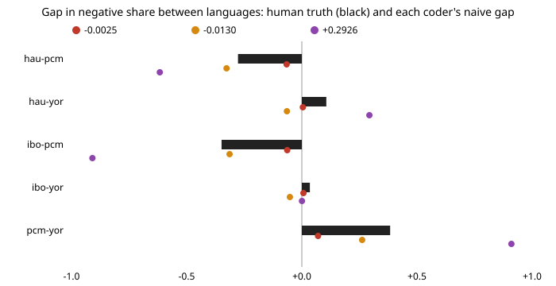

# qual-dialect: does an automated coder's error differ across languages, and how much does that move group comparisons?

**On 44,485 real tweets in four Nigerian languages with native-speaker sentiment labels, an English word-list coder and an English-trained classifier read almost none of the negative sentiment in Hausa, Igbo and Yoruba (sensitivity 0.4–2.4% for the word list, 0.4–10.8% for the English classifier), and so report language gaps that are wrong in size and, for some pairs, in sign.** The Hausa–Yoruba gap in negative share is +10.6 points by human labels; the English classifier reports −6.5. A classifier trained on a slice of the same corpus reports +29.3 for Hausa–Igbo against a true +7.1. Naive 95% intervals cover the true gap 0 times in 500 draws for every pair and coder. Prediction-powered inference (PPI) with 400 hand-coded tweets per study covers 93–96% for every pair and coder, but its interval is 0.4–26% wider than hand-coding alone and never narrower, because these coders are close to uninformative. **None of these coders is an LLM**: the session had no API key. Produced with AI assistance (Claude).

**Live page:** https://duncan-haywood.github.io/monorepo-projects/research/qual-dialect/

Track 19 (`qual`, [`PROJECTS.md`](../PROJECTS.md)), milestone 3. [`qual-correction`](../qual-correction) found, in simulation, that a coder that reads one group less accurately flips a naive group gap's sign; [`qual-real`](../qual-real) found differential error by comment length in English. This project asks the same about *language*, with real labels.



## Data

NaijaSenti (Muhammad et al. 2022): tweets in Hausa (`hau`), Igbo (`ibo`), Nigerian Pidgin (`pcm`) and Yoruba (`yor`), each labelled positive, neutral or negative by native-speaker annotators. The dataset's README states a CC BY licence. The project downloads the train, dev and test tsv files of each language from the authors' repository (`experiments/run.py`) into a cache outside the repository and **commits no tweet text**. Tweets carry user mentions, which the code strips and never outputs.

- Items: 63,550 labelled tweets, pooled over the three splits. Human code: the label is `negative`.
- Group: language. Human negative share on the evaluated items: Hausa 0.326, Igbo 0.254, Pidgin 0.603, Yoruba 0.219.
- Split (seeded): 30% (19,065) trains the in-language coder; the other 44,485 are the "corpus". Every corpus item has a human code, so the true shares and gaps are known; each study hides all but a random hand-coded sample, drawn over all four languages together.

## Coders (stand-ins for an LLM)

- `lexicon-en`: the 38-word English negative list from `qual-real` (written before looking at any result there); a zero-shot English codebook.
- `nb-english`: multinomial naive Bayes trained on the 5,313 English GoEmotions comments of `qual-real` (negative-emotion majority code), applied to the tweets. A model that has only ever seen English. Threshold set so its positive rate on its own training data matches that data's human share.
- `nb-in-language`: naive Bayes trained on the 19,065 Nigerian training tweets from all four languages, one global threshold. An in-language control. Because the threshold is global it cannot know Pidgin is 60% negative, so it codes 97% of Pidgin negative; that is part of what the control shows.

## Results

From [`results.txt`](experiments/results.txt); 500 random hand-coded samples per row, coverage of the 95% interval.

**Sensitivity (share of human-negative tweets coded negative) by language.**

| coder | hau | ibo | pcm | yor |
|---|---:|---:|---:|---:|
| lexicon-en | 0.009 | 0.022 | 0.090 | 0.004 |
| nb-english | 0.024 | 0.019 | 0.393 | 0.108 |
| nb-in-language | 0.660 | 0.150 | 0.985 | 0.147 |

Specificity of `nb-in-language` on Pidgin is 0.063 (it codes nearly everything negative); the other specificities are 0.73–1.00.

**Gap in negative share between languages: truth and the naive coded-share gap.**

| pair | true | lexicon-en | nb-english | nb-in-language |
|---|---:|---:|---:|---:|
| hau–ibo | +0.071 | −0.003 | −0.013 | +0.293 |
| hau–pcm | −0.277 | −0.066 | −0.327 | −0.617 |
| hau–yor | +0.106 | +0.004 | −0.065 | +0.293 |
| ibo–pcm | −0.349 | −0.064 | −0.314 | −0.909 |
| ibo–yor | +0.035 | +0.007 | −0.052 | +0.001 |
| pcm–yor | +0.383 | +0.070 | +0.262 | +0.910 |

**Estimators at 400 hand-coded tweets, `nb-english`, gap interval width (coverage).**

| pair | naive | human-only | PPI |
|---|---:|---:|---:|
| hau–ibo | 0.008 (0.000) | 0.232 (0.954) | 0.246 (0.944) |
| hau–yor | 0.011 (0.000) | 0.227 (0.934) | 0.251 (0.948) |
| ibo–yor | 0.012 (0.000) | 0.238 (0.950) | 0.269 (0.952) |
| pcm–yor | 0.024 (0.000) | 0.291 (0.956) | 0.365 (0.944) |

Findings:

1. **Coder error differs by language, and by a lot.** The English-trained coder's sensitivity is 0.39 on Pidgin (heavily English-derived vocabulary) and 0.02 on Hausa and Igbo. This is the mechanism `qual-correction` simulated, on real labels.
2. **It moves group comparisons, sometimes past zero.** For Hausa–Yoruba and Igbo–Yoruba the English classifier's gap has the opposite sign to the human gap (−0.065 against +0.106; −0.052 against +0.035). For `lexicon-en` every gap is shrunk toward zero (for example +0.071 to −0.003) because it barely fires outside Pidgin. Which direction a naive gap errs depends on the coder, so the bias cannot be guessed.
3. **An in-language coder is not a fix.** The control reads Hausa far better (sensitivity 0.66) than Igbo and Yoruba (about 0.15), and its global threshold wrecks Pidgin, so its gaps are off by 20 points or more in places (Hausa–Igbo +0.293 against +0.071). Training data from "the right language" does not make error equal across groups.
4. **PPI is valid, and does not pay here.** Gap coverage is 93–96% across pairs and coders at 400 items (91.8–96.6% over every target and size). Its intervals are wider than hand-coding alone in all 54 gap rows (3 coders, 3 sizes, 6 pairs), which is `qual-correction`'s and `qual-real`'s finding again: a coder this weak adds noise. The practical use of this result is the audit, not the correction: compare the coder with a stratified hand-coded sample per language before comparing languages.

## Limitations

- No LLM was run. Whether a frontier model closes these gaps for Hausa, Igbo and Yoruba is the open question this sets up; the deterministic pipeline here accepts any `code(text) -> 0/1` function. Do not read these results as a statement about any LLM.
- "Negative" is the dataset's label, from annotators who read tweets in context. Tweets can mix languages and code-switch (especially Pidgin); the language label is the dataset's, not verified here.
- The PPI hand-coded sample is random over the pooled corpus, so smaller languages get fewer hand-coded items; a stratified audit would behave differently.
- Language is confounded with topic and collection period in the corpus; the project measures coder error against human labels in each, not an effect of language itself.
- The English classifier's training task (negative emotion in Reddit comments) differs from the target (negative tweet sentiment); that mismatch is part of the measured gap, not separated from it.

## Next steps

Run an LLM coder behind `ANTHROPIC_API_KEY` (with a deterministic stub) on the same 44,485 tweets and compare per-language sensitivity with the English-only baselines here; add a stratified-audit variant (equal hand-coded items per language); include the other AfriSenti languages and the neutral class (multi-class PPI from `qual-regression`).

## Reproduce

```
python3 research/qual-dialect/experiments/run.py      # ~10 s after the downloads, writes results.txt
python3 research/qual-dialect/experiments/figure.py   # writes the SVG
cd research/qual-dialect && python3 -m unittest test_qualdialect
```

## References

- Muhammad, S. H., Adelani, D. I., Ruder, S., Ahmad, I. S., Abdulmumin, I., Bello, B. S., Choudhury, M., Emezue, C. C., Abdullahi, S. S., Aremu, A., Jeorge, A., Brazdil, P. (2022). NaijaSenti: A Nigerian Twitter Sentiment Corpus for Multilingual Sentiment Analysis. arXiv:2201.08277 (author-listed BibTeX in the dataset repository, github.com/hausanlp/NaijaSenti).
- Demszky, D., Movshovitz-Attias, D., Ko, J., Cowen, A., Nemade, G., Ravi, S. (2020). GoEmotions: A dataset of fine-grained emotions. *ACL 2020*. arXiv:2005.00547.
- Angelopoulos, Bates, Fannjiang, Jordan, Zrnic (2023). Prediction-powered inference. *Science* 382:669–674. arXiv:2301.09633.
- [`qual-correction`](../qual-correction), [`qual-real`](../qual-real): the estimators, the word list and the coder design.
