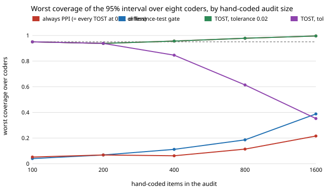

# qual-equivalence: how big must a hand-coded audit be before you can trust a coder's counts?

**No audit that fits in this corpus lets you safely skip the correction. On 3,188 real Reddit comments (GoEmotions), a test that the coder's prevalence bias is inside a stated tolerance (TOST equivalence) either never passed the coder (tolerance 0.02 or tighter: 100% of draws corrected, so it is just prediction-powered inference, coverage 0.94–1.00) or passed it far too often (tolerance 0.05: worst coverage fell from 0.95 at 100 hand-coded items to 0.35 at 1,600).** The reason is arithmetic. The naive interval for a prevalence over 3,188 items is only ±0.012 to ±0.017 wide, so trusting the coder is safe only if its bias is below roughly 0.01. Showing that, with a 5% test, takes about 7,700 hand-coded items at tolerance 0.01 and 30,900 at 0.005, more than the whole corpus. The difference-test gate of [`qual-gate`](../qual-gate) was still at 0.39 worst-case coverage with 1,600 items, and gating on one half of the sample did not help (0.22). The coders are a naive-Bayes classifier with a moved cut-off and a word list, not LLMs. Produced with AI assistance (Claude).

**Live page:** https://duncan-haywood.github.io/monorepo-projects/research/qual-equivalence/

Track 19 (`qual`, [`PROJECTS.md`](../PROJECTS.md)). It takes the first and last items in [`qual-gate`](../qual-gate)'s "Next steps" (an equivalence test against a stated tolerance, and sample-splitting variants) and asks how large the audit must be. The finding in `qual-gate` was that a 200-item audit cannot see a bias of a few points; this project asks whether a *better* test, or a bigger audit, fixes that. Same corpus, split and coders as `qual-gate`, estimators from [`qual-correction`](../qual-correction).



## Method

Same data as `qual-gate`: 5,313 GoEmotions examples with at least three raters; 2,125 train the naive-Bayes coder; 3,188 are evaluated; human code = a majority of raters marked a negative emotion; estimand = the human prevalence over the evaluated items (0.2447 with this seed). Comment text is read from a cached download and never committed. Eight coders: naive-Bayes ranking with the cut-off moved so it codes 1 for 0.6, 0.8, 0.9, 1.0, 1.1, 1.25 or 1.5 times the true share (bias −9.8 to +12.2 points), and the 38-word list (−10.4).

Estimators, each with a 95% normal interval, with hand-coded samples drawn at random without replacement (500 draws per cell, audit sizes 100, 200, 400, 800, 1,600):

- **always-PPI**: the prediction-powered correction, as in `qual-correction`.
- **difference-test gate** (`qual-gate`): naive if a 5% paired z test finds no bias, else PPI.
- **TOST gate**: naive only if the 90% interval of the mean human-minus-coder difference lies inside ±δ (two one-sided 5% tests), else PPI. δ = 0.005, 0.01, 0.02, 0.05.
- **split-sample gate**: the z test on the first half of the hand-coded sample picks the estimator; if PPI is chosen, only the second half is used for it.

E5 computes, from the coder's disagreement spread, the audit size at which a TOST has about 50% power to pass an exactly unbiased coder: n = (1.645·sd/δ)².

## Results

Copied from [`results.txt`](experiments/results.txt). Worst 95%-interval coverage over the eight coders (the audit protects only if this stays near 0.95):

| audit items | always-PPI | difference-test | TOST δ=0.02 or tighter | TOST δ=0.05 | split-sample |
|---:|---:|---:|---:|---:|---:|
| 100 | 0.950 | 0.040 | 0.950 | 0.950 | 0.052 |
| 200 | 0.938 | 0.068 | 0.938 | 0.938 | 0.068 |
| 400 | 0.956 | 0.112 | 0.956 | 0.846 | 0.062 |
| 800 | 0.978 | 0.186 | 0.978 | 0.614 | 0.114 |
| 1,600 | 0.996 | 0.388 | 0.996 | 0.352 | 0.216 |

Audit size for a TOST to have about 50% power against an exactly unbiased coder (sd of the human-minus-coder difference 0.534): δ=0.05: 309 items; 0.02: 1,931; 0.01: 7,723; 0.005: 30,891. The corpus has 3,188.

Findings:

1. **A tolerance tight enough to protect you cannot be shown.** The naive interval's half-width is 0.012–0.017 (E1), so a coder with bias above about 0.01 makes the naive interval miss. To pass a TOST at δ = 0.01 an unbiased coder needs about 7,700 audited items, and at 1,600 items the TOST at δ = 0.02, 0.01 and 0.005 never passed any coder, including the unbiased one (E3). It collapses to always-PPI: valid, and the audit was wasted.
2. **A tolerance loose enough to pass is not safe.** At δ = 0.05 the bias the test accepts is about three times the naive interval's half-width. Coders with a 2.4-point bias were trusted in 62–65% of draws at 1,600 items and covered the truth in 35–38%; coverage got *worse* as the audit got bigger, because a larger audit passes the coder more reliably. The tolerance, not the audit size, then sets the error, and a bigger audit only makes the wrong answer more certain.
3. **The difference test gets better only slowly.** Worst coverage was 0.04 at 100 items and 0.39 at 1,600 (the worst coders are the ones 2.4 points off). The 2.4-point coder was still trusted in 54–61% of draws at 1,600 items.
4. **Splitting the sample does not help.** Using one half to choose and the other to correct fixes nothing about the choice, which is the pre-test problem, and costs the correction half its data: worst coverage 0.05–0.22.
5. **Practical reading:** decide to correct before seeing the audit, and apply PPI whenever a random hand-coded sample exists. An audit is useful for *measuring* the coder (its error rate, its bias, whether it differs by group), not for deciding whether to correct. The only way to keep the narrow naive interval is to know the bias is under about 0.01 from something other than a 3,000-item audit.

## Limitations

- The coders are not LLMs. An LLM's per-item noise sets the audit's power (sd of the difference 0.45–0.56 here); a more accurate coder would need smaller audits (n scales with the square of the sd) and a more biased or less accurate one larger. The claim is about decision rules, not any model.
- One corpus, one split, one seed; bias enters only by moving a threshold. 500 draws per cell: coverage has a standard error of about 0.01 near 0.95 and 0.02 near 0.5.
- Coverage above 0.95 at large audits (up to 1.00 at 1,600 of 3,188) is the finite-population effect: the audit samples half the evaluated items without replacement and the normal intervals ignore the correction. It makes always-PPI conservative, not wrong.
- The estimand is one prevalence. Gaps between groups, regression coefficients, and a corpus much bigger than 3,188 (where the naive interval is narrower still and the audit has to be larger still) were not run. The TOST sizing in E5 is a closed-form 50%-power figure, not a simulated one.
- Only one equivalence test (paired TOST on the mean difference) was tried. A Bayesian or sensitivity-based audit may do better and is a next step.

## Next steps

Repeat with an LLM coder behind `ANTHROPIC_API_KEY` and a deterministic stub; try the sensitivity-based audit (hand-code only items the coder labels positive); test group-gap estimates under the same gates; find a published prevalence-bias profile of a real LLM coder to set δ from.

## Reproduce

```
python3 research/qual-equivalence/experiments/run.py      # about 2.5 minutes after the shared ~14 MB download (cache shared with qual-real), writes results.txt
python3 research/qual-equivalence/experiments/figure.py   # writes the SVG
cd research/qual-equivalence && python3 -m unittest test_qualequiv
```

## References

- Demszky et al. (2020). GoEmotions: A Dataset of Fine-Grained Emotions. ACL 2020; arXiv:2005.00547. Data under Apache 2.0, as checked in [`qual-real`](../qual-real).
- Angelopoulos et al. (2023), prediction-powered inference, *Science* 382; estimators from [`qual-correction`](../qual-correction).
- Schuirmann (1987), "A comparison of the two one-sided tests procedure and the power approach for assessing the equivalence of average bioavailability", *Journal of Pharmacokinetics and Biopharmaceutics* 15(6). The TOST procedure, cited for the method; not reproduced beyond the paired-mean version used here.
- Giles and Giles (1993), *Journal of Economic Surveys* 7(4), and Leeb and Pötscher (2005), *Econometric Theory* 21: pre-test estimators, as in [`qual-gate`](../qual-gate).

## Outside dependencies

The GoEmotions download (public bucket). No model API was called.
