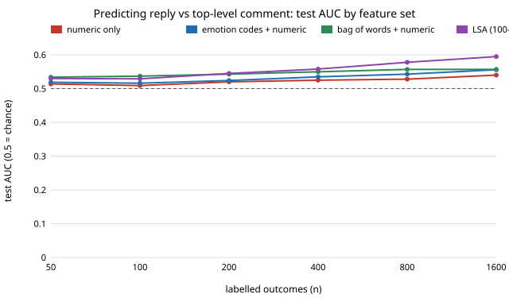

# qual-features-outcomes: do LLM-style qualitative codes predict outcomes better than bag-of-words, at the same labelling budget?

**Not on these outcomes. With 5,313 real Reddit comments, 28 human-coded emotion codes (the best an LLM coder could do) predicted whether a comment replies to another comment (test AUC 0.527 at 1,600 labelled outcomes) no better than the words themselves (0.557) or a 100-dimensional LSA embedding (0.595 with numeric features), and 5% simulated coder error erased what the codes did add.** Every feature set was weak (all AUC at most 0.60): reply-versus-top-level and "posted in a self-disclosure subreddit" are mostly not about emotion, which is the finding, not a flaw to hide. A coin-flip outcome stayed within 0.494-0.511, so the pipeline does not leak. **The "codes" are GoEmotions' human majority votes, not an LLM's output** (no API key in the session), so they are an upper bound on what an LLM coder gives here. Produced with AI assistance (Claude).

**Live page:** https://duncan-haywood.github.io/oss-monorepo/research/qual-features-outcomes/

Track 19 (`qual`, [`PROJECTS.md`](../PROJECTS.md)), milestone 5, second study. The first, [`qual-features`](../qual-features), asked the same question for an *emotional* target (negative emotion, with word-list codes) and found codes ahead of words; this one asks it for targets that are *not* about emotion, where the answer flips. Uses the corpus and download cache of [`qual-real`](../qual-real); the question there was "can you count the codes", here it is "can you model with them".



## Method

- Items: the 5,313 GoEmotions examples with at least 3 raters and none marked very unclear (as in `qual-real`). Fixed seeded split: 3,000 test items, 2,313 pool.
- Feature sets: **numeric** (log words, log characters, capital share, count of `?` and `!`); **codes** (28 binary emotion codes by majority of raters); **bow** (tf-idf unigrams, 2,368 terms); **lsa** (100-d SVD of the tf-idf, a cheap embedding stand-in, not a neural embedding); and concatenations. The tf-idf and SVD are fitted on all text without any outcome label.
- Model: L2 logistic regression, standardised features, C chosen from {0.01, 0.1, 1, 10} by 3-fold CV inside the labelled draw. Metric: AUC on the fixed test set. Labelled outcomes n = 50 to 1,600, 30 random draws per cell.
- Outcomes: **A** the comment's parent is a comment, not a post (prevalence 0.594); **D** the comment is from one of nine subreddits where people write about themselves (socialanxiety, confession, exmormon, LGBTeens, 2meirl4meirl, OkCupid, datingoverthirty, gaybros, TalesFromYourServer; chosen before any result, prevalence 0.037); **B** a null control, a coin flip by item id.
- **C** simulated coder error: each of the code cells flips independently with probability e before the model sees it.

## Results

Mean test AUC, from [`results.txt`](experiments/results.txt) (the file also has every column and spread).

| n | numeric | codes | codes+numeric | bow+numeric | lsa+numeric |
|---:|---:|---:|---:|---:|---:|
| 50 | 0.514 | 0.508 | 0.519 | 0.537 | 0.530 |
| 400 | 0.525 | 0.517 | 0.535 | 0.553 | 0.558 |
| 1600 | 0.540 | 0.527 | 0.556 | 0.559 | 0.595 |

(Outcome A.) Findings:

1. **Codes alone are the weakest text feature on A** (0.527 at n = 1,600, against 0.557 for words), and codes+numeric (0.556) beats numeric alone (0.540) by about as much as words do, never by more. The emotion codebook does not capture what separates replies from top-level comments.
2. **LSA pulled ahead only with more labels** (0.595 at n = 1,600), a sign that a dense embedding can use labels more efficiently than a 2,368-dimensional sparse one. This is one run on one corpus and a crude embedding.
3. **Coder error costs the codes their edge.** codes+numeric at n = 400 falls from 0.535 (perfect codes) to 0.523 at e = 0.02 and 0.513 at e = 0.05, below numeric alone (0.525): flipped cells in rare codes add far more false positives than a real coder would, so read this as a stress test of the worst symmetric error, not a prediction for an LLM.
4. **Outcome D is too thin to rank anything.** 9 subreddits give 3.7% positives (about 85 in the pool), the test AUC spread is 0.02-0.03 and every set sits between 0.49 and 0.55.
5. **The null control behaves.** Across all sets and n the coin-flip AUC is 0.494-0.511; the test set is fixed, so a shared 0.01 offset is test-set luck (standard error of an AUC on 3,000 items is about 0.011), not signal.

## Limitations

- The outcomes were chosen because they are available, not because emotion should drive them. The test this milestone needs is an outcome that loads on a codebook, such as satisfaction from support tickets, and a corpus with one; none is open and offline here. That is the main reason the result is "no".
- Codes here are human consensus, not LLM codes; a real coder would do worse than the e = 0 row.
- One seed, one corpus, one model family (regularised logistic regression); no gradient boosting or neural embeddings, and the tf-idf was not tuned.
- Outcome D's list of subreddits is my choice.

## Next steps

Run on a corpus with a real downstream outcome (ratings with review text, tickets with resolution time) and an LLM coder behind `ANTHROPIC_API_KEY` with a deterministic stub; add a neural sentence embedding; test whether LLM-scored dimensions chosen *for* the outcome (TabLLM or LLooM style) beat the fixed emotion codebook.

## Reproduce

```
python3 research/qual-features-outcomes/experiments/run.py      # about 5 minutes after the shared ~14 MB download; needs numpy, scipy, scikit-learn
python3 research/qual-features-outcomes/experiments/figure.py   # writes the SVG
cd research/qual-features-outcomes && python3 -m unittest test_qualfeaturesout
```

## References

- Demszky et al. (2020). GoEmotions: A Dataset of Fine-Grained Emotions. ACL 2020; arXiv:2005.00547. Data under Apache 2.0, as checked in [`qual-real`](../qual-real).
- Hegselmann et al. (2023). TabLLM: Few-shot Classification of Tabular Data with Large Language Models. AISTATS 2023; arXiv:2210.10723 (cited as the direction for the next step, not reproduced here).
- Lam et al. (2024). Concept Induction: Analyzing Unstructured Text with High-Level Concepts using LLooM. CHI 2024; arXiv:2404.12259 (same).

## Outside dependencies

The GoEmotions download (public bucket); scikit-learn, numpy, scipy. No model API was called.
