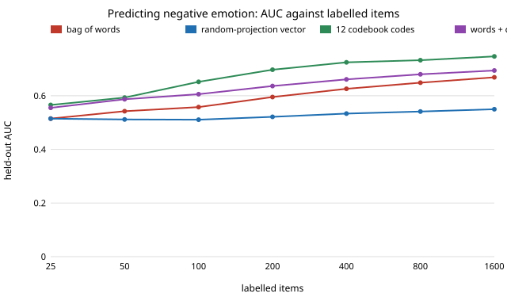

# qual-features: do a dozen codebook codes predict better than bag-of-words when labels are scarce?

**On GoEmotions comments, a logistic model on 12 interpretable codebook codes plus log length reached 0.65 AUC for "negative emotion" with 100 labelled comments, against 0.56 for bag-of-words, and still led at 1,600 labels (0.75 against 0.67).** Putting the codes next to the bag of words (0.61 and 0.69 at those sizes) did better than words alone but worse than the codes alone, and a 64-dimension random projection of the words stayed near chance (0.55 at 1,600). **The codes here are word lists, not an LLM**, and the vector is a random projection, not a learned sentence embedding, so this is a test of the shape of the idea (a small set of human-readable measurements as features) and not a result about LLM-scored dimensions. Produced with AI assistance (Claude).

**Live page:** https://duncan-haywood.github.io/oss-monorepo/research/qual-features/

Track 19 (`qual`, [`PROJECTS.md`](../PROJECTS.md)), milestone 5. Why this was worth doing: if qualitative codes become cheap to produce, the practical question is whether they are better *features* than raw text when hand labels are the scarce resource. The earlier `qual-*` projects asked how far to trust a code as a *measurement*; this one asks whether to use it as an *input*. Chosen over a variant of the correction studies because milestone 5 was open.



## Method
- **Data.** The 5,313 GoEmotions comments of [`qual-real`](../qual-real) (Demszky et al. 2020, Apache 2.0; downloaded to a cache, no comment text committed). Label: a majority of raters marked a negative emotion. Seeded shuffle: 1,500 items held out for AUC (24.2% negative), 3,813 form a labelling pool.
- **Budgets.** For each of n = 25, 50, 100, 200, 400, 800, 1,600, draw 12 random labelled subsets from the pool, fit each model on the subset and score the same held-out items. The table gives the mean and standard deviation over the 12 subsets.
- **Feature sets.** `bow`: presence of each of 2,409 words that occur in at least 3 comments (counted on all unlabelled text, no labels). `embed`: a 64-dimension signed hashed random projection of the same words, unit length. `codes`: 12 yes/no codes (anger/insult, sadness/loss, fear/worry, disapproval, disgust, profanity, regret, annoyance, praise, gratitude, humour, question) from short word lists in [`qualfeatures.py`](qualfeatures.py), plus log word count. `bow+codes`: both.
- **Model.** L2-regularised logistic regression (Adagrad, 40 epochs). The penalty (1, 10 or 100) is chosen per fit on a 25% validation slice of the labelled subset only, then the model is refit on all of it. Same model and tuning for every feature set.
- **Codebook provenance.** I wrote the word lists before running anything, from general knowledge of what emotion words look like, and did not edit them after seeing a result. They were still written knowing the target was negative emotion, as a real codebook for this question would be.

## Results (from `experiments/results.txt`)

| labelled items | bag of words | random projection | 12 codes | words + codes |
|---:|---:|---:|---:|---:|
| 25 | 0.515 | 0.515 | 0.566 | 0.555 |
| 50 | 0.543 | 0.512 | 0.593 | 0.587 |
| 100 | 0.558 | 0.511 | 0.652 | 0.606 |
| 200 | 0.595 | 0.522 | 0.697 | 0.636 |
| 400 | 0.626 | 0.534 | 0.725 | 0.661 |
| 800 | 0.649 | 0.541 | 0.733 | 0.680 |
| 1,600 | 0.669 | 0.550 | 0.747 | 0.694 |

Standard deviations over subsets are 0.01–0.07 (largest for the codes at small n; see the file).

1. **Codes lead at every budget tried.** The gap is largest at 100–200 labels (about 0.10) and narrows to 0.08 at 1,600. Bag-of-words is still climbing (+0.02 from 800 to 1,600), so it may catch up with more labels; this run does not reach the crossing point.
2. **Combining did not help over the codes alone.** With 2,409 sparse word features against 13 dense ones, the words add noise at these sample sizes under a single shared penalty. A separate penalty per block, or fitting the words only to the codes' residual, was not tried.
3. **The random projection is close to useless** (0.51–0.55). This says that a 64-dimension random hash of words keeps little of the signal, not anything about learned embeddings, which were not available offline.
4. **Even the best model is modest.** 0.75 AUC means the label is hard to predict from these features; most negative comments here carry no listed word.

## Limitations
- Not an LLM and not a learned embedding. LLM-scored dimensions would be richer than word counts (they would read negation and context), and a pretrained embedding would be far stronger than the random projection. Both should be tested behind `ANTHROPIC_API_KEY` or a downloaded model (not available in this session). Do not read this as a ranking of codes against embeddings.
- One corpus, one label, one model family, 12 subsets per size, a single held-out set. The codebook targets the label, so the codes' advantage partly reflects someone knowing what to look for; that is the realistic use but it is not "free".
- Only AUC is reported; calibration and the cost of writing the codebook are not counted.
- The same test examples were used for all budgets, and the 1,500 held-out comments are one draw.

## Next steps
Replace the word-list codes with an LLM scoring the same 12 dimensions (stub when no key) and add a pretrained sentence embedding; try a per-block penalty for `bow+codes`; extend to the 27 emotion classes; measure the labelled-item count at which bag-of-words overtakes the codes.

## Reproduce
```bash
cd research/qual-features
python3 -m unittest test_qualfeatures
python3 experiments/run.py      # downloads GoEmotions to a cache on first use, about 3 minutes, stdlib only
python3 experiments/figure.py
```

## References
- Demszky et al. (2020). GoEmotions: A Dataset of Fine-Grained Emotions. ACL 2020; arXiv:2005.00547. Data under Apache 2.0, as checked in [`qual-real`](../qual-real).
- Data loading reused from [`qual-real`](../qual-real); the design follows the track description in [`PROJECTS.md`](../PROJECTS.md). TabLLM (Hegselmann et al. 2023) is the closest published idea (text-serialised features); not reproduced or re-read here.

## Outside dependencies
The GoEmotions download (public bucket). No model API was called; no LLM or pretrained embedding was used.
