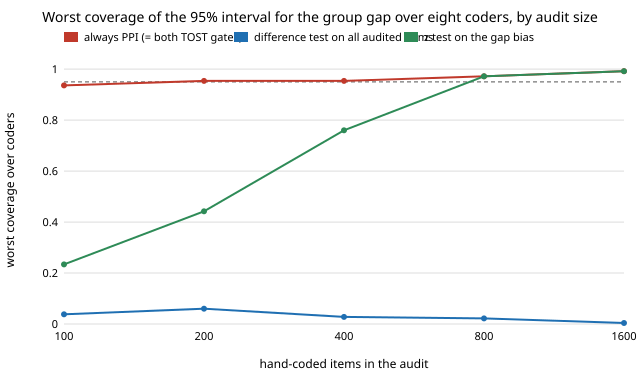

# qual-gapaudit: does a hand-coded audit protect a group gap when it only checks the overall count?

**No. On 3,188 real Reddit comments (GoEmotions), a coder with exactly zero overall prevalence bias still distorted the short-minus-long gap in negative-emotion prevalence by 0.20 (the true gap is −0.053), and the audit gate that works for a single prevalence, trusting the coder when its overall bias test passes, gave worst-case 95% coverage of 0.04 at 100 hand-coded items and 0.004 at 1,600.** More audit made it worse: the larger the audit, the more surely the unbiased-overall coder was trusted. A z test on the gap bias itself fixed it only slowly (worst coverage 0.23 at 100 items, 0.44 at 200, 0.97 from 800). The equivalence (TOST) gates at tolerance 0.02 and 0.05 never passed any naive-Bayes coder, so they were always-correct: group-wise prediction-powered inference covered 0.94–0.99 at every size. The coders are a naive-Bayes classifier with a moved cut-off and a word list, not LLMs. Produced with AI assistance (Claude).

**Live page:** https://duncan-haywood.github.io/oss-monorepo/research/qual-gapaudit/

Track 19 (`qual`, [`PROJECTS.md`](../PROJECTS.md)). It takes the "test group-gap estimates under the same gates" item in [`qual-equivalence`](../qual-equivalence)'s "Next steps". Same corpus, split, seed and coders as that project; the gap estimand follows [`qual-real`](../qual-real) and [`qual-dialect`](../qual-dialect) (short, ≤10 words, versus long comments).



## Method

5,313 GoEmotions examples with at least three raters; 2,125 train the naive-Bayes coder, 3,188 are evaluated (1,165 short, 2,023 long); human code = a majority of raters marked a negative emotion. Estimand: human prevalence short − long over the evaluated items = 0.2112 − 0.2640 = −0.0528. Eight coders as in `qual-equivalence` (naive-Bayes with the cut-off moved to code 1 for 0.6 to 1.5 times the true share, and the 38-word list). Audit = a random sample of the corpus, so the number in each group is random; draws with fewer than 5 in a group would be dropped (none were). 500 draws per cell, audit sizes 100 to 1,600.

Rules, each with a 95% normal interval; the correction is the group-wise prediction-powered estimate (each group's PPI uses only its audited items; the gap's standard error combines the two):

- **ppi**: always correct.
- **overall**: [`qual-gate`](../qual-gate)'s difference test on all audited items: naive gap if |z| ≤ 1.96. The habit when the audit was designed for one prevalence.
- **gap**: a z test on the gap bias (mean human-minus-coder difference in short minus long); naive gap if |z| ≤ 1.96.
- **tost0.02 / tost0.05**: naive gap only if the 90% interval of the gap bias lies inside ±δ.

## Results

From [`results.txt`](experiments/results.txt). Coders (E1): overall bias −0.10 to +0.12 for the naive-Bayes ones, but the gap they report is −0.18 to −0.30 against a true −0.053, an error of 0.13–0.25 against a naive interval half-width of 0.02–0.03. A likely cause (not tested here) is that a bag-of-words score grows with comment length, so a threshold over-codes long comments. The word list errs by only −0.017. The coder tuned to zero overall bias (`nb x1.0`) has a gap error of −0.196.

Worst 95% coverage over the eight coders (E4):

| audit items | always-PPI (= both TOST gates) | overall-bias gate | gap-bias gate |
|---:|---:|---:|---:|
| 100 | 0.936 | 0.038 | 0.234 |
| 200 | 0.954 | 0.060 | 0.442 |
| 400 | 0.954 | 0.028 | 0.760 |
| 800 | 0.972 | 0.022 | 0.972 |
| 1,600 | 0.992 | 0.004 | 0.992 |

1. **The overall test is the wrong test.** For `nb x1.0` the overall bias is 0 by construction, so the gate trusts it in 94–99.6% of draws and the gap interval covers the truth in 0.4–6% (E2, E3). A coder can be unbiased in total and badly biased in a comparison.
2. **The gap-bias test is right but needs power for a gap.** A gap bias has the variance of two groups' differences, and each group holds only the audited items in it, so at 100 items it trusted `nb x1.0` in 51% of draws. It reaches 0.97 coverage at 800 items (a quarter of the corpus).
3. **Equivalence gates degenerate here too.** A tolerance of 0.05 (the naive interval's scale is 0.02–0.03) can never be shown for a coder whose gap error is 0.13 or more. Only the word list, with error 0.017, passed the TOST at 0.05, in 40% of draws at 1,600 items, and the result was still covered. Both TOSTs equalled always-PPI for the other seven coders (and for the word list up to 800 items at 0.05).
4. **Practical reading, extending `qual-equivalence`:** apply the correction to every estimand you report, with the audit stratified or large enough in the smaller group; a comparison between groups needs its own check, and a pass on the overall count says nothing about it.

## Limitations

- The coders are not LLMs. The large gap errors come from a length effect in a bag-of-words score; an LLM may or may not have a group-dependent error of that size. The finding is about the decision rule: a pass on one estimand does not carry to another. The word list shows the gap error can also be small.
- One corpus, one split, one seed; one grouping (comment length). 500 draws per cell: coverage has a standard error of about 0.01 near 0.95 and 0.02 near 0.5.
- Coverage above 0.95 at large audits (up to 1.00 at 1,600 of 3,188) is the finite-population effect: the audit samples half the evaluated items without replacement and the normal intervals ignore it, which makes the PPI intervals conservative.
- The gap estimand is a single difference of two group means in a fixed partition of the evaluated items. Stratified audit designs (oversampling the smaller group) were not run.

## Next steps

Audit stratified by group, and the audit size that gives the gap-bias test 80% power; a coder with a group-dependent error in the other direction; an LLM coder behind `ANTHROPIC_API_KEY` with a deterministic stub.

## Reproduce

```
python3 research/qual-gapaudit/experiments/run.py      # a few minutes after the shared ~14 MB download (cache shared with qual-real), writes results.txt
python3 research/qual-gapaudit/experiments/figure.py   # writes the SVG
cd research/qual-gapaudit && python3 -m unittest test_qualgap
```

## References

- Demszky et al. (2020). GoEmotions: A Dataset of Fine-Grained Emotions. ACL 2020; arXiv:2005.00547. Data under Apache 2.0, as checked in [`qual-real`](../qual-real).
- Angelopoulos et al. (2023), prediction-powered inference, *Science* 382; estimators from [`qual-correction`](../qual-correction).
- Schuirmann (1987), *Journal of Pharmacokinetics and Biopharmaceutics* 15(6): the TOST procedure, as used in [`qual-equivalence`](../qual-equivalence).
- Giles and Giles (1993), *Journal of Economic Surveys* 7(4), and Leeb and Pötscher (2005), *Econometric Theory* 21: pre-test estimators, as in [`qual-gate`](../qual-gate).

## Outside dependencies

The GoEmotions download (public bucket). No model API was called.
