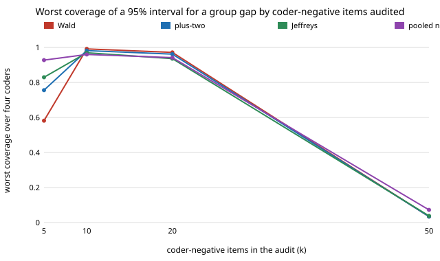

# qual-gapneg: can you estimate a group gap from an audit that hand-codes only a few of the coder's negatives?

**Not cheaply, and a plain random audit beats the design. On 3,188 real Reddit comments (GoEmotions), a 200-item audit with 5 coder-negative items gave a short-minus-long gap interval that, as a Wald interval, covered the true gap (−0.059) in only 58% of draws at worst; a Jeffreys-posterior interval per group-by-coder-label cell covered 97% but was 0.82–0.99 wide. Auditing 200 random items gave 0.23 wide at 95% coverage.** Pooling the two groups' coder-negatives to save items looked sharp (width 0.05–0.17) and then covered the truth in 3% of draws for the word-list coder, whose miss rate differs by group.

**Live page:** https://duncan-haywood.github.io/oss-monorepo/research/qual-gapneg/

Track 19 (`qual`, [`PROJECTS.md`](../PROJECTS.md)). [`qual-negint`](../qual-negint) found that Wilson or Jeffreys intervals fix the small-k problem for a single prevalence, and listed "the same intervals for a group gap" as a next step; this tests it. Lab tags: none; this builds on no group in `prompt.md`. Not an LLM: the four coders are automated stand-ins.



## Method

Corpus, split, coders and audit size (200) as in `qual-negint`: GoEmotions, 3,188 evaluated comments, three cut-offs of a naive-Bayes coder and a word list. The estimand is the human negative-emotion prevalence in short comments (≤10 words, 1,207) minus long ones (1,981): −0.0586. The audit hand-codes k coder-negatives and 200−k coder-positives drawn over the whole corpus, so how many land in each group's cell is random (at k = 5 the thinnest negative cell has under 3 items in every draw, and none in 7–9%). Each group's prevalence is the share-weighted sum over its two coder-label cells. Four 95% intervals on the same draws (500 per cell, seed 20261023):

- **wald**: per-cell sample proportions and variances; an empty cell contributes nothing.
- **plus_two**: one success and one failure added to each cell.
- **jeffreys**: Beta(x+½, n−x+½) per cell (Beta(½,½) if empty), 400 posterior draws of the gap.
- **pooled**: as Jeffreys, but both groups share one posterior for the coder-negative stratum, i.e. assumes the miss rate is group-independent.
- A reference design: **random** 200 items, post-stratified the same way.

Tests ([`test_qualgapneg.py`](test_qualgapneg.py)) check that a full audit returns the exact gap, that empty cells are handled, and that Jeffreys matches Wald with large cells.

## Results

From [`experiments/results.txt`](experiments/results.txt) (per-coder tables there). Worst coverage / mean width over the four coders:

| design | Wald | plus-two | Jeffreys | pooled |
|---|---|---|---|---|
| k = 5 | 0.58 / 0.57 | 0.99 / 1.00 | 0.97 / 0.92 | 0.03 / 0.13 |
| k = 10 | 0.76 / 0.61 | 0.98 / 0.76 | 0.96 / 0.70 | 0.03 / 0.10 |
| k = 20 | 0.83 / 0.52 | 0.97 / 0.55 | 0.94 / 0.53 | 0.04 / 0.09 |
| k = 50 | 0.93 / 0.35 | 0.96 / 0.36 | 0.94 / 0.35 | 0.07 / 0.08 |
| random 200 | 0.95 / 0.23 | 0.96 / 0.23 | 0.95 / 0.23 | 0.66 / 0.11 |

1. **Wald's small-k failure carries over to the gap**, and is worse (0.58 at k = 5 against 0.63 for one prevalence).
2. **Jeffreys and plus-two hold coverage, but a gap of ±0.46 at k = 5 says nothing.** The interval is wide because the gap needs the miss rate in each group, and with 5 negatives that is 2–3 items per group.
3. **A random audit is better for the gap.** Its width (0.23) beats every coder-label design up to k = 50 (0.35); spending the audit on coder-positives only pays when the quantity is a whole-corpus prevalence, not a comparison. This agrees with `qual-labelaudit` and `qual-stratified`, where design effects were small.
4. **Pooling the negatives is a bias you cannot see in the interval.** For the word-list coder the positive rate among negatives is 0.155 (short) against 0.200 (long); pooled intervals are 0.05 wide and miss. For naive-Bayes coders the rates differ by 0.01–0.02 and pooled coverage is 0.84–0.95. A group-independent miss rate is exactly the assumption an audit should test, and k = 5 cannot.

## Limitations

- No LLM coder; one code, one corpus, one length-based grouping, one split. Real group-dependent LLM error may be much larger (`qual-correction`, `qual-dialect`).
- 500 draws, so a coverage figure carries a Monte Carlo error of about ±0.01; Jeffreys uses 400 posterior draws. Worst coverage is a minimum over four coders and so biased low.
- Intervals ignore the finite population; the groups' sizes are treated as known.
- "Random 200" uses the same post-stratified estimator, not the PPI estimator of `qual-gapaudit`; PPI could be narrower.

## Next steps

Choose k from a small pilot; a Neyman allocation across the four group-by-label cells (an oracle was tried only for prevalence in `qual-labelaudit`); an LLM coder behind `ANTHROPIC_API_KEY` with a deterministic stub; a regression coefficient instead of a gap.

## Reproduce

```
python3 research/qual-gapneg/experiments/run.py      # about 1 minute after the shared ~14 MB download (cache shared with qual-real)
python3 research/qual-gapneg/experiments/figure.py   # writes the SVG
cd research/qual-gapneg && python3 -m unittest test_qualgapneg
```

## References

- Demszky et al. (2020). GoEmotions. ACL 2020; arXiv:2005.00547. Apache 2.0, as checked in [`qual-real`](../qual-real).
- Brown, Cai and DasGupta (2001), Interval estimation for a binomial proportion, *Statistical Science* 16(2). Agresti and Coull (1998), *The American Statistician* 52(2). Jeffreys (1946), *Proc. R. Soc. A* 186.

## Outside dependencies

The GoEmotions download (public bucket). No model API was called.
