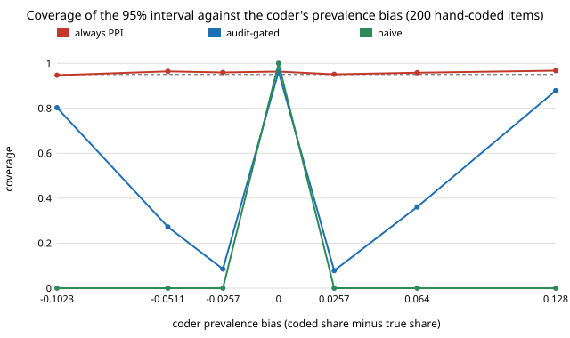

# qual-gate: if a hand-coded audit finds no bias in a coder, can you trust its counts?

**No. On 3,188 real Reddit comments (GoEmotions), "audit the coder on 200 hand-coded items, use its labels if the audit passes, else correct them" gave a 95% interval that covered the true prevalence in only 8% of draws when the coder's prevalence was 2.6 points too high (10% too many positives), and 27% when it was 5.1 points too low. Always applying the prediction-powered (PPI) correction covered 94.7–96.7% at every bias tried.** The gate behaves as designed at zero bias (it corrects in 4% of draws, covering 96%), but a 200-item audit cannot see a bias of a few points, and a bias that small is still several standard errors of the naive estimate. The coders are a naive-Bayes classifier with a moved cut-off and a word list, not LLMs. Produced with AI assistance (Claude).

**Live page:** https://duncan-haywood.github.io/oss-monorepo/research/qual-gate/

Track 19 (`qual`, [`PROJECTS.md`](../PROJECTS.md)). It takes the first item in [`qual-register`](../qual-register)'s "Next steps" (compare an audit with simply always applying PPI) and asks the question that follows from its finding that audits are low-powered: what does a *decision rule* built on a weak audit do to the coverage of the final interval? This is the pre-test estimator problem from econometrics (a test chooses between a biased and an unbiased estimator, and the chooser is itself noisy), applied to LLM-coded data. Builds on the estimators of [`qual-correction`](../qual-correction) and the corpus and coders of [`qual-real`](../qual-real).



## Method

Same corpus, split and seed family as `qual-real` (5,313 examples with at least 3 raters; 2,125 train the naive-Bayes coder; 3,188 evaluated; human code = a majority of raters marked a negative emotion). The comment text is read from a cached download and never committed. Estimand: the human prevalence over the 3,188 evaluated items (0.2560).

- **Coders with a controlled bias.** The naive-Bayes ranking is kept and only its cut-off moves, so the coder codes 1 for 0.6, 0.8, 0.9, 1.0, 1.1, 1.25 or 1.5 times the true share of items. Same ranking, so accuracy changes only a little while the prevalence bias goes from −10.2 to +12.8 points. The fixed word-list coder from `qual-real` is added as a real-world case (bias −11.0 points).
- **Estimators**, each with a 95% normal interval: naive (the coder's share over the corpus, with a standard error that ignores coder error); human-only; always-PPI; and **audit-gated**: a paired z test on the hand-coded sample of whether the mean human-minus-coder difference is zero (|z| > 1.96); if it passes use the naive estimate, else use PPI.
- E1: the coders against the humans. E2: coverage and width at 200 hand-coded items, 1,000 random draws per coder. E3: the gated interval's coverage at 100, 200 and 400 items.

## Results

Copied from [`results.txt`](experiments/results.txt).

| coder | bias (points) | gate corrects | naive | human-only | always-PPI | audit-gated |
|---|---:|---:|---:|---:|---:|---:|
| nb ×0.6 | −10.2 | 0.825 | 0.000 | 0.950 | 0.947 | 0.803 |
| nb ×0.8 | −5.1 | 0.287 | 0.000 | 0.948 | 0.964 | 0.272 |
| nb ×0.9 | −2.6 | 0.110 | 0.000 | 0.949 | 0.959 | 0.085 |
| nb ×1.0 | 0.0 | 0.040 | 1.000 | 0.951 | 0.963 | 0.963 |
| nb ×1.1 | +2.6 | 0.101 | 0.000 | 0.954 | 0.951 | 0.078 |
| nb ×1.25 | +6.4 | 0.379 | 0.000 | 0.943 | 0.958 | 0.361 |
| nb ×1.5 | +12.8 | 0.898 | 0.000 | 0.952 | 0.967 | 0.879 |
| lexicon | −11.0 | 0.925 | 0.000 | 0.953 | 0.953 | 0.909 |

Coverage of the 95% interval at 200 hand-coded items, 1,000 draws. Mean interval widths at 200 items: naive 0.025–0.034, always-PPI 0.130–0.160, gated 0.035–0.147.

Gated coverage by hand-coded sample size:

| coder | 100 | 200 | 400 items |
|---|---:|---:|---:|
| nb ×0.9 (−2.6 points) | 0.034 | 0.080 | 0.124 |
| nb ×1.1 (+2.6) | 0.044 | 0.080 | 0.130 |
| nb ×0.8 (−5.1) | 0.153 | 0.257 | 0.470 |
| nb ×1.25 (+6.4) | 0.192 | 0.339 | 0.632 |
| nb ×1.5 (+12.8) | 0.609 | 0.884 | 0.962 |

Findings:

1. **The gate fails exactly where coders usually are.** A coder that over- or under-counts by 2.6 points (about 10% of the prevalence) passes the audit in about 90% of draws and then reports a naive interval 0.03 wide around a value 0.026 off the truth. Gated coverage is 0.08 at 200 items and 0.12–0.13 even at 400.
2. **The gate needs a large bias to protect you.** At 200 items it reaches 0.88 coverage only with a bias of 12.8 points (50% of the prevalence), and 0.96 only with 400 items. Its coverage is an inverted U against bias: best at zero bias, worst at small to moderate bias.
3. **At zero bias the gate costs and earns what it should.** It corrects in 4.0% of draws (nominal 5%), keeps coverage at 0.963 and its interval is 0.035 wide, about a quarter of PPI's 0.152. That narrow interval is the only thing the gate buys, and it is only trustworthy if the bias is exactly zero, which an audit cannot establish.
4. **Always-PPI was valid everywhere** (0.947–0.967 coverage; the 1,000-draw error is about ±0.014). Its interval was 0.130–0.160 wide, 4–5 times the naive interval, because with coders this weak the correction term has nearly as much variance as the human labels (as in `qual-real`). Its guarantee does not depend on the coder.
5. **Practical reading:** do not let a small hand-coded audit decide whether to correct. Choose the estimator before looking at the audit (PPI whenever a random hand-coded sample exists), or, if the narrow interval matters, size the audit for the bias you need to exclude rather than for a 5% test. The audit sizes needed were not computed here; the E3 trend (0.08 at 200 items, 0.12–0.13 at 400, for a 2.6-point bias) says they are large.

## Limitations

- The coders are a naive-Bayes classifier with a shifted cut-off and a 38-word list, not LLMs. A real LLM's bias profile (and the size of its per-item noise, which sets the audit's power) will differ; the claim here is about the decision rule, not about any model.
- One corpus, one split, one seed; the controlled bias is a threshold shift, one of many ways a coder can be biased. The gate tested is one rule (a 5% paired z test on prevalence); a tolerance (equivalence) test, a higher significance level, or a sample-size rule would change the numbers, though none can remove the dependence of the choice on the audit.
- Coverage is against the finite-population prevalence of 3,188 evaluated items, with hand-coded items drawn without replacement (200 of 3,188); the normal intervals ignore that finite-population correction, which is conservative.
- The estimand is a single prevalence. Group gaps (as in `qual-register`) combine two such estimates and were not run here.
- 1,000 draws per cell: coverage values have a standard error of about 0.007 (near 0.95) to 0.015 (near 0.5).

## Next steps

Gate with an equivalence (TOST) test against a stated tolerance and see how large the audit must be for it to protect coverage; repeat with an LLM coder behind `ANTHROPIC_API_KEY` and a deterministic stub; try the sensitivity-based audit (hand-code only items the coder labels positive); and test sample-splitting variants (choose the estimator on one hand-coded half, estimate on the other).

## Reproduce

```
python3 research/qual-gate/experiments/run.py      # ~40 s after a ~14 MB download (shared cache with qual-real), writes results.txt
python3 research/qual-gate/experiments/figure.py   # writes the SVG
cd research/qual-gate && python3 -m unittest test_qualgate
```

## References

- Demszky et al. (2020). GoEmotions: A Dataset of Fine-Grained Emotions. ACL 2020; arXiv:2005.00547. Data under Apache 2.0, as checked in [`qual-real`](../qual-real).
- Angelopoulos et al. (2023), prediction-powered inference, *Science* 382; estimators from [`qual-correction`](../qual-correction).
- Pre-test estimators: Giles and Giles (1993), "Pre-test estimation and testing in econometrics: recent developments", *Journal of Economic Surveys* 7(4); Leeb and Pötscher (2005), "Model selection and inference: facts and fiction", *Econometric Theory* 21. Cited for the general phenomenon; their results are not reproduced here.

## Outside dependencies

The GoEmotions download (public bucket). No model API was called.
